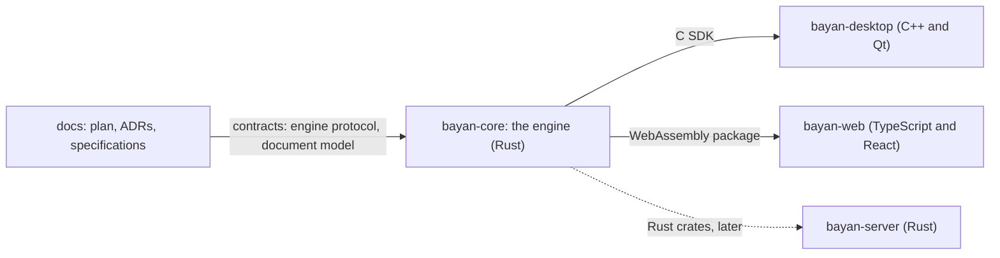

# Getting started

This guide takes you from a clean computer to a passing verification gate in each BayanDocs repository. It gives you the map and the order of the steps. The exact commands, and the exact versions of every tool, live in each repository's own `README.md`, `AGENTS.md` and setup script, which change every month in the dependency session; this guide points to them instead of copying them. If this guide and a repository's own files ever disagree, the repository's files are right: please report the difference in an issue in the [docs repository](https://github.com/BayanDocs/docs/issues).

People and AI agents follow the same steps. Agents in the BayanDocs cloud environment find most tools already installed ([see the last section](#bayandocs-cloud-sessions)). When you are set up, [Your first contribution](first-contribution.md) explains how work packages, branches, commits and pull requests work.

## The repositories and how they fit together

BayanDocs is split into five repositories, one for each toolchain ([ADR-0002](../adr/0002-repository-topology-and-contracts.md)). You do not need all of them: set up the one you want to work on. Each repository's gate runs on its own.

| Repository | What it is | Built with | Verification gate | Developer page |
|---|---|---|---|---|
| [bayan-core](https://github.com/BayanDocs/bayan-core) | The engine: everything that must behave the same on desktop and web (the document model, file formats, layout, rendering, editing, collaboration and encryption), and the Fidelity Lab that measures BayanDocs against Microsoft Word. | Rust | `cargo xtask verify` | [bayan-core](bayan-core.md) |
| [bayan-desktop](https://github.com/BayanDocs/bayan-desktop) | The desktop app for Windows, macOS and Linux, a thin shell around the engine. | C++20 and Qt 6 (Qt Quick), with CMake | `cmake --workflow --preset verify` | [bayan-desktop](bayan-desktop.md) |
| [bayan-web](https://github.com/BayanDocs/bayan-web) | The browser app, a thin shell that runs the engine as WebAssembly in a Web Worker. | TypeScript, React and Vite, with pnpm | `pnpm verify` | [bayan-web](bayan-web.md) |
| [bayan-server](https://github.com/BayanDocs/bayan-server) | The zero-knowledge collaboration server: accounts, sharing and a relay for end-to-end-encrypted data, shipped as one container. | Rust | `cargo xtask verify` | [bayan-server](bayan-server.md) |
| [docs](https://github.com/BayanDocs/docs) | This knowledge base: the plan, the architecture decision records (ADRs), the specifications and the work packages, built into this website. | Markdown and mdBook | `scripts/verify.sh` | [docs](docs.md) |



- **The shells hold no document logic.** The desktop app links the engine through a small C interface, the engine's **C SDK** (its libraries, a C header and the protocol's JSON Schema), and the web app runs the engine's **WebAssembly package** in a Web Worker. Both talk to the engine with the JSON messages of the [engine protocol](../specs/engine-protocol.md) ([ADR-0012](../adr/0012-engine-boundary.md)).
- **The shells build the engine from a pinned commit.** Until bayan-core publishes releases, bayan-desktop and bayan-web build the engine themselves from the bayan-core commit they pin: bayan-desktop in `deps/bayan-core.json`, bayan-web in `bayan-core.pin` ([ADR-0002](../adr/0002-repository-topology-and-contracts.md) §4). That is why the web app's setup needs Rust, and the desktop app needs it to test against the real engine, although neither repository has Rust code of its own.
- **Contracts come first.** A change that crosses a repository boundary starts with the specification in docs, then bayan-core, then the shells or the server (ADR-0002 §2). [plan/03-architecture.md](../plan/03-architecture.md#3-repositories-and-their-boundaries) lists what each repository owns and what it must not contain.

## Supported development platforms

Each repository supports the systems its CI checks, as its own `README.md` and `AGENTS.md` say. On other systems nothing checks that the steps work, and some setup scripts refuse to run.

| Repository | Linux | macOS | Windows | CI jobs (`.github/workflows/`) |
|---|---|---|---|---|
| bayan-core | Ubuntu 24.04 | Apple Silicon | x64 | `verify.yml`: `ubuntu-24.04`, `macos-latest` (Apple Silicon), `windows-latest` |
| bayan-desktop | Ubuntu 24.04 | Apple Silicon | x64, with Visual Studio 2022 | `ci.yml`: `ubuntu-24.04`, `macos-15` (Apple Silicon), `windows-2025` |
| bayan-web | Ubuntu 24.04 on x86-64 | macOS 14 or later, on Apple Silicon or Intel | not supported | `ci.yml`: `ubuntu-24.04`, `macos-15` (Apple Silicon), `macos-26-intel` (Intel) |
| bayan-server | Linux on x86-64 | not supported | not supported | `ci.yml`: `ubuntu-24.04`; its `scripts/dev-setup.sh` runs only on Linux x86-64 |
| docs | Linux on x86-64 | not supported | not supported | `verify.yml`: `ubuntu-24.04`; its `scripts/dev-setup.sh` downloads Linux x86-64 builds |

## Before you start

- **Git, with your name and email address.** Set them once with `git config --global user.name "<your name>"` and `git config --global user.email "<your email address>"`: every commit you write must be signed off with them ([CONTRIBUTING.md](../CONTRIBUTING.md#developer-certificate-of-origin)).
- **The full history.** Clone with a plain `git clone`, never with `--depth`. bayan-core's and bayan-server's lockfile-age check, bayan-web's check of its engine pin and bayan-desktop's Qt release-age check read the Git history, and fail in a shallow clone (`git fetch --unshallow` repairs one).
- **Disk space.** The Rust builds are large: bayan-core's and bayan-server's gates each write several gigabytes into the repository's `target/` folder. Delete a `target/` folder (or `build/` in bayan-desktop) whenever you need the space back; the next build recreates it.

## Step 1: the base tools for your system

### Linux (Ubuntu 24.04)

```sh
sudo apt install git curl build-essential unzip
```

`build-essential` provides the C compiler and linker: Rust needs them to link programs, and bayan-server compiles SQLite from its C source. `unzip` unpacks some of the archives that the setup scripts download. Python 3, `tar` and `xz` come with Ubuntu. bayan-desktop needs a few more system packages, which [its page](bayan-desktop.md) lists.

### macOS

```sh
xcode-select --install
```

macOS includes curl, and the Xcode command line tools add Git and the C compiler and linker. bayan-desktop also needs Python 3.11 or newer, from [python.org](https://www.python.org/downloads/macos/): Apple's own `python3` is older.

### Windows

Only bayan-core and bayan-desktop support Windows. Install:

- [Git for Windows](https://git-scm.com/download/win). Its **Git Bash** runs the repositories' shell scripts, as CI does on Windows.
- **Visual Studio 2022**, the version that bayan-desktop names, with the "Desktop development with C++" workload: Microsoft offers it on its [older downloads page](https://visualstudio.microsoft.com/vs/older-downloads/), under "Visual Studio 2022 family". bayan-desktop is built with its compiler (MSVC), and Rust uses its linker on Windows.
- For bayan-desktop, **Python 3.11 or newer**, from [python.org](https://www.python.org/downloads/windows/).
- For bayan-core, **Node.js**: its `node.exe`, downloaded and checked as CI does, which [bayan-core's page](bayan-core.md#windows) describes. bayan-core's setup script installs Node.js on Linux and macOS only.

## Step 2: Rust

bayan-core and bayan-server are written in Rust, and bayan-web and bayan-desktop build the engine with it. Install **rustup**, Rust's installer and version manager, at the version this guide pins, after checking the installer against its SHA-256, and without a default toolchain.

The pinned installer is **rustup 1.29.3**, released on 2026-11-03. Each command below downloads it from the Rust project's archive of rustup versions, `https://static.rust-lang.org/rustup/archive/1.29.3/<platform>/`, and checks it against the SHA-256 that the project publishes next to it (the `.sha256` file) before anything runs it.

**Linux (x86-64):**

```sh
curl --proto '=https' --tlsv1.2 -fsSO https://static.rust-lang.org/rustup/archive/1.29.3/x86_64-unknown-linux-gnu/rustup-init
echo "b1c8cb14e30889e7e2999e6b69e62d9e9b9ffc0f4df8180564d306d9680e6c55  rustup-init" | sha256sum --check
```

**macOS on Apple Silicon:**

```sh
curl --proto '=https' --tlsv1.2 -fsSO https://static.rust-lang.org/rustup/archive/1.29.3/aarch64-apple-darwin/rustup-init
echo "63752a1919a3a4793173ec70f8f212621a7ce38ba6a246095984482f4de20f9f  rustup-init" | shasum -a 256 --check
```

**macOS on Intel** (which bayan-web supports):

```sh
curl --proto '=https' --tlsv1.2 -fsSO https://static.rust-lang.org/rustup/archive/1.29.3/x86_64-apple-darwin/rustup-init
echo "bc107f1fb0228de7fa32413c89c1b305cea9cd256e94b01150cd054128145429  rustup-init" | shasum -a 256 --check
```

Go on only if the check printed `rustup-init: OK`; otherwise delete the file and report it in an issue. Then, on Linux and macOS, run the installer without a default toolchain, load Cargo's programs into the terminal you are in (new terminals find them by themselves), and stop rustup from updating itself:

```sh
chmod +x rustup-init
./rustup-init --default-toolchain none
rm rustup-init
. "$HOME/.cargo/env"
rustup set auto-self-update disable
```

**Windows (x64)**, in PowerShell:

```powershell
Invoke-WebRequest https://static.rust-lang.org/rustup/archive/1.29.3/x86_64-pc-windows-msvc/rustup-init.exe -OutFile rustup-init.exe -UseBasicParsing
(Get-FileHash rustup-init.exe -Algorithm SHA256).Hash -eq '38027d51d69a5d05493627a0634dbea52d6cd793c8f072d2373d3f4163eec7db'
```

Go on only if the second line printed `True`; otherwise delete the file and report it in an issue. Then run `.\rustup-init.exe --default-toolchain none`, delete `rustup-init.exe`, and in a new terminal run `rustup set auto-self-update disable`.

Why this way: each Rust repository pins its exact Rust version, with the components and targets it needs, in `rust-toolchain.toml`, and rustup installs exactly that version the first time you run `cargo` in the repository, checking every download against the release's checksums. The installer itself is pinned here and checked before it runs, like every other download ([ADR-0017](../adr/0017-supply-chain-and-dependency-policy.md)). Without a default toolchain, rustup installs no other Rust version (a brand-new release could be younger than the 24 hours that ADR-0017 requires), and with self-update disabled it never replaces itself with a newer, unchecked version, as in CI (`rustup set auto-self-update disable` in bayan-core's `verify.yml` and bayan-web's `ci.yml`). So ignore rustup's hint to run `rustup default stable`. The pinned installer moves in the monthly dependency session ([dependency update runbook](dependency-update-runbook.md#docs)).

## Step 3: each repository

Follow the developer page of each repository you want; this is the outline, in an order that suits someone who sets up everything. Every setup script can be run again at any time: it leaves alone what is already installed at the pinned version. Run it again whenever it changes. The scripts install into your home folder (the docs repository's into the repository itself), never system-wide, except for the Ubuntu packages that bayan-web's script installs with `sudo`; when a tool must be on your `PATH`, the script prints the `export PATH=…` line to add to your shell's profile.

| Order | Repository | Systems | Set up | Gate |
|---|---|---|---|---|
| 1 | [bayan-core](bayan-core.md) | Linux, macOS, Windows | `scripts/dev-setup.sh` (Linux and macOS), then cargo-deny | `cargo xtask verify` |
| 2 | [bayan-server](bayan-server.md) | Linux | `scripts/dev-setup.sh` | `cargo xtask verify` |
| 3 | [bayan-web](bayan-web.md) | Linux, macOS | `scripts/dev-setup.sh`, then `scripts/engine-package.sh` | `pnpm verify` |
| 4 | [bayan-desktop](bayan-desktop.md) | Linux, macOS, Windows | the system packages, `scripts/dev-setup.sh`, then the tools' environment in every new terminal | `cmake --workflow --preset verify` (see the note below) |
| 5 | [docs](docs.md) | Linux | `scripts/dev-setup.sh` | `scripts/verify.sh` |

For bayan-desktop, `.github/workflows/ci.yml` runs `cmake --workflow --preset verify` on Linux, `cmake --workflow --preset ci` (the same build and tests, without the lint) on macOS, and `cmake --workflow --preset msvc` on Windows, which is also the command that bayan-desktop's README gives for Windows, because the preset `verify` exists only on Linux and macOS.

Run the gate before every push. CI runs it again on every pull request, together with checks that every repository shares (the DCO sign-off, `reuse lint`, the supply-chain checks, the workflow lint and CodeQL); [GitHub Settings Baseline](github-settings.md#rulesets) lists the checks that must pass before a pull request can merge.

## Where the versions are pinned

Every tool and package is pinned to an exact version that was at least 24 hours old when it was pinned, and every download is checked against a hash ([ADR-0017](../adr/0017-supply-chain-and-dependency-policy.md)). The setup scripts install exactly these versions, and the gates check several of them; never install a newer version by hand. The pins move only in the monthly dependency session ([dependency update runbook](dependency-update-runbook.md)), so this guide names the files that hold them:

| What | Where it is pinned |
|---|---|
| rustup, the installer | [step 2](#step-2-rust) of this page |
| Rust toolchain | `rust-toolchain.toml` (bayan-core, bayan-server; the shells use the one of the bayan-core commit they pin) |
| Rust crates | `[workspace.dependencies]` in `Cargo.toml`, and `Cargo.lock` |
| Node.js | bayan-web's `.nvmrc`; `NODE_VERSION` in bayan-core's `xtask/src/verify.rs`; the `node` entry of the `tools` list in bayan-server's `scripts/dev-setup.sh` |
| pnpm and npm packages | the `packageManager` field of bayan-web's `package.json`, and `pnpm-lock.yaml` |
| Qt | bayan-desktop's `deps/qt.json` |
| CMake, Ninja, clang-format, clang-tidy | bayan-desktop's `deps/requirements-tools.txt` |
| The engine that the shells build | bayan-desktop's `deps/bayan-core.json`, bayan-web's `bayan-core.pin` |
| cargo-deny | `CARGO_DENY_VERSION` in bayan-core's `xtask/src/verify.rs`; bayan-server's `scripts/dev-setup.sh` |
| Other tools (wasm-bindgen, grype, the browsers for the tests, mdBook, lychee, typos) | each repository's `scripts/dev-setup.sh` (in docs, `scripts/cloud-environment-setup.sh`, which its `scripts/dev-setup.sh` reads) |
| Tools and actions in CI | the workflows in `.github/workflows/` and the hash-pinned requirements files in `.github/` |

## When something goes wrong

- **A tool is missing or at another version.** Run the repository's setup script again and check that the `PATH` line it printed is in your shell's profile, ahead of other copies of the same tool. The gates name the version they expect.
- **A tool offers to update itself or suggests a newer version.** Ignore it, as with rustup's hint in [step 2](#step-2-rust) or pnpm's update notice: every version moves only in the monthly dependency session, and the gates check several of them.
- **A check complains about missing history.** The clone is shallow: `git fetch --unshallow`, or clone again without `--depth`.
- **A download fails its checksum.** Stop and report it in an issue; never work around a checksum. The scripts install nothing that fails one.
- **The gate fails on a fresh clone of `main`.** First look at the latest CI run on `main` (the repository's Actions tab): a newly published security advisory can turn a gate red on `main` without any change to the repository, as happened to bayan-server's cargo-deny step from 2026-11-09. If `main` is green, check the [supported platforms](#supported-development-platforms) and your tools, then ask in an issue, with the step that failed and its output.

## BayanDocs cloud sessions

Agent sessions run in the BayanDocs cloud environment, whose setup script, [scripts/cloud-environment-setup.sh](../scripts/cloud-environment-setup.sh), installs most of these tools at the same pins before the session starts. Run `bayandocs-tools` in a session to list them; [plan/06](../plan/06-agent-workflow.md#cloud-environment-for-agent-sessions) explains the environment, and each repository's `AGENTS.md` says what else to run in a session.
