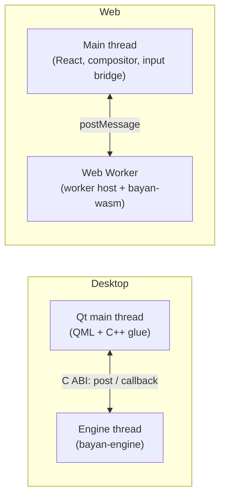
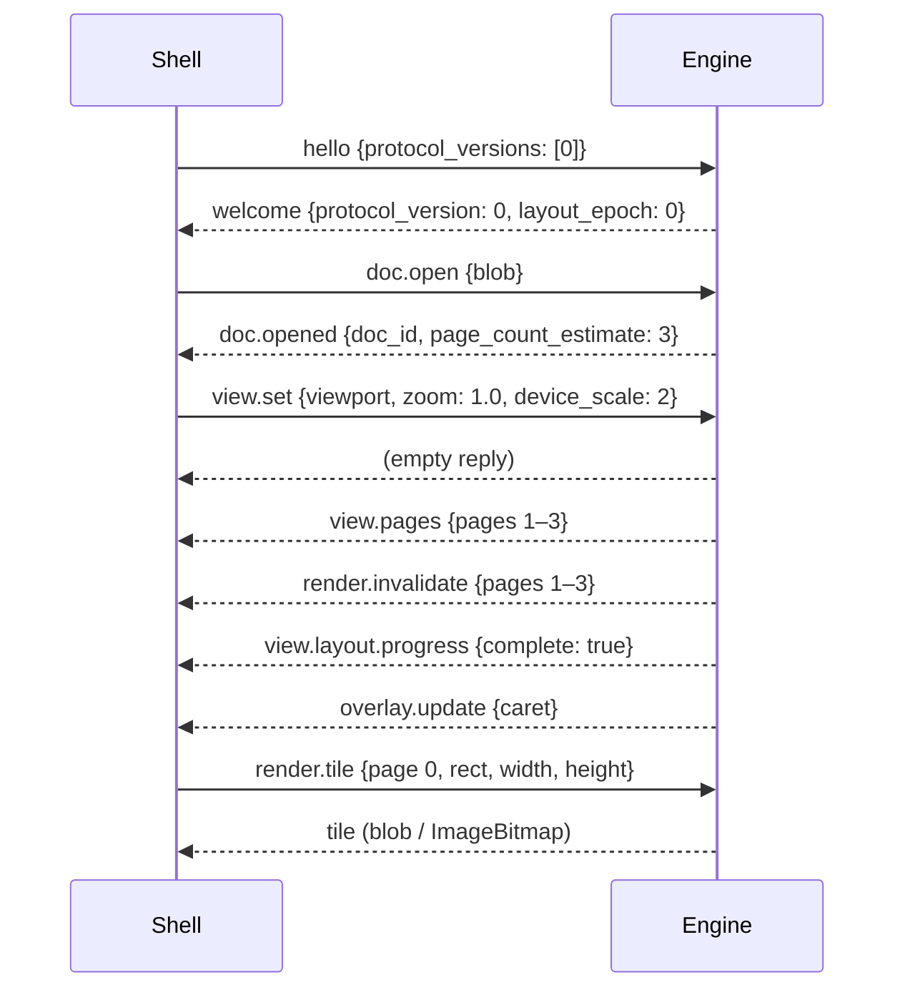

# Engine Protocol — v0

- **Status:** Draft. Sections 2–13 describe **protocol v0**, as the engine and both shells implement it today: CORE-007 implemented the skeleton and fixed the details of v0 recorded here (2026-10-07); DESK-002 and WEB-002 exercise it; FU-7 added the shells' recovery policy (§12.1, 2026-11-04). Version 0 is unstable and may still change between core releases (§9). **Protocol v1 is agreed but not built yet:** the planning session PLAN-PROTO (2026-11-21) decided its changes contract-first (§14) and its conformance vectors (§15); the work packages of §14.10 build them, and CORE-125 then adds the messages for viewing real documents. Paragraphs marked **Next version (v1)** and §§14–15 describe what v1 requires, not what the code does, until this line says that a work package has implemented them.
- **Owner stream:** UI / engine
- **Related:** ADR-0012, ADR-0019, ADR-0021, [plan/03-architecture.md §8](../plan/03-architecture.md#8-the-engine-boundary)

## 1. Goals

- One contract for both shells, so behavior cannot drift.
- Thin shells: all document behavior is in the engine.
- Asynchronous, so the interface never blocks on the engine.
- Recordable and replayable across platforms.
- Versioned and additive.

## 2. Topology



Messages are identical in both topologies; only the transport differs.

## 3. Transport

| | Desktop (C ABI, `bayan-ffi`) | Web (`bayan-wasm` in a worker) |
|---|---|---|
| Shell → engine | `bayan_engine_post(engine, json, json_len)` | `worker.postMessage(message)` |
| Engine → shell | the callback registered with `bayan_engine_set_callback`, `callback(user_data, json, json_len)`, invoked on the engine thread; the shell copies and marshals to the main thread | `self.postMessage(message)` from the worker host |
| Blobs | `bayan_blob_put(engine, bytes, len) → blob_id`, `bayan_blob_get(engine, blob_id, out, out_capacity, out_len)`, `bayan_blob_release(engine, blob_id)` | transferable `ArrayBuffer`s in the messages' `blob` fields (§3.2) |
| Tiles | `bayan_render_tile(engine, request_json, request_len, rgba_out, out_capacity, width, height, stride)` into a caller-provided buffer (premultiplied RGBA8), or the `render.tile` message, whose reply carries the pixels as a blob | `ImageBitmap` produced in the worker and transferred, in the reply to `render.tile` |
| Lifecycle | `bayan_engine_new(config_json, config_len) → engine`, `bayan_engine_free(engine)`, `bayan_version()` | worker creation, the optional `init` control message (§3.2), and termination |

All strings are UTF-8 JSON, passed with an explicit length and not NUL-terminated (except the static string `bayan_version` returns). Pointers passed to the engine are borrowed for the duration of the call only.

### 3.1 The C interface

`bayan-ffi` exports exactly these nine functions with C linkage and the platform's standard C calling convention; cbindgen generates `bayan_ffi.h` from the Rust code, and the C SDK ships it (ADR-0002). The declarations below are copied from that header; the header's comments are the authoritative per-function documentation.

```c
typedef struct BayanEngine BayanEngine;      /* opaque */
typedef uint64_t BayanBlobId;                /* 0 is never a valid blob */
typedef int32_t BayanStatus;
#define BAYAN_STATUS_OK 0
#define BAYAN_STATUS_INVALID_ARGUMENT 1      /* a null pointer, a malformed request, or a size outside the limits (§13) */
#define BAYAN_STATUS_NOT_FOUND 2             /* unknown blob, document or page */
#define BAYAN_STATUS_BUFFER_TOO_SMALL 3      /* the output buffer is too small; the function says how to learn the size needed */
#define BAYAN_STATUS_INTERNAL_ERROR 4        /* the engine failed or is stopping */
#define BAYAN_STATUS_WRONG_THREAD 5          /* called from inside any engine's callback, where it could wait for itself */
typedef void (*BayanMessageCallback)(void *user_data, const uint8_t *json, size_t json_len);

const char *bayan_version(void);
BayanEngine *bayan_engine_new(const uint8_t *config_json, size_t config_len);
void bayan_engine_free(BayanEngine *engine);
BayanStatus bayan_engine_set_callback(BayanEngine *engine, BayanMessageCallback callback, void *user_data);
BayanStatus bayan_engine_post(BayanEngine *engine, const uint8_t *json, size_t json_len);
BayanBlobId bayan_blob_put(BayanEngine *engine, const uint8_t *bytes, size_t len);
BayanStatus bayan_blob_get(BayanEngine *engine, BayanBlobId blob, uint8_t *out, size_t out_capacity, size_t *out_len);
BayanStatus bayan_blob_release(BayanEngine *engine, BayanBlobId blob);
BayanStatus bayan_render_tile(BayanEngine *engine, const uint8_t *request_json, size_t request_len, uint8_t *rgba_out,
                              size_t out_capacity, uint32_t width, uint32_t height, size_t stride);
```

These signatures adopt the provisional header that DESK-001 wrote for its stub engine, unchanged, and add `BAYAN_STATUS_WRONG_THREAD`. The header is plain ASCII, so it compiles with warnings as errors under any code page. Rules for callers:

- Pointers passed to the engine are borrowed for the duration of the call only. An input pointer (`config_json`, `json`, `bytes`, `request_json`) must point to that many initialized bytes, written and not only allocated, because the engine reads them as Rust byte slices; output buffers need not be initialized.
- `bayan_engine_new` takes the engine configuration (§3.3); a null pointer with length 0 means the defaults. It returns NULL if the configuration is invalid or the engine thread cannot start.
- Register the callback before the first `bayan_engine_post`: until then a later registration replaces an earlier one, and once a message has been posted, registering returns `BAYAN_STATUS_INVALID_ARGUMENT`. `user_data` is passed back unchanged and must be usable from the engine thread.
- `bayan_engine_post` copies the message, queues it and returns without waiting.
- The callback runs on the engine thread, one message at a time. The `json` pointer is valid only during the call: copy the bytes and hand them to your own thread. The callback must never block waiting for a thread of the shell, which may itself be waiting for the engine (§8). It must not let a C++ exception escape; if one does, the engine stops the process.
- `bayan_blob_put` copies the bytes into a new blob and returns its identifier, or 0 if `bytes` is NULL while `len` is not 0, or the blob is too large or there are too many (§13). An empty blob is allowed, and then `bytes` may be NULL. Blob 0 never names a blob: it stands for bytes that could not be stored, and the engine answers a message that names blob 0 with `limit_exceeded` (`args.limit`: `blob`). The engine numbers blobs that shells put with odd identifiers and blobs it creates itself with even ones, so that recordings replay with identical identifiers (§10).
- `bayan_blob_get` copies a blob's bytes into `out`, which has room for `out_capacity` bytes, and sets `*out_len` to the blob's size. If the blob does not fit (a NULL `out` has room for nothing) it returns `BAYAN_STATUS_BUFFER_TOO_SMALL`, so callers can ask for the size first; an empty blob always fits, so asking for its size returns `BAYAN_STATUS_OK`. The output buffers of `bayan_blob_get` and `bayan_render_tile` need not be initialized. Blobs the engine creates (recordings, message-path tiles) belong to the shell, which releases them with `bayan_blob_release`.
- `bayan_render_tile` renders the tile that a `render.tile` payload describes (§6.4) into `rgba_out` and returns when it is done. `width` and `height` give the tile's size in pixels (the payload's own `width` and `height` may be omitted; if present they must be equal). `stride` is the distance between the starts of two rows in bytes, at least `4 × width`, and `out_capacity` is at least `stride × (height − 1) + 4 × width`. The request is processed on the engine thread, in order with the posted messages (§8), so it waits for messages posted before it. Inside any engine's callback it returns `BAYAN_STATUS_WRONG_THREAD` instead of waiting (§8).
- Every function may be called from any thread, also from several threads at once, except `bayan_engine_free`.
- `bayan_engine_free` stops the engine thread and destroys the engine; it accepts NULL. It must be the last call on an engine: apart from the engine's own callback, no other thread may be inside a call on that engine, and nothing may use the engine afterwards (a callback that frees the engine must first make sure of this). Called from any other thread, it waits until the engine thread has stopped; the callback may still be running meanwhile, and a `bayan_engine_post` it makes then fails with `BAYAN_STATUS_INTERNAL_ERROR`, or, if it comes just before the engine starts stopping, succeeds but is never handled. Called from inside the engine's own callback, it returns at once and the engine thread finishes by itself. Either way, the callback is never called again after `bayan_engine_free` returns. A callback may free only its own engine: freeing another one waits for that engine's thread, which may be waiting for this one.
- No function lets a Rust panic escape: each entry point catches panics and returns `BAYAN_STATUS_INTERNAL_ERROR`, NULL or 0, and a panic while the engine thread handles a message becomes an `engine.error` event (§12). Panics inside the engine are not printed either, because a panic's message could quote document content: the first `bayan_engine_new` installs a Rust panic hook that stays silent for the engine's threads and calls, and hands every other panic in the process to the hook installed before it. A panic inside the shell's own callback, if it is written in Rust, is the shell's and is printed as usual.

**Next version (v1):** `bayan_render_tile` gains a last parameter, `uint64_t *revision_out`, for the render revision of the tile it renders (§14.6); once the engine has used up its restarts, `bayan_engine_post` and `bayan_render_tile` return `BAYAN_STATUS_INTERNAL_ERROR` (§14.2).

### 3.2 The web transport

The WebAssembly package contains the engine (`bayan_wasm_bg.wasm`), its wasm-bindgen glue (`bayan_wasm.js`) and the worker host (`bayan-worker.js`), a dependency-free module worker script that relays messages between the main thread and the engine. The main thread never calls the engine directly (ADR-0012).

- **Starting:** create the worker with `new Worker(<URL of bayan-worker.js>, { type: "module" })`. The first message may be the control message `{ "worker": "init", "config": { … }, "wasm_url": "…" }`, both fields optional: `config` is the engine configuration (§3.3) and `wasm_url` the address of `bayan_wasm_bg.wasm`, resolved against the worker script's address (default: next to the script); it must have the worker script's origin, or the worker host fails with `load_failed`. Without it, the worker host initializes with the defaults when the first protocol message arrives. It answers `{ "worker": "ready", "engine_version": "…" }`, or `{ "worker": "failed", "reason": "…" }` with one of the fixed reasons `invalid_config`, `load_failed` (the engine module could not be loaded) and `restart_failed` (the engine could not be replaced after a panic); after `failed` the worker host ignores every message, and the shell terminates the worker. Messages sent before it is ready are queued. Control messages have a `worker` field and no `v`, so they cannot be mistaken for protocol messages; only the very first message, of any kind, may be `init`, and any other control message is ignored.
- **Messages** are plain objects with the shapes of §4, sent with `postMessage` (structured clone); no JSON text crosses the worker boundary. The worker host handles them one at a time and delivers each message's answers in order, before it handles the next message. Two kinds of message are answered by the worker host itself, without being copied into the engine: one that JSON cannot represent (for example one holding a `BigInt`), with `invalid_message` (§12), and one whose JSON text is longer than the 16 MiB limit (§13), measured in UTF-8 bytes with a blob's identifier in place of its bytes, with `limit_exceeded` (`args.limit`: `message_size`). Either answer is the reply if the message has a valid `id` (§4), otherwise `engine.error`; in the second case a running recording stops there and is marked truncated, because it cannot hold a message the engine never saw.
- **Blobs:** wherever a payload has a `blob` field, the web carries an `ArrayBuffer` in it instead of a blob identifier, in both directions; list it in the transfer list. Towards the engine, a view of one (such as a `Uint8Array`) is accepted too, and its bytes are copied. The worker host converts between the two: it stores an incoming `ArrayBuffer` as a blob for the message and releases it once the message is handled, and it takes every blob the engine sends out of the engine. An `ArrayBuffer` it cannot store (larger than 64 MiB, or beyond another blob limit of §13) becomes blob 0, which the engine answers with `limit_exceeded`.
- **Tiles:** the reply to `render.tile` carries `bitmap`, a transferred `ImageBitmap`, instead of `blob` and `stride`; every other field of the reply is kept. The worker host converts the engine's premultiplied pixels into the `ImageData` format (non-premultiplied) before creating the bitmap; pixels with alpha 0 or 255 are unchanged. If the browser cannot create the bitmap, the request is answered with the error `internal` instead.
- **Panics:** a panic in the WebAssembly engine stops its instance. The worker host then replaces the engine instance with a new one created from the same configuration, and the new engine replies to the message that caused the panic (if it had an `id`) with the error `panic` and sends `engine.error` with `recoverable: false` (§12), its first event (`seq` 1). The worker host passes the new engine only that `id`, never the message itself. It then continues with the next message. A replay (`diag.replay`, §10) runs in the same instance, so on the web a panic during a replay, such as one a recording of `diag.panic` repeats, ends the shell's session too; on desktop the replay's own session absorbs it.

**Next version (v1):** `init` takes `wasm_integrity`, which the browser checks before the engine module runs (§14.8), and the worker host replaces an engine that panicked only within the restart allowance (§14.2).

### 3.3 Engine configuration

The engine receives all configuration from the host when it is created (architecture §12); it reads no environment variables. The configuration is a JSON object; every field is optional:

| Field | Meaning |
|---|---|
| `test.allow_panic` | `true` lets `diag.panic` (§6.7) make the engine panic, for tests of the error path. Default `false`. |

Unknown fields at the top level are ignored, so a newer shell can configure an older engine. An unknown field inside `test`, or a value of the wrong type, makes creation fail, so that a misspelt test switch cannot silently test the normal path.

## 4. Envelope

```json
{ "v": 0, "id": 42, "type": "doc.open", "payload": { "blob": 7 } }
```

- `v`: protocol version, `0` for this draft.
- `id`: request identifier chosen by the sender, a positive integer below 2⁵³ (so JavaScript numbers hold it exactly). Omitted for fire-and-forget messages. A request whose reply would carry a blob (`render.tile`, `diag.record.stop`) sent without an `id` is still carried out, but the engine keeps no blob for it, since nobody could learn its identifier to release it.
- `type`: dotted message type (§6).
- `payload`: an object; it may be omitted when it would be empty.
- Replies: `{ "v": 0, "re": 42, "ok": true, "payload": { … } }` or `{ "v": 0, "re": 42, "ok": false, "error": { "code": "…", "message_id": "…", "args": { … } } }`. Where §6 names a reply (`welcome`, `doc.opened`), the reply also carries that name in `type`. Error text is a Fluent message identifier, never raw content; `args` holds only codes and numbers (§12).
- Events from the engine have no `re` and carry `seq`, which increases by one with every event an engine instance sends, starting at 1. `seq` is diagnostic: it starts again at 1 when the web worker host replaces a crashed instance.
- A message the engine cannot handle without an `id` has nobody to reply to; the engine reports the problem as an `engine.error` event with `recoverable: true` instead.
- Both sides ignore fields they do not know.
- An object may not contain the same key twice. An envelope with `v`, `id`, `type` or `payload` twice is `invalid_message`, without a reply, since its `id` is in doubt; a payload with one of its fields twice is `invalid_request`.

**Next version (v1):** `v` is 1; the engine reads a `hello` whatever its `v`, and both sides check `v` on every other message (§14.1).

## 5. Handshake

1. Shell sends `hello` with `{ protocol_versions: [0], shell: { name, version, platform }, capabilities: { clipboard_formats, ime, accessibility, … }, locale, theme }`.
2. Engine replies `welcome` with `{ protocol_version, engine_version, layout_epoch, features }`.
3. If no common protocol version exists, the engine replies with the error `unsupported_protocol_version` and the shell shows an update prompt.

Until the handshake has succeeded, every other message is answered with the error `handshake_required`. A later `hello` starts a new session: the engine closes every document first.

**Next version (v1):** `shell.platform` names the operating system from a fixed list and the new `shell.runtime` says whether the shell runs in a browser; a refused `hello` ends the shell's use of the engine, with the update prompt only after `unsupported_protocol_version`; a message that breaks the protocol ends it too (§14.1); and both sides name their clipboard formats (§14.5).

## 6. Message catalog (v0)

Only the messages needed by Phase 0–1 are defined here; editing messages are added in Phase 2. The v0 skeleton (CORE-007) implements the messages marked **v0**; the others are answered with the error `unsupported_message` until their work package adds them. Until real documents can be opened, `doc.open` opens a fixed multi-page mock document (described in bayan-core's `bayan-engine` documentation), so that the shells can be built and tested end to end.

The precise shape of every v0 payload is the JSON Schema `engine-protocol.schema.json`, generated from the engine's Rust types and shipped in the C SDK and the WebAssembly package together with the TypeScript declarations `engine-protocol.d.ts` (§9). §6.1–§6.8 give their meaning; all geometry is in BLU and all text offsets in UTF-16 code units (§7).

**Next version (v1)** adds `input.select` and `query.hit` (§14.4), `input.paste` and `clipboard.copy` (§14.5), and fields of `doc.opened`, `render.invalidate`, `overlay.update` and the reply to `render.tile` (§14.6), of `engine.error` (§14.2), of `query.a11y` and `a11y.update` (§14.7), and of `ui.manifest` (§14.3).

### Documents

| Type | Direction | Payload |
|---|---|---|
| `doc.open` **v0** | → | `{ blob, format_hint?, file_name_hint? }` (file names are used only for format detection and display, never logged) |
| `doc.opened` **v0** | ← | the reply to `doc.open`: `{ doc_id, page_count_estimate, warnings: [ { message_id, args } ], fonts: { missing: […], machine_dependent: bool } }` |
| `doc.prompt` | ← | `{ prompt_id, kind: "password" \| "external_content" \| …, args }` |
| `doc.prompt.answer` | → | `{ prompt_id, answer }` |
| `doc.save` | → | `{ doc_id, format, options }` → reply `{ blob }` |
| `doc.close` **v0** | → | `{ doc_id }` → empty reply |

### View

| Type | Direction | Payload |
|---|---|---|
| `view.set` **v0** | → | `{ doc_id, viewport: { x, y, width, height } (device-independent pixels), zoom, device_scale, mode: "print" \| "web" \| "draft" \| "focus", show_formatting_marks }` → empty reply, followed by `view.pages`, `render.invalidate`, `view.layout.progress` and `overlay.update` |
| `view.layout.progress` **v0** | ← | `{ doc_id, pages_laid_out, page_count_estimate, complete }` |
| `view.pages` **v0** | ← | `{ doc_id, pages: [ { index, width, height (BLU), section, x, y (BLU, the page's position in view space, §7) } ] }` |
| `render.invalidate` **v0** | ← | `{ doc_id, regions: [ { page, rect } ] }` |
| `render.tile` **v0** | → | `{ doc_id, page, rect, width, height, zoom, device_scale, mode: "reference" \| "interactive" }` → reply with the tile (§6.4) |
| `overlay.update` **v0** | ← | `{ doc_id, caret: { page, rect, visible } \| null, selection: [ { page, rects } ], remote: [ … ], highlights: [ … ] }` |

### Input (in v0, pointer, keyboard and text input reach the mock document's editable line; editing real documents arrives in Phase 2)

| Type | Direction | Payload |
|---|---|---|
| `input.pointer` **v0** | → | `{ doc_id, kind: "down" \| "move" \| "up" \| "cancel", x, y, button, clicks, modifiers, pointer_type }` |
| `input.key` **v0** | → | `{ doc_id, key, code, modifiers, repeat, composing }` |
| `input.text` **v0** | → | `{ doc_id, text }` (committed text) |
| `input.composition` **v0** | → | `{ doc_id, phase: "start" \| "update" \| "end", text, selection }` |
| `input.ime.query` | ← / → | engine reports caret rectangle and surrounding text for the input method |

### Commands and queries

| Type | Direction | Payload |
|---|---|---|
| `cmd.exec` | → | `{ doc_id, command, args }` (command identifiers come from the UI manifest) |
| `cmd.states` | ← | `{ doc_id, states: { command_id: { enabled, checked, value } } }` (pushed when they change) |
| `query.outline` | → | `{ doc_id }` → headings with page numbers |
| `query.find` | → | `{ doc_id, text, options }` → matches as ranges |
| `query.a11y` **v0** | → | `{ doc_id, node? }` → accessibility subtree (§6.6) |
| `a11y.update` **v0** | ← | incremental accessibility tree changes (§6.6) |
| `ui.manifest` **v0** | → | `{ locale }` → the UI manifest with formatted strings (a stub in v0, §6.8) |
| `i18n.format` | → | `{ message_id, args, locale }` → formatted string |

### Host services (engine asks, shell answers)

| Type | Direction | Payload |
|---|---|---|
| `host.font.request` | ← | `{ request_id, family, weight, style, script }` → shell replies with font blob or `not_found` |
| `host.clipboard.write` | ← | `{ items: [ { mime, blob } ] }` |
| `host.clipboard.read` | ← | `{ request_id, mimes }` → shell replies with items |
| `host.open_url` | ← | `{ url }` (shell confirms with the user before opening) |
| `host.timer` | ← | `{ timer_id, after_ms }` → shell later sends `host.timer.fired` |
| `host.net.send` / `net.received` | ← / → | opaque byte frames for sync (Phase 3) |
| `host.ai.infer` | ← | inference request (Phase 5) |

### Diagnostics

| Type | Direction | Payload |
|---|---|---|
| `diag.record.start` / `diag.record.stop` **v0** | → | start or stop recording; the reply to `stop` carries the recording as a blob (§6.7, §10) |
| `diag.replay` **v0** | → | `{ blob }`: replay a recording in a separate session → reply with a comparison report (§6.7, §10) |
| `diag.panic` **v0** | → | make the engine panic, for tests of the error path; only when the configuration allows it (§3.3, §6.7) |
| `diag.log` | ← | structured log records without document content |
| `engine.error` **v0** | ← | `{ code, message_id, recoverable, args }` (including caught panics, §12) |

### 6.1 Handshake and documents

- `hello`: `protocol_versions` must contain 0; `shell`, `capabilities`, `locale` and `theme` are optional and do not change the v0 engine's behavior. `welcome` answers with `protocol_version: 0`, `engine_version` (the core's semantic version), `layout_epoch` (0 until the first real layout engine, ADR-0004 §4) and `features`, a list of strings (the skeleton reports `mock_document` and `record_replay`).
- `doc.open`: `blob` must name an existing blob; the skeleton ignores its bytes, `format_hint` and `file_name_hint`, and opens a new copy of the mock document. `doc_id`s are positive integers, never reused within a session.
- `doc.close`: forgets the document; later messages naming it get the error `not_found`.

### 6.2 View

- `view.set`: `zoom` and `device_scale` are finite and positive (zoom from 0.05 to 64, device scale up to 16); the viewport is in device-independent pixels relative to the view origin (§7). The skeleton lays out every page at once, so it answers with all pages and `complete: true`, and it invalidates every page.
- `view.pages`: `index` counts from 0; `section` is the index of the page's section (0 in the mock); `x` and `y` place the page in view space (§7).
- `render.invalidate`: rectangles in page coordinates; the shell re-requests the tiles that intersect them.

**Next version (v1):** `view.set` invalidates only what its change alters: in a mode whose layout does not follow the window, a new viewport, `zoom` or `device_scale` invalidates nothing; in a mode whose layout follows the window, such as `web`, a new width or zoom invalidates what the text's new layout changes; a new `mode` or `show_formatting_marks` invalidates every page; and every invalidation carries the document's render revision (§14.6).

### 6.3 Overlays

`overlay.update` describes what the shell draws over the tiles (ADR-0011 §5): `caret` (or `null` when there is none), `selection` rectangles per page, and, from later phases, `remote` cursors and find `highlights`, which are empty in v0. The engine sends it after `view.set` and whenever the caret or selection changes.

### 6.4 Tiles

`render.tile` asks for the pixels of `rect` (page coordinates) of page `page`, `width` × `height` pixels in size (each from 1 to 4,096). The scale is defined by `rect` and the pixel size alone (§7); `zoom`, `device_scale` and `mode` are hints for later rasterizers (ADR-0011 §3) and do not change v0's output. In the message form, `width` and `height` are required. The reply is `{ width, height, stride, hash, blob }`: the pixels as an engine-created blob, `stride = 4 × width` bytes per row, and `hash`, the digest of the pixels (§10). On the web, `blob` and `stride` are replaced by `bitmap` (§3.2).

### 6.5 Input

- `input.pointer`: `x` and `y` are in device-independent pixels relative to the view origin; `button` is 0 for the primary button (as in the DOM's `button`), `clicks` the click count, `pointer_type` `"mouse"`, `"pen"` or `"touch"`, and `modifiers` an object of booleans `{ shift, ctrl, alt, meta }`. The engine needs a `view.set` first to know the zoom.
- `input.key`: `key` and `code` use the values of the DOM's `KeyboardEvent` (`"Backspace"`, `"ArrowLeft"`, `"KeyA"`, …). While `composing` is true, the input method owns the key and the engine ignores it. Committed text arrives as `input.text`, never as `input.key`.
- `input.text`: inserts committed text at the caret. If a composition is active, the text replaces it and ends it.
- `input.composition`: `start` begins a composition at the caret, `update` replaces its text (`text`) and its selection (`selection: { start, end }`, offsets into `text`), and `end` ends it and discards its text; the committed text arrives separately as `input.text`.

**Next version (v1):** a shell sends as `input.key` exactly the presses that the UI manifest's bindings and document keys name (§14.3); `input.text` can replace a range (§14.4); pasted content arrives as `input.paste` (§14.5).

### 6.6 Accessibility

`query.a11y` returns `{ doc_id, root, caret }`: the subtree rooted at node `node` (the whole document when `node` is omitted) and the accessibility caret `{ node, offset }` (or `null`). A node is `{ id, role, level?, name?, text?, editable?, bounds?, chars?, children? }`:

- `id`: a positive integer, stable for the node's lifetime.
- `role`: one of `document`, `heading`, `paragraph`, `list`, `list_item`, `table`, `row`, `column_header`, `cell`; `level` gives a heading's level (1–9).
- `name`: an accessible name where the content does not provide one (the document, an editable field).
- `text`: the node's own text, on nodes that hold text; `editable` marks text the user can edit.
- `bounds`: `{ page, rect }`, the node's box; `chars`: the box of every character, `[ { start, end, rect } ]`, with `start` and `end` offsets into `text` and rectangles on the page of `bounds`. In v0's mock document the editable line neither wraps nor scrolls: characters past its frame are not drawn, and their boxes continue beyond the frame's right edge, possibly beyond the page.

`a11y.update` is `{ doc_id, changes: [ { kind: "replace", node } ], caret }`: each change replaces the node with the same `id`, children included. v0 sends it when the editable text, the composition or the caret changes.

**Next version (v1):** limits on a tree's depth and size that the engine keeps, children that a shell loads in parts with `query.a11y`, and language, direction, line starts and the selection (§14.7).

### 6.7 Diagnostics

- `diag.record.start`: starts recording (§10); the error `already_recording` if a recording is running.
- `diag.record.stop`: stops it and replies `{ blob, entries, truncated }`: the recording as an engine-created blob, the number of entries, and whether a limit (§13) cut it short. The error `not_recording` if none is running.
- `diag.replay`: replays the recording in `blob` in a separate session that does not touch the shell's documents, and replies `{ entries, identical, first_difference, tiles }`: whether every entry produced exactly what it produced when it was recorded, the index of the first entry that did not (or `null`), and `[ { entry, page, width, height, hash } ]` for every tile rendered during the replay. The errors `invalid_recording` and `recording_mismatch` (§10), and `limit_exceeded` (`args.limit`: `replay_pixels`) if the recording's tiles have more pixels than one replay may render (§13). Not allowed while recording.
- `diag.panic`: panics inside its message handler, so tests can check §12's recovery. Without `test.allow_panic` (§3.3) the engine answers with the error `not_allowed` instead.

### 6.8 UI manifest

`ui.manifest` answers in v0 with a stub, `{ manifest_version: 0, locale, commands: [ { id, label, shortcut? } ], ribbon: { tabs: [ { id, label, groups: [ { id, label, commands: [ id ] } ] } ] } }`, in English whatever `locale` asks for, so that the shells can try rendering a ribbon from data. ADR-0019's real manifest (`bayan-ui`, Phase 2) replaces it.

**Next version (v1):** shortcuts become structured bindings, resolved by the engine for the session's platform and runtime, with the document keys, the keys a shell keeps and the commands the shell carries out through the clipboard (§14.3).

## 7. Coordinates and units

- Viewport coordinates are device-independent pixels (CSS pixels on the web, Qt logical pixels on desktop) relative to the scroll origin of the page area, the **view origin**; `device_scale` gives physical pixels per logical pixel.
- **View space** is the page area at zoom 1, measured in BLU from the view origin. `view.pages` gives each page's top-left corner in view space (`x`, `y`); the shell draws page `p` with its top-left corner at `x × zoom / 19,050` and `y × zoom / 19,050` device-independent pixels. A device-independent pixel is 19,050 BLU at zoom 1 (1/96 inch), so a viewport or pointer coordinate `d` is the view-space coordinate `d × 19,050 / zoom`. A shell may move the whole page area (for example to center it), as long as it moves the pointer coordinates it sends by the same amount.
- Document geometry in queries is in BLU (ADR-0005) with page index.
- **Tiles:** a tile of `width` × `height` pixels covering `rect` (page coordinates) maps pixel column `i` to the page interval from `rect.x + i × rect.width / width` to `rect.x + (i + 1) × rect.width / width`, and rows likewise. Pixels are premultiplied RGBA8, rows from top to bottom; anything outside the page is transparent (all four bytes 0).
- **Text offsets** (caret, composition selection, accessibility) count UTF-16 code units, as strings in JavaScript and Qt do, and never fall inside a surrogate pair.
- The engine owns hit-testing; shells never interpret document geometry beyond drawing tiles and overlays.

**Next version (v1):** both shells compute a page's size in device pixels and its tiles' rectangles with one formula (§14.6), and a platform accessibility interface that must at once name the character at a point answers from the engine's character boxes (§14.4).

## 8. Threading and re-entrancy

- The engine processes inbound messages in order on its own thread or worker.
- Callbacks must not call back into the engine synchronously; shells queue work to their main thread. A callback must never block waiting for a thread of the shell, and it may free only its own engine (§3.1).
- On desktop, `bayan_engine_new` starts the engine thread, and `bayan_engine_post` and `bayan_render_tile` hand their work to it, in the order they are called. The callback runs on that thread. From inside the callback, a shell may post (the message runs after the current one) and use the blob functions, but `bayan_render_tile` returns `BAYAN_STATUS_WRONG_THREAD` inside any engine's callback, because it would wait for the thread it is running on, or for another engine whose callback may be waiting for this one; `bayan_engine_free` of the callback's own engine stops it without waiting (§3.1).
- On the web, the worker host hands one message at a time to the engine, which runs inside the worker; the main thread is never blocked.
- Tile rendering may run on engine worker threads in later versions; results are delivered asynchronously. In v0, `bayan_render_tile` blocks its caller until the engine thread has rendered the tile.

## 9. Versioning

- Version 0 is unstable and may change between core releases.
- Version 1, agreed in §14, is the first stable version. CORE-013 makes its changes that are not additive and switches the engine to `v: 1` in the pull request that completes them, so that no core commit speaks a version 1 that later changes shape; CORE-014 and CORE-125 extend it additively, and it is complete at the Phase 1 exit (§14.10).
- Within a version, only additive changes are allowed: new message types, new optional fields. Shells ignore unknown fields and unknown event types.
- Every core release publishes the JSON Schema (draft 2020-12) and TypeScript declarations for its protocol. Both are generated from the engine's Rust types, checked by tests against the code, and shipped as `engine-protocol.schema.json` and `engine-protocol.d.ts` in the C SDK and the WebAssembly package.

## 10. Record and replay

`diag.record.start` makes the engine capture every inbound message, host-service reply, timer firing and blob (in order, with timestamps) into a recording. Replaying it on any platform with the same engine version must reproduce identical layout hashes. Recordings contain document content; they are created only on explicit user or developer action and never uploaded automatically.

In v0 a recording is a JSON object:

| Field | Content |
|---|---|
| `format`, `format_version` | `"bayan-engine-recording"`, `1` |
| `engine_version`, `protocol_version`, `layout_epoch` | the engine that recorded it |
| `initial_state` | the engine's session state when recording started (engine-defined), so a recording can start in the middle of a session |
| `blobs` | `[ { id, base64 } ]`: every blob a recorded message used, captured when the message was handled |
| `entries` | `[ { t_ms, kind, text, width?, height?, digest } ]`: each inbound message (`kind: "message"`, its exact JSON in `text`, or `base64` if it was not UTF-8) and each `bayan_render_tile` call (`kind: "tile"`, its request with `width` and `height`), in the order the engine handled them |
| `truncated` | `true` if a limit (§13) stopped the recording early |

- `t_ms` is the time since the recording's first entry, in milliseconds, from a clock the host binding supplies (the desktop binding's monotonic clock, the web worker host's `performance.now()`); the engine itself never reads a clock.
- `digest` records what the entry produced: for messages, a digest of every message the engine sent while handling it; for tiles, the digest of the pixels, or, if rendering failed, `error:` followed by the failure's name (`error:invalid_argument`, `error:not_found`, `error:internal` or `error:wrong_thread`).
- The digests of messages and pixels, and tile hashes, are written `fnv1a64:` followed by 16 hexadecimal digits: the 64-bit FNV-1a hash of the bytes (for tiles, the rows of pixels without padding, top to bottom). FNV-1a is not a cryptographic hash; it detects accidental differences, and recordings make no claim against deliberate tampering.
- `diag.replay` refuses a recording that cannot be read or exceeds the limits (`invalid_recording`) and one from another engine version, protocol version or layout epoch (`recording_mismatch`, with the differing field in `args`). Otherwise it restores `initial_state` and the blobs in a new, separate session with the replaying engine's own configuration (§3.3), handles every entry again, and compares each digest. Recordings are untrusted input: they are read with the limits of §13, a replay session cannot start another replay, and a replay renders at most 2³⁰ pixels in all; before the tile that would exceed that, the replay ends with `limit_exceeded` (`args.limit`: `replay_pixels`).
- A recording does not say when the shell released blobs. After each entry the replay therefore releases the blobs that entry created, except those the recording carries (every blob that a later message read is among them). An outcome that depended on blobs the shell was still holding while recording, such as `limit_exceeded` because the blob store was full, cannot be reproduced and shows as a difference.
- On the web, a panic during a replay ends the shell's session too (§3.2).

**Next version (v1):** the bindings add the restart allowance's `restart` to an `engine.error` only after the engine has digested it, and the allowance's history is not part of `initial_state`, so a recording that spans a restart replays as it was recorded. On desktop nothing in a replay counts towards the allowance; on the web a panic during a replay stops the instance that also holds the shell's session (§3.2), and the worker host counts that restart like any other (§14.2).

## 11. Example: opening a document and rendering the first page



## 12. Errors and recovery

Errors carry a `code`, for programs, and a `message_id`, a Fluent identifier the shell formats for people (ADR-0021). `args` carries only codes and numbers, never document content, file names or parts of the message that failed, with one exception: `args.type` repeats the failing message's type if it looks like one, that is, 1 to 64 lower-case letters, digits, `_` and `.`; any other type is left out.

| `code` | `message_id` | Meaning |
|---|---|---|
| `invalid_message` | `engine-error-invalid-message` | not a JSON object of the envelope's shape (§4), or not UTF-8 |
| `unsupported_protocol_version` | `engine-error-unsupported-protocol-version` | `v` is not 0, or `hello` offers no common version (`args.supported` lists the engine's) |
| `handshake_required` | `engine-error-handshake-required` | a message other than `hello` before the handshake |
| `unsupported_message` | `engine-error-unsupported-message` | an unknown message type, or one v0 does not implement (`args.type`) |
| `invalid_request` | `engine-error-invalid-request` | the payload does not have the message's shape, or a value is out of range (`args.type`) |
| `not_found` | `engine-error-not-found` | an unknown document, blob, page or node (`args.what`) |
| `limit_exceeded` | `engine-error-limit-exceeded` | a limit of §13 (`args.limit`) |
| `already_recording`, `not_recording` | `engine-error-already-recording`, `engine-error-not-recording` | `diag.record.start` or `stop` at the wrong time |
| `invalid_recording` | `engine-error-invalid-recording` | `diag.replay` cannot read the recording |
| `recording_mismatch` | `engine-error-recording-mismatch` | the recording comes from another engine version, protocol version or layout epoch (`args.field`) |
| `not_allowed` | `engine-error-not-allowed` | `diag.panic` without its test switch, or `diag.replay` while recording (`args.reason`) |
| `panic` | `engine-error-panic` | the engine panicked while handling the message |
| `internal` | `engine-error-internal` | any other failure inside the engine |

`engine.error` events say in `recoverable` what the shell must do. `true`: the engine kept its state and the shell can continue. `false`: the engine discarded its session (every document is closed, recordings included on the web), and the shell starts a new one with `hello` within the limits of §12.1. A panic while handling a message is always `false` (ADR-0006 §4): the native engine catches it, answers the message with the error `panic` if it had an `id`, sends `engine.error`, and continues with a fresh session on the same thread; on the web, the worker host does the same with a new engine instance (§3.2). On desktop a recording that is running keeps running across a panic in a message's handler or in rendering, so it can reproduce the crash. The engine thread also catches a panic anywhere else; that one discards a running recording too, because the panic may have left it half-written.

### 12.1 Recovery in the shells

Both shells follow one policy after an `engine.error` with `recoverable: false`, so that an engine that fails, or a document that makes it fail, neither stops the app for good nor sends it into an endless loop (ADR-0006 §4). Whether the engine discarded its session, the shells learn from `recoverable` alone, and any value other than `true` counts as `false`.

**Next version (v1):** core's bindings count the restarts of step 1, once for both shells, and `engine.error` tells the shell whether to start a new session and which restart it is; the shells keep steps 2–4 (§14.2). A refused `hello` and a message that breaks the protocol end the shell's use of the engine without a restart (§14.1).

1. **Restart a limited number of times.** The shell starts a new session with `hello` if it has started fewer than three sessions this way in the last ten minutes, measured with a monotonic clock (the browser's `performance.now()`, Qt's `QElapsedTimer`), so that changing the system time changes nothing. Otherwise it starts no new session and stops using the engine: the web shell terminates the worker, and the desktop shell sends the engine nothing more; only reloading the page or starting the app again brings the engine back. Restarts older than ten minutes no longer count, so the allowance refills by itself. If the web worker host reports `failed` (§3.2), the engine cannot be restarted at all, and the shell stops in the same way.
2. **Tell the user each time.** Each restart, and the stop, is shown on screen and announced in words that screen readers read out without the user moving focus: on the web in a live region (`role="status"`), on desktop as an accessibility announcement (`QAccessibleAnnouncementEvent`, which QML's `Accessible.announce` sends). After a restart the message says that the engine stopped working and was restarted, which restart this is ("1 of 3", so that a screen reader announces a second restart too instead of skipping words it has just read), and what became of the documents: that those that were open, or being opened, were closed and can be reopened; that they are still closed after an earlier failure; or, if none had been opened yet, that they can be opened now. After the stop it says that the engine stopped and how to start it again. The words are the shell's own: the error's `code`, `message_id` and `args` come from the engine, which may be repeating something a document made it say, so the shells never show them or build text from them.
3. **Never reopen documents unasked.** After a restart the shell does not reopen the documents that were open, or being opened, when the engine failed, because one of them may be what made the engine fail. It offers next to the message to reopen them (the web shell's "Reopen the document" button), or to open them if the failure came before they were ever open, and sends `doc.open` only when the user chooses to; until then the new session has no documents. The offer stays through further failures until the user takes it, and is withdrawn at the stop. If keyboard focus was in a document that a failure closes, it stays in that document's area (on the web the "Pages" region), never on the offer, so that a key the user meant for the document cannot accept it. If the offer goes while it has keyboard focus, whether because the user takes it or at the stop, focus moves to the document's area, and from there into the document once a reopened document is open. If a reopened document makes the engine fail again, that is one more restart: in any ten minutes, a document that makes the engine fail whenever it is opened is opened once and reopened at most three times, and the fourth failure stops the shell. Once documents are edited and saved (Phase 2), this offer is where the shell offers recovery from the auto-recovery journal (ADR-0006 §4).
4. **Forget the old session.** The error `panic` in reply to the message that failed, which arrives just before the `engine.error`, replies to requests sent before the new `hello`, such as `handshake_required` for messages that reached the engine before the new session existed, and events about the old session's documents are ignored: none of them ends the new session or counts as another error.

Why these numbers: a panic is a bug, usually tied to one message or one document, so one restart normally recovers; three let the user reopen a document after each of its first three failures, so that in any ten minutes it is opened once and reopened at most three times before the fourth failure stops the shell. An engine that keeps failing within minutes is failing for a reason that restarting does not remove, such as a failure while it handles `hello` or a document that makes it fail whenever it is opened; restarting it without end would keep the processor busy while the user can do nothing, which is what the limit prevents. Ten minutes is long enough to hold the restarts of a failure that repeats, even while the user takes time to decide, and short enough that an occasional, unrelated failure during a long working session never uses up the restarts.

## 13. Limits

The engine treats every message as untrusted input and enforces these limits (ADR-0006 §5):

| What | Limit |
|---|---|
| A message, in either direction | 16 MiB |
| A blob; all blobs together; the number of blobs | 64 MiB; 256 MiB; 1,024 |
| Open documents | 16 |
| A tile's width and height | 1 to 4,096 pixels each |
| A tile rectangle's coordinates; its width and height | within ±2⁴⁰ BLU; 1 to 2⁴⁰ BLU |
| A recording: entries; size as JSON | 100,000; 64 MiB |
| Pixels rendered by one replay | 2³⁰ (as many as 64 tiles of the largest size) |

A message over a limit is refused with `limit_exceeded`, with the limit's name in `args.limit` (on the C interface, `BAYAN_STATUS_INVALID_ARGUMENT`). Messages are measured in UTF-8 bytes. The tile rectangle's range is not a resource limit but keeps the rasterizer's integer arithmetic exact, so a rectangle outside it is an invalid request (`invalid_request`, §12), like any value out of range. Fields the engine does not know are skipped without being stored, at any depth; they count only towards the message's size. The mock document adds its own limits for its editable text, listed in `bayan-engine`'s documentation.

**Next version (v1)** adds limits for accessibility trees, which the engine keeps (§14.7), and for the length of the engine's version (§14.1).

## 14. Protocol v1: the agreed changes

The architecture reviews of 2026-10-27 ([H5](../plan/reviews/2026-10-27.md#h5-the-engine-protocol-leaves-behavior-to-the-shells-and-they-already-decide-differently)) and 2026-11-20 ([H8](../plan/reviews/2026-11-20.md#h8-the-shells-keep-diverging-while-the-protocol-work-of-h5-waits)) found that v0 leaves behavior to the shells, and that the shells decide it differently. The planning session PLAN-PROTO decided each item contract-first (ADR-0002 decision 2), before any code changes. For every item this section says what v0 does today, what v1 requires, why, and what else was considered. Nothing here is built yet: the work packages of §14.10 build it, and each one marks its items as implemented in this spec's status line. v1 is a new protocol version (§9): a v1 engine speaks only v1, and each shell moves to it in its own work packages by pinning a core commit that has the change (ADR-0002 decision 4).

| § | Item | Raised by | v1 in one line | Built by |
|---|---|---|---|---|
| 14.1 | The protocol version `v`; the platform; a refused `hello`; the update prompt; the engine's version; messages that break the protocol | H5, H8, CORE-125's open questions | one version per session, checked on every message; the operating system and the runtime named in `hello`; a refused `hello` or a broken message ends the shell's use of the engine, with an update prompt only after `unsupported_protocol_version` | CORE-013; DESK-004, WEB-004 |
| 14.2 | The restart rule of §12.1 | H8 | counted once, in core's bindings; `engine.error` tells the shell what follows | CORE-013; DESK-004, WEB-004 |
| 14.3 | Which key presses reach the engine; the manifest's shortcuts | H5, H8 | exactly the presses that the manifest's structured bindings name, resolved by the engine for the platform and runtime, minus one table of reserved keys | CORE-013; DESK-004, WEB-004 |
| 14.4 | Replacing text; moving the caret; hit-testing | H5 | `input.text` with a range; `input.select`; `query.hit` | CORE-014; DESK-005, WEB-005 |
| 14.5 | Paste, copy and clipboard formats | H5, H8 | raw bytes in both directions, started by the shell's own clipboard actions | CORE-014; DESK-005, WEB-005 |
| 14.6 | Render revisions; narrower invalidation; the tile grid's rounding | H5, H8 (and the first review's L4) | a revision on invalidations, overlays and tiles; invalidation of what changed only; one formula with a tolerance of 10⁻⁶ | CORE-013; DESK-004, WEB-004 |
| 14.7 | Accessibility: limits; selection, lines, language and direction | H5, H8, CORE-125's open questions | the engine keeps trees within the limits without losing text, and a shell loads a large node's children in parts; nodes carry language, direction and line starts, and trees the selection | CORE-013 (limits), CORE-014 (content); the shells' work packages |
| 14.8 | The engine module's hash in the worker host's `init` | H5 | `wasm_integrity`, checked by the browser before the module runs | CORE-013; WEB-004 |

### 14.1 Versions, the handshake and protocol violations

**Today (v0).** Every message carries `v: 0`, and the engine refuses any other `v`, even on `hello` (§12). bayan-desktop refuses every incoming message whose `v` is not 0 and stops its session; bayan-web never reads `v` ([H8](../plan/reviews/2026-11-20.md#h8-the-shells-keep-diverging-while-the-protocol-work-of-h5-waits)). `hello.shell.platform` is free text: the desktop sends Qt's name for the operating system (such as `windows` or `ubuntu`), the web sends `"web"` and matches Ctrl against Command itself ([H5](../plan/reviews/2026-10-27.md#h5-the-engine-protocol-leaves-behavior-to-the-shells-and-they-already-decide-differently)). After a refused `hello`, the desktop stops using the engine, while the web reports that the document could not be opened and carries on without a session. Neither shows the update prompt that §5 asks for after `unsupported_protocol_version`. What a shell does with a message from the engine that it cannot read is not specified: the desktop stops, the web drops the message. Only the 16 MiB message limit bounds `engine_version`, which the desktop shows in its status bar.

**v1 requires:**

1. **One version per session, checked in both directions.** The envelope (§4) has the same fields with the same meanings in every version, so that a shell and an engine without a common version can still exchange `hello` and its refusal. The shell sends `hello` with `v` set to the highest version it offers. The engine reads a `hello` whatever its `v` (v0's engine refuses one whose `v` is not 0) and answers with its own version in `v`: `welcome` names the session's version in `protocol_version`, and a refusal lists the engine's versions in `args.supported`. From `welcome` on, every message in both directions carries the session's version: the engine answers any other `v` with `unsupported_protocol_version`, and the shell treats any other `v` as a protocol violation (item 5); only the reply to its `hello` is exempt. A v1 engine speaks exactly one version, 1, so every message it sends carries `v: 1`. How an engine that speaks two versions labels its messages is decided when one is first needed (§14.9).
2. **The platform and the runtime.** `hello.shell.platform` names the operating system whose keyboard conventions apply, from a fixed list: `windows`, `macos`, `linux`, `ios`, `android`, `chromeos` or `other`. A browser shell names the system it runs on, as far as the browser tells it. The new field `hello.shell.runtime` is `native` or `browser`. The engine uses the two only to resolve the UI manifest's key bindings (§14.3), as [ADR-0014's amendment of 2026-10-12](../adr/0014-web-shell.md#amendment-2026-10-12-results-of-the-web-002-validation-gate) decided for the platform; nothing that affects layout or rendering may depend on them (ADR-0004). An unknown or missing value counts as `other` and `native`, with which Ctrl stays Ctrl.
3. **A refused `hello` ends the engine's use.** If the engine refuses `hello` with any error other than `panic`, the shell stops using it, as at the end of §12.1 step 1, without trying again; a `panic` is a failure that §12.1 and §14.2 handle. After `unsupported_protocol_version` the shell shows an update prompt instead of the stop message: on the web, that the app must be reloaded to finish an update, with a button that reloads the page, because a browser that holds files of two deployments is the usual cause; on desktop, that the installation is incomplete and must be updated or reinstalled, with the app's update action once the update channel exists (DESK-104, ADR-0026). The words are the shell's own, as in §12.1 step 2. A `welcome` whose `protocol_version` the shell did not offer is a protocol violation.
4. **An error in any other reply ends nothing.** An error in the reply to any other request, such as `invalid_request` for a `view.set` or `not_found` for a `doc.open`, ends neither the session nor the engine's use; the shell handles it for that request, as today. Only an `engine.error` with `recoverable: false` (§12, §14.2) and the cases of items 3 and 5 end a session.
5. **Protocol violations.** A message from the engine that the shell cannot accept is a protocol violation: a message that is not a JSON object (on the web, not a plain object); an envelope field of the wrong type; a `v` other than the session's; an event without `type` or `seq`; or a payload of a known message type that lacks a required field, has a field of the wrong type, or breaks a limit of §13 (for example an accessibility tree beyond the limits of §14.7, or an `engine_version` longer than item 6 allows). Unknown message types and unknown fields are not violations (§9), and neither is a reply to a request that the shell no longer waits for (§12.1 step 4); the worker host's control messages (§3.2), which carry `worker` and no `v`, are not protocol messages at all. Each shell checks every field it reads, its type and, where this spec gives one, its range, before using it. After a violation the shell stops using the engine, as at the end of §12.1 step 1 and with the same message, and starts no new session.
6. **The engine's version.** `engine_version`, in `welcome` and in the worker host's `ready`, is the core's version as Semantic Versioning 2.0 writes it, at most 64 ASCII characters; core's tests hold it to that.

**Why.**

- A version on every message helps only if both sides read it: a shell that does not would act on messages of another version without noticing. Reading `hello` whatever its `v` is what lets a newer shell learn which versions an older engine speaks, which is the purpose of negotiating (ADR-0012 decision 6).
- The platform names the operating system, not the shell, because keyboard conventions follow the system: a browser on a Mac uses Command. The runtime is a separate field because a browser keeps keys that a native app does not (§14.3).
- A refused `hello` is not a failure that a new session repairs: the shell would send the same `hello` and be refused again. Carrying on without a session, as the web does today, leaves a shell whose every message the engine refuses with `handshake_required`. `unsupported_protocol_version` is the one refusal that the user can fix, by updating or reloading, so it alone gets the prompt; the others are bugs.
- A violation shows that the engine and the shell disagree about the contract, through a bug or a mixed build, and a restart would run the same code again. Dropping the message, as the web does today, hides the bug: a dropped reply leaves its request unanswered, a dropped event leaves an old tile, caret or accessibility tree in place, and a dropped accessibility tree leaves screen-reader users without the document while nobody else notices. Stopping makes the bug visible at once, and reloading the page or restarting the app recovers.

**Alternatives considered.** Accepting messages of any `v` (the web today): rejected, above. Starting a new session after a refused `hello` or a violation, counted against the restart allowance: neither is a failure that a restart repairs, and with the allowance in core's bindings (§14.2) the shell could not count such restarts in the same place. Dropping a message the shell cannot read and carrying on (the web today): rejected, above. Letting the shells shorten a long `engine_version` (the desktop session's suggestion): unnecessary once the engine guarantees the limit. Naming the platform `"web"` (the web today): the engine could not tell a Mac from a PC, and ADR-0014's amendment gives the engine the matching of Ctrl against Command.

### 14.2 Where the restart rule lives

**Today (v0).** §12.1's allowance, at most three restarts in any ten minutes, is written twice, in C++ (bayan-desktop's `src/app/restartallowance.h`) and in TypeScript (bayan-web's `src/engine/recovery.ts`), with different unit tests and a one-way comment as the only link between them ([H8](../plan/reviews/2026-11-20.md#h8-the-shells-keep-diverging-while-the-protocol-work-of-h5-waits)). Core's bindings already restart the engine after a panic: the native engine continues with a fresh session on its thread, and the web worker host replaces the WebAssembly instance (§3.2, §12).

**v1 requires:**

1. **Core's bindings count the restarts.** The allowance of §12.1 step 1 is applied by the engine's bindings, the native engine thread that `bayan-ffi` drives and the web worker host, through one implementation in `bayan-engine` that both use. It counts the times the engine discarded its session after a panic, by the monotonic times that the bindings already pass with every message and tile for recordings (§10): the desktop binding's monotonic clock and the worker host's `performance.now()`. A restart counts while it is less than 600,000 ms (ten minutes) old, and no longer from exactly 600,000 ms, as both shells count today. The worker host keeps the times of earlier restarts when it replaces the instance. The engine itself still reads no clock (ADR-0012 decision 5).
2. **`engine.error` says what follows.** Every `engine.error` with `recoverable: false` carries `restart`. While the allowance lasts, `restart` is `{ number, limit }`: the engine is ready for a new session, which is restart `number` of `limit` (3) within ten minutes, and the shell starts it with `hello`. When the allowance is used up, `restart` is `null`: the engine has stopped and answers nothing more (natively, `bayan_engine_post` and `bayan_render_tile` return `BAYAN_STATUS_INTERNAL_ERROR`; on the web, the worker host ignores every message, as after `failed`), and the shell stops using it. A shell never creates a new engine to carry on; only the user does, by restarting the app or reloading the page.
3. **The shells keep the rest of §12.1:** telling the user each time, with the restart's number taken from `restart` ("1 of 3"); never reopening documents unasked; forgetting the old session; and stopping after the worker host reports `failed`.
4. **Recordings and replays (§10).** The binding adds `restart` to an `engine.error` after the engine has digested what it sent, so no recording holds it, and the allowance's history is not part of `initial_state`. A panic inside a replay session does not count on desktop, where the replay's own session absorbs it and the shell's session goes on. On the web such a panic also stops the WebAssembly instance that holds the shell's session (§3.2), so the worker host replaces the instance and counts the restart like any other. A desktop recording keeps running across a panic (§12): its entry for the message that panicked holds the digest of the `panic` reply and of the `engine.error` without `restart`, and the entries after it, from the shell's new `hello` on, belong to the new session. On desktop, a replay meets the same panic at the same entry, recovers inside its own session as the engine did, with the same digest, and goes on with the entries that follow, and nothing in the replay counts towards the allowance or stops the engine. On the web, where a replay runs in the instance that holds the shell's session (§3.2), the same panic stops that instance: the worker host replaces it and counts the restart like any other, and the replay ends there, as in v0; so a desktop recording that spans a restart replays in full only on desktop. A recording made on the web ends at a panic (§12), so none spans a restart.

**Why.** The allowance is logic that both shells need, which ADR-0002 decision 6 and [plan/03 §3](../plan/03-architecture.md#3-repositories-and-their-boundaries) place in core. The bindings are where restarting already happens ([ADR-0006](../adr/0006-rust-core-and-memory-safety.md) decision 4 gives the worker host the restart), and they already have monotonic times. No Accepted ADR gives the allowance to the shells: it came with §12.1 (FU-7), a section of this spec, so moving it needs no amendment of an ADR. The shells keep what only they can do: the words on screen and in the screen reader, and the offer to reopen documents. A third-party shell gets the same protection without writing it. Adding `restart` outside the digest keeps replays identical (ADR-0012 decision 7): a replay has no history of restarts, and must not count its own. On the web, a panic inside a replay ends the shell's session like any other panic, so it is counted like any other: the shell has to start a new session and tell the user all the same, and a restart that the allowance does not count would need a second kind of message in both shells.

**Alternatives considered.** Keeping the rule in both shells and testing both with shared conformance vectors: it would still exist twice, and the vectors would only detect the drift that writing it once avoids. Moving all of §12.1 into core, the messages included: core owns no platform interface (plan/03 §3). Counting in the engine proper, outside the bindings: the engine reads no clock, and on the web a panic replaces the engine's instance with all its state, so the count would be lost. Leaving a panic inside a replay uncounted on the web as well: the shell's session ends there all the same, and such a restart would need a message without a number, for a case that only a developer's explicit replay can cause. Recording the allowance's history in `initial_state`: a replay would then depend on when it runs.

### 14.3 Which key presses reach the engine

**Today (v0).** bayan-desktop sends every key but Tab, printable keys as both `input.key` and `input.text`, so Ctrl+=, Ctrl+− and Ctrl+0 reach the engine from the desktop only; bayan-web sends twelve editing keys and the manifest's shortcuts, printable keys as `input.text` only ([H8](../plan/reviews/2026-11-20.md#h8-the-shells-keep-diverging-while-the-protocol-work-of-h5-waits)). The manifest's shortcuts are strings such as `"Ctrl+B"` (§6.8), which the web parses and matches against Command on Apple systems by itself ([H5](../plan/reviews/2026-10-27.md#h5-the-engine-protocol-leaves-behavior-to-the-shells-and-they-already-decide-differently)).

**v1 requires:**

1. **The engine publishes the keys it handles, as data resolved for the session.** For the `platform` and `runtime` of the session's `hello` (§14.1), the reply to `ui.manifest` gives:
   - for each command, `bindings`, which replace v0's `shortcut` string: a list of `{ key, ctrl, shift, alt, meta, label }`, or with `code` in place of `key`. `key` names the key as the DOM's `KeyboardEvent.key` does (a lower-case letter, a digit, a punctuation character, or a name such as `F7`); `code` names a physical key as `KeyboardEvent.code` does, for the shortcuts that follow a key's position rather than its character. The four modifiers are the DOM's, with the manifest's "Ctrl" resolved to `meta` on macOS and iOS (ADR-0014's amendment of 2026-10-12; ADR-0019 decision 1, "default shortcuts per platform"). `label` is the binding as the platform writes it, formatted by the engine ("Ctrl+B", "⌘B"). A binding always gives all four modifiers, `true` or `false`;
   - `keys.document`: entries `{ key }`, without modifiers, for the keys that the engine handles in the document area with any modifiers. In v1 these are the twelve that the web sends today: Backspace, Delete, Enter, Escape, ArrowLeft, ArrowRight, ArrowUp, ArrowDown, Home, End, PageUp and PageDown;
   - `keys.reserved`: entries `{ key, ctrl?, shift?, alt?, meta? }`, or with `code` in place of `key`, for the presses that the shell keeps for itself, the operating system or the browser even where a binding or a document key matches them (the table below). An entry gives only the modifiers that matter, and one that it leaves out matches either state. A group of keys is one entry per key: Alt with a letter or digit, for example, is 36 entries from `{ "code": "KeyA", "alt": true, "ctrl": false, "meta": false, "shift": false }` to `Digit9`, and Mod with `=` in a browser on macOS is `{ "key": "=", "meta": true, "ctrl": false, "alt": false, "shift": false }`;
   - for the commands `edit.copy`, `edit.cut` and `edit.paste`, which v1's stub manifest adds, `shell_action` (`copy`, `cut` or `paste`): the shell carries these commands out through the platform's clipboard (§14.5), whether a key, a button of the ribbon or a menu asks for them. A shell that meets a `shell_action` it does not know neither sends that command's keys nor offers the command, so that later manifests can add values without breaking v1 (§9).
2. **The shell sends exactly the presses that the engine handles.** A key press goes to the engine as `input.key`, and the shell stops the platform's own handling of it, if and only if it matches a binding of a command without `shell_action` or a document key, matches no reserved key, and no input method is composing with it. Every other press stays with the platform and with the shell's own interface. Typed text reaches the engine from the platform's text input as `input.text`, never as `input.key`. For that reason the engine binds a key that types a character only together with Ctrl or Meta, or with Alt on Windows and Linux, where Alt types nothing, so that a press that types text matches no binding.
3. **One way to match**, for bindings, document keys and reserved keys alike. A modifier that an entry gives must equal the press's, and one that it leaves out matches either state; so a binding's four modifiers must all equal the press's, and a document key matches with any modifiers. An entry with `code` matches the press's `code`. An entry with `key` matches the press's `key`: ASCII letters compared without regard to case, and every other character exactly, because Rust, Qt and JavaScript change the case of other letters differently. If the two differ, the entry's `key` is an ASCII letter or digit, the press's `key` is not, and the press does not hold Ctrl and Alt together (which is how Windows reports AltGr), the letter or digit that the press's `code` names (`KeyA` to `KeyZ`, `Digit0` to `Digit9`) is compared instead. Both shells therefore fill `code` for every key whose position they know, letters and digits included (the desktop from the platform's scan code). The engine decides what an `input.key` means from the same bindings, matched the same way.

The keys a shell keeps in v1, as `keys.reserved` lists them ("Mod" is Ctrl, or Command, the DOM's `meta`, on macOS and iOS):

| Kept by | Keys | Kept for |
|---|---|---|
| every shell | Tab and Shift+Tab | moving focus out of the document, so that the keyboard never gets stuck in it (ADR-0020 decision 5); Phase 2's editing protocol revisits Tab, which inserts a tab in Word (§14.9) |
| every shell | F6, Shift+F6, F10, Shift+F10 and ContextMenu; on Windows and Linux also Alt pressed alone, and Alt with a letter or digit and no other modifier | the shell's own interface: moving between panes, the menu or ribbon, context menus, and KeyTips (ADR-0019 decision 3) |
| every shell | Mod+C, Mod+X and Mod+V; on Windows and Linux also Ctrl+Insert, Shift+Insert and Shift+Delete | the platform's clipboard actions, which the shell carries out (§14.5) |
| every shell | on macOS, Command+H, Command+M and Command+Q | the operating system |
| browser | Mod with `=`, `+`, `-` or `0`, without Shift or Alt | the browser's page zoom, on which people with low vision rely |
| browser | F5, F7, F11 and F12; Ctrl+Shift+I, J and C on Windows and Linux; Command+Alt+I, J and C on macOS; Alt+D on Windows and Linux | reloading, caret browsing, full screen, the developer tools and the address bar |
| browser | Mod+N, Mod+T, Mod+W, Mod+Shift+N, Mod+Shift+T, Mod+Shift+W, Mod+1 to Mod+9, Ctrl+Tab, Ctrl+Shift+Tab, Ctrl+PageUp and Ctrl+PageDown; Alt+ArrowLeft and Alt+ArrowRight on Windows and Linux | windows, tabs and history, most of which browsers do not let a page take anyway |

**Why.**

- On the web, the shell has to decide at once whether to stop the browser's own handling of a key, while the engine answers later from its worker; only a list that the shell has in advance makes that decision possible. Sending every key, as H5 proposed, would either take every shortcut away from the browser or let the engine and the browser both act on the same key. Data from the engine keeps the meaning of keys in core (ADR-0002 decision 6, ADR-0014's amendment, ADR-0019) and leaves each shell one simple rule, the same in both.
- The reserved table is the shells' only freedom, and it is written once, in core. Most of its rows protect something the user needs: leaving the document with Tab, the shell's own interface, and the platform's clipboard, which only the shell can reach. The browser rows keep the browser usable, page zoom most of all.
- The manifest's bindings follow Microsoft's current public list of Word's shortcuts ("Keyboard shortcuts in Word" on support.microsoft.com, read on 2026-11-21): Word for Windows on Windows and Linux, and Word for Mac on macOS and iOS, in a browser without the keys of the browser's rows. Keeping page zoom costs Word's users nothing: Word for Windows also zooms with Ctrl with Plus, Minus and 0, and Word for Mac with Command, while subscript, superscript and the optional hyphen are Ctrl+Shift+Minus, Ctrl+Shift+Plus and Ctrl+Alt+Minus (on the Mac, Command+Shift+Minus for subscript and Command+Option+Minus for the optional hyphen), which the zoom row leaves to the engine because it keeps only the zoom keys without Shift or Alt. Word for the web lists none of these and zooms through its access keys (Alt+Period, W, Q). What the browser rows do take from the web are other shortcuts of Word for Windows: F5 (Go To), F7 (spelling and grammar), F11 (the next field), F12 (Save As), Ctrl+1, Ctrl+2 and Ctrl+5 (line spacing), Ctrl+N and Ctrl+W (a new document, closing one), Ctrl+Shift+N (the Normal style), Ctrl+Shift+W (underlining words but not spaces), Ctrl+Shift+T (removing a hanging indent), Ctrl+Tab (a tab in a table cell), Ctrl+PageUp and Ctrl+PageDown (the previous and next page) and Alt+ArrowLeft (back one page); Word for Mac has the line-spacing keys with Command, and F5, F7 and F11, too. Word for the web lists none of F5, F7, F11, F12, Ctrl+1, Ctrl+2 and Ctrl+5 either, and every command stays available from the ribbon and the menus.
- Matching by the character a key types follows Word on Latin keyboard layouts. Falling back to the key's position when the key types no ASCII letter or digit lets people who type with an Arabic, Hebrew, Cyrillic or Greek layout use the same shortcuts, and follows Word on layouts such as French, where Ctrl with the key that types `é` is Ctrl+2; a character that AltGr types, such as `€` or `ą`, stays text. The rule needs no Unicode data about scripts, so the engine and both shells can apply it alike.

**Alternatives considered.** Sending every key but a reserved list (H5's proposal, and the desktop today): impossible on the web without an answer from the engine at once (above). A fixed list in each shell (the web today): the drift that H8 found. Matching Ctrl against Command in the shell, from a platform it guesses (the web today): ADR-0014's amendment gave this to the engine. Matching only by `code`: wrong for French, German and other Latin layouts, where Word follows the character. Sending `cmd.exec` instead of `input.key` for a binding: the engine would lose the key itself, which composition and later features such as recording macros need. Forwarding the zoom keys on the web as well: current Word zooms with the same keys, so the engine has nothing else to do with them, and forwarding them would take page zoom away from the people who need it most. Following an older Word, in which Ctrl+= was subscript: Microsoft's current list no longer has it, and the bindings follow what Word's users meet today.

### 14.4 Replacing text, moving the caret and hit-testing

**Today (v0).** `input.text` inserts at the caret. To replace text near the caret, as input methods, autocorrect and screen readers do, the desktop sends one Backspace or Delete per character and the web inserts the new text and leaves the old range in place ([H5](../plan/reviews/2026-10-27.md#h5-the-engine-protocol-leaves-behavior-to-the-shells-and-they-already-decide-differently)). No message moves the caret or finds the character under a point, gaps that the DESK-002 and WEB-002 reports recorded.

**v1 requires:**

- **Text positions** are an accessibility node and a UTF-16 offset into its `text`, `{ node, offset }`, as the accessibility caret already is (§6.6, §7).
- **`input.text` with a range:** `{ doc_id, text, replace? }`, where `replace` is `{ node, start, end }`, the range of the node's text that `text` replaces; the caret ends after the new text. A node that does not exist is `not_found`; a node that is not editable, a range outside its text, or an end inside a surrogate pair is `invalid_request`. As for any message without an `id`, such an error arrives as an `engine.error` with `recoverable: true` (§4). Without `replace`, `input.text` inserts at the caret as in v0. The shell takes the range from the platform (an input method's or a screen reader's range, an `EditContext`'s update range, a `beforeinput` event's target range) and expresses it in the engine's text that it mirrors.
- **`input.select`:** `{ doc_id, anchor: { node, offset }, focus: { node, offset } }` sets the selection, which is a caret where anchor and focus are equal. It serves assistive technologies and input methods that move the caret or select text, such as Qt's `setCursorPosition` and `setSelection` and the selection in the web's mirror. The engine answers as it does for keys, with `overlay.update` and `a11y.update`. Its errors are those of `input.text`: a node that does not exist is `not_found`, and an offset beyond its node's text or inside a surrogate pair is `invalid_request`.
- **`query.hit`:** `{ doc_id, x, y }`, in view coordinates like `input.pointer` (§6.5), replies `{ hit }`, which is `null` when the point is on no page and otherwise `{ node, caret, character }`. `caret` is the caret position nearest to the point: the offset at the nearer edge, in the line's visual order, of the character under or beside the point, so that in right-to-left text the right half of a character gives the offset before it. `character` is the offset of the character whose box holds the point, or `null` when the point lies on no character's box.
- A platform accessibility interface that must name the character at a point at once, such as Qt's `offsetAtPoint`, answers from the character boxes of the accessibility tree (`chars`, §6.6), which the engine sends for that purpose. This is the one place where a shell looks up document geometry itself (§7), and it still gives the engine's answer, because the boxes are the engine's.

**Why.** One kind of text position, the one both shells already mirror for screen readers, lets a shell pass the platform's ranges on as they are, without counting keys. Deleting one character at a time goes wrong as soon as the engine deletes whole grapheme clusters, and leaving the old text in place is wrong already. Hit-testing belongs to the engine (§7) wherever an answer can wait; platform interfaces that cannot wait get the engine's own boxes instead of a guess.

**Alternatives considered.** Ranges relative to the caret, as Qt's input-method events give them: shorter in that one case, but absolute ranges from screen readers and `EditContext` would have to be converted, and a range relative to a caret that has moved meanwhile replaces the wrong text. Offsets into the whole document: no such offset exists in a model made of nodes, nor, from Phase 3, under other people's edits. A synchronous hit-test across the boundary: impossible on the web, where the engine runs in a worker (§8).

### 14.5 The clipboard

**Today (v0).** Only the web pastes, and only plain text, which it sends as `input.text`; it announces `text/plain` in `hello`, while the desktop announces no formats and has no way to paste ([H8](../plan/reviews/2026-11-20.md#h8-the-shells-keep-diverging-while-the-protocol-work-of-h5-waits)). Neither shell can copy. The catalog's `host.clipboard.write` and `host.clipboard.read`, with which the engine would ask the shell, are not implemented.

**v1 requires:**

- `hello.capabilities.clipboard_formats` lists the MIME types that the shell can read from and write to the platform's clipboard as raw bytes; the new `welcome.clipboard_formats` lists those that the engine reads and writes, preferred first (in v1, `text/plain`; CORE-125 adds `text/html` for copying).
- **Paste.** On the platform's paste action, from a reserved clipboard key, a menu or the ribbon's `edit.paste`, the shell sends `input.paste { doc_id, items: [ { mime, blob } ] }` with the clipboard's bytes for every format in both lists that the clipboard holds. Text formats are sent as UTF-8, converted from the platform's text encoding and otherwise untouched; the shell sanitizes, parses and decodes nothing (ADR-0006 decision 3). A format larger than a blob may be (§13) is left out. A shell passes on only bytes that the platform's clipboard holds, never a format that its toolkit makes by decoding another, such as the `image/png` that Qt makes from a Windows bitmap or the `text/html` that Qt cuts out of Windows' CF_HTML, which wraps HTML in a header of offsets. A format that a platform keeps only in a form of its own, like CF_HTML, gets its name in this list when the engine first reads it (pasting HTML comes with Phase 2's editing). A browser gives a page only formats it has converted itself, so the web shell passes on what the browser gives, unchanged. The engine inserts the richest format it reads at the selection: in v1, plain text into the mock document's editable line; documents themselves are read-only until Phase 2.
- **Copy and cut.** On the platform's copy or cut action, the shell sends `clipboard.copy { doc_id, cut }` and writes the items of its reply, `{ items: [ { mime, blob } ] }` (empty when nothing is selected), to the platform's clipboard as raw bytes. With `cut: true` the engine also deletes the selection where the document is editable.
- On the web, a copy or cut event must be answered at once, while the engine answers later; the web shell therefore writes the items with the asynchronous Clipboard API during the event's user activation (`navigator.clipboard.write` with items whose data are promises of the engine's reply). It pastes from the paste event's `clipboardData`, which needs no permission prompt.
- `host.clipboard.read` and `host.clipboard.write` stay unused in v1 (§14.9).

**Why.** Browsers let a page reach the clipboard only during the user's own copy, cut or paste action, or behind a permission prompt, so the action has to start in the shell, and the engine supplies or receives the bytes. Raw bytes keep every decoder of clipboard content in the engine, where ADR-0006 wants untrusted input parsed. The shell reads the clipboard only when the user pastes, and passes on only the formats that the engine reads (threat model T18).

**Alternatives considered.** Sending Mod+V to the engine and letting it ask for the clipboard with `host.clipboard.read`, as the catalog planned: on the web this needs a permission prompt, or fails outside the user's action. Pasting as `input.text` (the web today): loses every format but plain text. Converting HTML or images in the shell: shell code would parse untrusted content.

### 14.6 Revisions, invalidation and the tile grid

**Today (v0).** Neither `render.invalidate` nor tiles carry a revision. The web relies on tile replies arriving in order with events; the desktop renders through `bayan_render_tile`, whose pixels arrive outside the order of messages, and assumes that every invalidation belongs to the request answered last, which stops holding once the engine invalidates by itself ([H5](../plan/reviews/2026-10-27.md#h5-the-engine-protocol-leaves-behavior-to-the-shells-and-they-already-decide-differently)). Every `view.set` invalidates every page, even when only the viewport moved. The shells compute a page's size in device pixels with different tolerances, 10⁻⁶ on the desktop and 10⁻⁹ on the web ([H8](../plan/reviews/2026-11-20.md#h8-the-shells-keep-diverging-while-the-protocol-work-of-h5-waits); the first review's L4).

**v1 requires:**

1. **Render revisions.** Every open document has a render revision, a positive integer below 2⁵³ like `id` (§4), that `doc.opened` gives and that grows with every change to what any of the document's tiles shows: its content, its layout, the view's `mode` or `show_formatting_marks`, or its fonts. `render.invalidate` carries the revision after the change and the regions changed since the previous revision; `overlay.update` carries the revision that its rectangles belong to; and every tile carries the revision it shows, in the reply to `render.tile` and, on the C interface, in a new last parameter of `bayan_render_tile`, `uint64_t *revision_out`, which may be NULL. A shell keeps a tile while no invalidation with a higher revision covers it, and relies on no order between tiles and events.
2. **Narrower invalidation.** `render.invalidate` names only what changed. In a mode whose layout does not follow the window, which are `print`, `draft` (which breaks lines as the page does, as Word's Draft view does unless it is set to wrap text to the window) and the paginated view of `focus`, a `view.set` that changes only the viewport, `zoom` or `device_scale` invalidates nothing, because tiles are requested for a scale and keep their content at that scale; the shell requests the tiles that a new scale needs by itself. `view.set` has no field yet that chooses between Focus mode's paginated and reflowed views (ADR-0019 decision 4): a later field, added without breaking v1 (§9), chooses it, and until then `focus` uses its paginated view. In a mode whose layout follows the window, which are `web` and the reflowed view of `focus`, a new viewport width or `zoom` lays the text out again: the engine raises the revision, invalidates what the new layout changes (item 1), and sends `view.pages` where the pages changed. A `view.set` that changes `mode` or `show_formatting_marks` invalidates every page.
3. **One tile grid.** Both shells compute with these formulas, in IEEE 754 double precision and in this order, where `s = zoom × device_scale`: a page's width in device pixels is `max(1, ceil(width × s / 19,050 − 10⁻⁶))`, with `width` in BLU, and its height likewise; and a tile that covers the page's pixel columns from `a` to `b` covers the page from `x = round(a × 19,050 / s)` to `round(b × 19,050 / s)`, with rows likewise, rounded to the nearest integer with halves away from zero (C's `llround`, and JavaScript's `Math.round` for numbers that are not negative), and at least 1 BLU wide and high (§13).

**Why.** A revision makes a tile's freshness independent of the order of delivery, which the C interface does not keep today, which tile rendering on worker threads will not keep later (§8), and on which the desktop's assumption breaks once the engine lays out in the background ([plan/03 §6.1](../plan/03-architecture.md#61-opening-a-docx)). The DESK-002 report asked for it first. Invalidating on every scroll makes both shells render again what they already have; where the layout follows the window, what the tiles show really changes, and the revision says so. The tolerance is the desktop's, 10⁻⁶: for every page size Word allows (up to 22 inches) at every scale the protocol allows (zoom up to 64, device scale up to 16), the formula's rounding errors stay below about 7 × 10⁻¹⁰ pixels (three roundings, of `s`, of the product and of the quotient, at about 2.2 million pixels), so a page whose exact size is a whole number of pixels never gains a pixel, with a wider margin than 10⁻⁹ leaves. A page that is larger than a whole number of pixels by less than a millionth of a pixel loses that sliver, which no screen shows. The grid stays in the shells, with its formula written here and tested with shared vectors (§15), because it is presentation rather than document behavior, a few lines long, and needed while the user scrolls, when a round trip to the engine would be too slow.

**Alternatives considered.** Delivering every tile in order with the events (H5's alternative, and the web today): the C interface would lose its path without copies, and worker threads would lose the order again. Letting the engine refuse a tile whose revision the shell no longer expects: retries, and different code on the two paths. Keeping `bayan_render_tile` and adding a second function with the revision: two entry points to test and fuzz for a single consumer that pins its core exactly (ADR-0002 decision 4). Computing the grid in the engine: a round trip for geometry that the shell needs at once.

### 14.7 Accessibility trees: limits and content

**Today (v0).** Neither the spec nor the engine limits a tree's depth or size beyond the 16 MiB message limit. The desktop refuses a tree deeper than 64 levels or larger than 200,000 nodes and then exposes no document text at all; the web flattens what lies below level 64 into lines of text and has no node limit ([H8](../plan/reviews/2026-11-20.md#h8-the-shells-keep-diverging-while-the-protocol-work-of-h5-waits); [CORE-125's open questions](../workpackages/phase-1/core.md#core-125--engine-api-v1-for-viewing)). Nodes carry no language, direction or lines, and trees no selection, so the web's mirror marks the whole document as English, left to right ([H5](../plan/reviews/2026-10-27.md#h5-the-engine-protocol-leaves-behavior-to-the-shells-and-they-already-decide-differently)).

**v1 requires:**

1. **Limits in §13, kept by the engine.** A tree is at most 64 levels deep, the document node being level 1, and one reply to `query.a11y`, or one change of an `a11y.update`, holds at most 200,000 nodes. The engine keeps every tree it sends within these limits and within the message limit:
   - a node at level 64 has no children; the text of the nodes below it is appended to its own text in reading order, each starting on a new line, with their character boxes;
   - where a subtree does not fit into one message, the engine gives some nodes only a part of their children. A node's children in a message are always one unbroken run; a node that holds fewer than all of its children carries `child_count`, its number of children, and `children_start`, the index of the first child that it holds (0 when the run starts at the first child), and a node that holds none of them carries `child_count` and no `children`. In a reply to `query.a11y` without `children`, and in an `a11y.update`, the engine fills the message breadth-first in reading order and always includes the path from the root to the caret: a node on that path holds the part of its children that starts with the child on the path.
   - a shell loads the rest with `query.a11y { doc_id, node, children: { start, count } }`, which asks for at most `count` of the node's children from index `start` on. The answer holds that range: the node with `children_start` equal to `start` and as many of the requested children as fit, each with as much of its own subtree as fits, filled breadth-first in reading order; the rule for the path to the caret does not apply to it. It holds at least one child whenever the node has a child at `start`, so that a node's children are never refused for their number alone and every part fits the message limits; a `start` equal to or greater than `child_count` gives none. The shell loads parts when its bridge needs them, and may load them earlier.
   - Shells check both limits on every tree and treat a tree beyond them as a protocol violation (§14.1).
2. **Content.** Nodes gain `lang`, a BCP 47 language tag, and `dir`, `ltr` or `rtl`, which their descendants inherit unless they set their own; the document node always has both. `runs: [ { start, end, lang?, dir? } ]` marks the parts of a node's own text whose language or direction differs from the node's, and `line_starts` lists the offsets in the node's `text` at which its lines start, as laid out. Replies to `query.a11y` and `a11y.update` gain `selection: [ { anchor, focus } ]`, with positions as in §14.4, empty when nothing is selected.

**Why.** Flattening keeps every word that a screen reader can read; refusing the whole tree, as the desktop does, leaves a screen-reader user with nothing, for a document that a sighted user reads without trouble. Only the engine knows the document's structure, so the limits are its to keep, and one rule in one place makes the shells agree. Leaving children out, instead of cutting the tree off, keeps the message limit from cutting large documents short, and loading them in parts reaches every child, however many a node has: a document node's paragraphs, with a box for every character, pass 16 MiB after a few thousand paragraphs. Language and direction let screen readers choose a voice and braille displays the order (ADR-0020 decision 2, "text with attributes"; ADR-0021 decisions 3 and 4); line starts let them read line by line where the shell's own layout of the invisible mirror would break lines elsewhere; and the selection lets them read what is selected.

**Alternatives considered.** Refusing trees beyond the limits (the desktop today): above. Flattening without a node limit (the web today): a hostile document could make a shell build millions of elements. Cutting the tree off at the node limit: loses text. Giving a node all of its children or none: a node with more children than one message holds could never be loaded. A limit on the number of a node's children, kept by grouping nodes that the engine inserts: it would change the structure that screen readers navigate by. Raising the limits: they are already far beyond what a person navigates. Lines as pairs of offsets: twice the size for the same information.

### 14.8 The integrity of the engine module on the web

**Today (v0).** The web app checks the engine's three files against SHA-384 hashes before it starts the worker, but the worker's own request for `bayan_wasm_bg.wasm` is not bound to the bytes the app checked ([ADR-0014's amendment of 2026-10-12](../adr/0014-web-shell.md#amendment-2026-10-12-results-of-the-web-002-validation-gate), design detail 2). [bayan-web issue 8](https://github.com/BayanDocs/bayan-web/issues/8) tracks the gap, and [threat model §13.3](threat-model.md#133-later-phases-and-other-repositories) item 4 requires it closed before collaboration runs in browsers.

**v1 requires:** the worker host's `init` takes `wasm_integrity`, Subresource Integrity metadata as an `integrity` attribute holds it (`sha384-…`). The worker host fetches the module with it, so that the browser refuses bytes that do not match, and then reports `failed` with `load_failed`. The web shell always sends it, with the hash that its build writes for the module. The worker's scripts stay as ADR-0014's amendment describes, until the PWA's service worker (WEB-103) or a browser feature checks them.

**Why.** It closes the module's part of the gap with the browser's own check, for one optional field. **Alternatives considered.** Hashing the bytes in the worker host's own code after the download: the browser's check does the same without code. Leaving it to the service worker: WEB-103 comes in Phase 1, and the module is the largest of the files.

### 14.9 Still open

These questions are left open on purpose, each for the work that has the information to answer it:

- **Tab in the document**, and how a user leaves the document once editing needs Tab: Phase 2's editing protocol, together with a documented way out (WCAG 2.1.2, No Keyboard Trap).
- **Clipboard reads that the engine starts**, for example for Paste Special: Phase 2's editing protocol, which decides whether `host.clipboard.read` is needed despite browsers' permission prompts.
- **The text of one accessibility node larger than a message:** CORE-128, which builds the real accessibility tree.
- **Zooming the desktop with the keyboard**, as current Word does with Mod and Plus, Minus and 0 (§14.3). Zoom belongs to the shell, which sends `view.set`, and v1's manifest binds none of these keys, so in v1 they do nothing in the desktop shell and stay the browser's page zoom on the web. The mechanism for later is decided: the manifest that first needs keyboard zoom (DESK-101's viewer, or bayan-ui in Phase 2) adds the commands `view.zoom.in`, `view.zoom.out` and `view.zoom.reset` with Word's bindings and a `shell_action` for each (`zoom_in`, `zoom_out`, `zoom_reset`), which the shell carries out with `view.set` as it carries out the clipboard's; in a browser the reserved row keeps those keys for the page zoom, which reaches the engine as a new viewport and `device_scale`. Adding them is additive, because a shell ignores a `shell_action` it does not know (§14.3). The alternative, reserving the keys for the native runtime and letting the desktop shell zoom by itself, was set aside because it would take a binding out of the manifest that users can customize (ADR-0019 decision 3).
- **The composition's range in the accessibility tree**, one of the gaps that H5 lists: which platform interfaces need it, and in what form, is decided by CORE-128 with DESK-103 and WEB-102, after the screen-reader and input-method passes that DESK-002 and WEB-002 left to the owner.
- **Which side scrolls the view when keys move the caret out of it**, for example PageDown while selecting: CORE-125, with the viewer's navigation. Recommendation: a flag on `overlay.update` with which the engine asks the shell to bring the caret into view.
- **Text positions under concurrent edits**, when other people's changes move text while a message is on its way: Phase 3.
- **An engine that speaks two protocol versions:** decided when one is first needed.

### 14.10 The work packages and their order

| Order | Work package | Builds |
|---|---|---|
| 1 | [CORE-013](../workpackages/phase-0/CORE-013-protocol-v1-session-keys-and-vectors.md) | the engine's side of §14.1, §14.2, §14.3, §14.6, the limits of §14.7 and §14.8, and the conformance vectors with their first set (§15); it switches the engine to v1 |
| 2, in parallel | [CORE-014](../workpackages/phase-0/CORE-014-protocol-v1-text-input-clipboard-and-a11y.md) | the engine's side of §14.4, §14.5 and the content of §14.7, which add to v1 |
| 2, in parallel | [DESK-004](../workpackages/phase-0/DESK-004-desktop-on-protocol-v1.md), [WEB-004](../workpackages/phase-0/WEB-004-web-on-protocol-v1.md) | each shell on CORE-013's v1: versions, refusals, violations and the update prompt, restarts through core, keys, revisions and the tile grid, accessibility limits, and on the web the module's integrity |
| 3, in parallel | [DESK-005](../workpackages/phase-0/DESK-005-desktop-text-input-clipboard-and-a11y.md), [WEB-005](../workpackages/phase-0/WEB-005-web-text-input-clipboard-and-a11y.md) | each shell on CORE-014's additions: replacing text, the caret, hit-testing, the clipboard, and the accessibility tree's content |

CORE-125 builds on CORE-014, and DESK-101, DESK-103, WEB-101 and WEB-102 build on the shells' work packages; none of the six needs to wait for the Phase-0 gate.

## 15. Conformance vectors

Conformance vectors are shared test cases: inputs with their expected results, as JSON, for behavior that the engine, its bindings and both shells must agree on and that a unit test can check without a screen. bayan-core's tests check the engine's and the bindings' side of every case, and both shells' unit tests read the same files, so that one file defines the expected behavior for all of them.

- **Where they live.** In bayan-core next to the protocol's committed schema, in `crates/bayan-engine/protocol/conformance/`, one file per area, under bayan-core's license like the schema. They ship in the C SDK (`schema/conformance/`) and in the WebAssembly package (`conformance/`), next to `engine-protocol.schema.json`. The web shell reads them from the package that it pins. bayan-desktop, whose own gate builds against its stub engine without the SDK, keeps byte-identical copies next to its copies of the header and the schema, and its `engine.sdk_copies` test compares them with the SDK's whenever the app is built against one, as it does for those. No shell edits them.
- **Format.** Each file is `{ "format": "bayan-engine-conformance", "format_version": 1, "protocol_version": 1, "area": "…", "cases": [ … ], "removed": [ … ] }`. A case has a stable `id` (lower case, words joined by hyphens), a `description`, `for`, which names who must pass it (`engine`, `binding`, `shell`, or `desktop` or `web` where the runtimes differ), its inputs and `expect`. A large input may be described by a generator that a test builds in a few lines, such as a chain of nodes of a given depth or a node with a given number of children. A JSON Schema of the files ships with them.
- **Rules.** A shell's test fails on a case of its areas that it does not recognize, such as an unknown value of `for` or an unknown input, so that a new case cannot pass unnoticed. Cases change only through this spec first, like the messages (ADR-0002 decision 2), and in the same core pull request as the code they test. An `id` is never reused; a removed case's `id` goes into `removed`. bayan-core computes or checks every expected result with an implementation in its own tests that is independent of the code under test, so that a wrong expectation fails there before it reaches a shell.

The first set, which [CORE-013](../workpackages/phase-0/CORE-013-protocol-v1-session-keys-and-vectors.md) writes:

| File | Cases | For |
|---|---|---|
| `restart.json` | Sequences of failures with their monotonic times and the `restart` that each `engine.error` must carry (§14.2): the first three within ten minutes numbered 1 to 3, the fourth stopping the engine, the allowance refilling as earlier restarts leave the window, a restart 599,999 ms old that still counts and one exactly 600,000 ms old that no longer does, and a desktop recording that spans a restart and replays with every digest equal. Sequences of messages that a shell receives around a failure, with what it must do: start a new session, ignore the old session's replies and events, tell the user which restart this is, and stop after `restart: null` or the worker host's `failed`. | binding, shell |
| `tile-grid.json` | Page sizes, zooms, device scales and tile sizes, with the page's size in device pixels, its columns and rows, and the pixel and BLU rectangles of chosen tiles (§14.6), including sizes within 10⁻⁶ of a whole pixel on either side, and the largest page at the largest scale. | shell |
| `a11y-limits.json` | Trees at and beyond the depth and node limits, and nodes with more children than one message holds, with whether a shell accepts each tree and which `query.a11y` with a `children` range it sends for the parts it lacks, including the part that holds the caret (§14.7); for the engine, trees that it must flatten or split, with the result. | engine, shell |
| `keys.json` | For every platform and runtime, the v1 stub manifest's resolved bindings, document keys and reserved keys; and key presses, with their `key`, `code` and modifiers, from US, French, German, Arabic and Russian keyboard layouts, with AltGr, and during composition, with whether a shell sends each as `input.key` and, for the engine, which command each runs (§14.3). | engine, shell |

[CORE-014](../workpackages/phase-0/CORE-014-protocol-v1-text-input-clipboard-and-a11y.md) adds cases for replacing text and for the selection where a shell's behavior can be checked without a platform.
