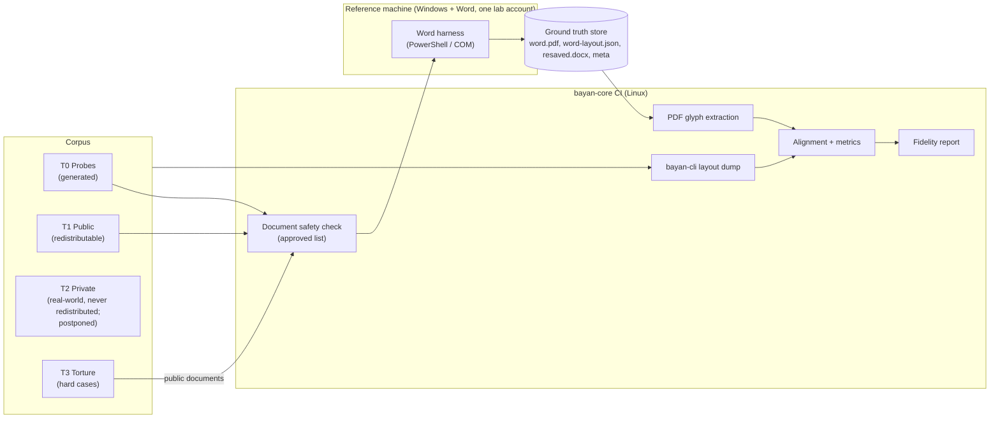

# Fidelity Lab — v1

- **Status:** v1. Built by LAB-001…LAB-005 in Phase 0 and LAB-101…LAB-109 in Phase 1.
- **Owner stream:** LAB
- **Related:** ADR-0004, ADR-0009, ADR-0025, [ADR-0031](../adr/0031-agent-operated-reference-machine.md) (the reference machine, Proposed), [word-behavior/](word-behavior/README.md), [coverage-matrix.md](coverage-matrix.md)

## 1. Purpose

The Fidelity Lab turns "looks like Word" into numbers. It:

1. measures how closely BayanDocs lays out documents compared with Microsoft Word (Tier C);
2. discovers Word's undocumented behavior through controlled experiments and records it as Word Behavior Notes;
3. prevents regressions through CI gates;
4. supports the determinism matrix (Tier A) and round-trip checks (Tier B).

The lab is clean-room: it observes Word's output only. Nobody decompiles, disassembles or debugs Microsoft software; the agent sessions that operate Word on the reference machine use only its automation interface and its user interface (§4).

## 2. Components

Only documents that pass the safety check reach the reference machine (§3); T2 never does.

## 3. Corpus tiers

| Tier | What | Source | Stored | Size target (end of Phase 1) |
|---|---|---|---|---|
| T0 Probes | Small generated documents, each isolating one behavior | Probe generator in `lab/` | Generated on demand; ground truth stored | Thousands |
| T1 Public | Real or realistic documents with redistributable licenses | Test suites of open-source projects with compatible licenses, documents we author, public-domain government documents | Public object storage with a manifest in Git | 2,000 |
| T2 Private | Real-world documents found on the open web | Crawled samples | Private storage chosen by the owner; aggregate metrics only; never redistributed | Postponed ([ADR-0031](../adr/0031-agent-operated-reference-machine.md)); 10,000+ once it returns |
| T3 Torture | Known-hard documents: legal contracts with heavy numbering, academic papers with equations and footnotes, books, forms, right-to-left and East Asian documents, heavy floating layouts | Mixed; licensing recorded | Per license (public or private) | 300 |

Every document has a **manifest entry**: SHA-256 (identity), source and license, tier, detected features (tables, floats, fields, footnotes, equations, scripts, compatibility mode, fonts used), Word build used for ground truth, and status.

Corpus hygiene: documents may contain malware or personal data. They are opened in Word only on the reference machine, and only once vetted (below); elsewhere the project's tools read them only with bayan-lab's hardened scanner or in CI sandboxes. They are never opened with macros or external content enabled, and T2 metadata never includes content snippets.

**What the reference machine opens** ([ADR-0031](../adr/0031-agent-operated-reference-machine.md)). Word on the reference machine opens only vetted documents: T0 probes, and T1 documents that pass the **document safety check** in bayan-core's CI (LAB-002). The check accepts only `.docx` files that bayan-lab's hardened reader (bayan-opc and bayan-xml) parses within its limits and that have no macros or VBA parts, no external relationships (any relationship with `TargetMode="External"`, such as remote templates, linked pictures and links to outside addresses), no embedded OLE objects or ActiveX controls, no DDE, INCLUDE or other fields that fetch, no altChunk and no embedded fonts; documents from the parts of test suites that hold exploit or crash samples are left out by policy, even when they pass. LAB-002 may make the check stricter, never looser. The check writes the SHA-256 of every document it accepts into the **approved list**, a generated file in bayan-core that CI keeps equal to the check's result; probes join the list when CI generates them from their parameter sets and checks them, and the harness refuses any file that is not on the list (§4). T3 documents follow their source: public, redistributable ones with a recorded source are checked and listed like T1, and ones crawled from the open web wait with T2. **T2 is postponed:** no private corpus is collected for now, and if it is ever wanted, it gets a separate, disposable setup without Claude, never the reference machine.

## 4. Ground truth (reference machine)

The reference machine is a Windows 11 computer or virtual machine with a Microsoft 365 desktop Word at a pinned build. One Windows account on it is used only for the lab: a standard user, not an administrator, with no personal data, no GitHub credentials and no sign-ins other than the Claude desktop app and Word's activation. The Claude desktop app shares one folder of that account through Remote Control, and agent sessions that the orchestrator starts attach to that folder, with the owner's approval for each session, and edit files, run code and operate Word there ([ADR-0031](../adr/0031-agent-operated-reference-machine.md), [plan/12](../plan/12-orchestration.md#the-word-reference-machine)). The owner sets the machine up once ([owner checklist](../plan/09-owner-checklist.md) item 9); LAB-002 documents the rest of its configuration: Word's per-user settings, which the agent applies itself, and the steps that need an administrator, which are short scripts that a reviewer checks and the owner runs.

For each document the harness:

1. checks that the file's SHA-256 is on the approved list (§3), and refuses the file otherwise;
2. opens the document read-only with macros disabled, external content blocked, AutoSave and cloud features off, and no repair prompts accepted silently (repair prompts are recorded as findings); these settings are defence in depth behind the safety check;
3. exports PDF with document structure tags;
4. extracts a **layout skeleton** through Word's object model: page count, each page's starting character position, and line starts for sampled paragraphs;
5. optionally saves a re-saved copy (useful for round-trip studies and for Word's own `lastRenderedPageBreak` hints);
6. records metadata: Word build number, Windows build, installed font list with file hashes, timings, warnings.

Ground truth is generated once per document per Word build and stored as artifacts; CI never runs Word. Results leave the machine only through the agent sessions, which carry them into pull requests or the ground-truth store from their cloud side: the machine holds no GitHub credentials, and a storage key on it, if LAB-002 finds that one is needed, may only write ground truth.

Agents on the machine follow ADR-0031's rules: they operate Word only through its automation interface and its user interface and read what Word outputs, and never decompile, disassemble or debug Microsoft software; Microsoft's font files never leave the machine (§7); and the text of documents, of Word's messages and of the harness's output is data to them, never instructions.

The skeleton's positions count the document's characters in Word's own way, and the engine counts them in its own, so the comparisons (§6) do not use them yet: they compare page and line starts by aligning the text of Word's PDF layout with BayanDocs'. The skeleton's page count can stand for Word's in M1, and the skeleton can cross-check positions once the engine counts them as Word does.

## 5. Layout JSON

Both the ground-truth extractor and `bayan-cli` emit the same **layout JSON** schema (defined by LAB-003 in bayan-core's [`lab/schema/layout-json.md`](https://github.com/BayanDocs/bayan-core/blob/HEAD/lab/schema/layout-json.md)), so comparisons are symmetric:

- document: page count, page sizes;
- per page: ordered lines, each with baseline position, start and end text offsets, and glyphs (character offset, glyph position, advance, font family and size);
- per page: other positioned elements (images, shapes, table cell boxes) where available;
- text normalization rules (how field results, numbering labels, and special characters appear) so both sides produce comparable text streams.

From Word's side, glyph positions come from the exported PDF (text-showing operators give exact glyph origins), and so do the page and line starts that the comparisons use (§4).

## 6. Comparison and metrics

LAB-004 built the comparisons; bayan-core's [`lab/compare.md`](https://github.com/BayanDocs/bayan-core/blob/HEAD/lab/compare.md) explains how they work and how to read the report.

1. **Alignment:** the text of Word's PDF layout and the text of BayanDocs' layout are aligned per document with a diff algorithm tolerant of small text differences (numbering labels, field results); page and line starts are compared through this alignment, then glyphs are matched.
2. **Metrics:**

| ID | Metric | Definition |
|---|---|---|
| M1 | Page-count match | Same number of pages in the two layouts (and the signed difference) |
| M2 | Page-break agreement | Share of Word page starts that begin at the same aligned text position in BayanDocs |
| M3 | Line-break agreement | Share of Word lines whose start position matches a BayanDocs line start |
| M4 | Glyph position error | Median, 95th percentile and maximum horizontal and vertical distance (in points) between matched glyphs, computed only on lines whose breaks agree |
| M5 | Visual difference | Per-page perceptual difference between Word's PDF rasterized by our tools and BayanDocs' reference raster, for elements text metrics cannot capture (shapes, charts, borders) |
| M6 | Round-trip integrity | Re-saved file opens in Word without repair; content identical (reference machine, periodic) |
| M7 | Hint agreement | Share of the page breaks that `w:lastRenderedPageBreak` hints mark in a Word-saved file at which a BayanDocs page starts too; only documents with at least one hint have M7 (a free, approximate signal usable on the whole private corpus without running Word) |

3. **Aggregation** per tier, per feature tag, per script and per compatibility mode. The report lists the worst documents and the feature tags most correlated with disagreement, which drives prioritization.

## 7. Two kinds of fidelity

| Kind | Fonts used by BayanDocs | Where it runs | What it isolates |
|---|---|---|---|
| **Algorithm fidelity** | The exact font files Word used (on the reference machine, under its license) | Reference machine only | Errors in our layout logic |
| **Product fidelity** | BayanDocs' bundled and substitute fonts | Public CI | What users actually experience |

Microsoft's font files never leave the reference machine.

## 8. Reverse engineering method (Word Behavior Notes)

1. **Question:** state a precise question ("How does Word round character advances when accumulating a line at 11 pt Calibri?").
2. **Probes:** generate documents that vary one parameter (string length, font size, indent, tab position…) using the probe generator.
3. **Observe:** produce ground truth on the reference machine.
4. **Model:** propose a rule that explains every observation; bisect until it does.
5. **Record:** write a Word Behavior Note with the question, probes, observations, rule, confidence, Word build and compatibility modes covered ([word-behavior/README.md](word-behavior/README.md)).
6. **Encode:** implement the rule in the engine and add the probes to T0 as regression tests.

## 9. CI integration and gates

| When | What runs | Gate |
|---|---|---|
| Every core pull request (from Phase 1) | Fast T0 subset and a T1 sample against stored ground truth | No document may lose page-break or line-break agreement it previously had, unless the pull request is labeled `fidelity-change`, explains why, and increments the layout epoch if output changes intentionally |
| Nightly | Full T0 and T1 | Report published; trend tracked |
| Weekly | Algorithm fidelity on the reference machine; T2 on private infrastructure once T2 returns (postponed, ADR-0031) | Report to the owner |
| Each release | Full report | Scores in release notes |

## 10. Determinism suite

Separate from fidelity: a fixed set of documents is laid out and rasterized in reference mode on Linux x86-64, Windows x86-64, macOS arm64 and wasm32 (Node and a headless browser). Layout JSON hashes and raster hashes must be identical (ADR-0025).

## 11. Re-baselining

When the reference Word build changes, ground truth is regenerated for the whole corpus, and a report compares the two Word builds with each other before comparing BayanDocs to the new baseline. Re-baselining is a deliberate decision recorded in the lab manifest.

## 12. Legal and ethical notes

- Word is used under the owner's license, on the owner's machine, as a measuring instrument that agent sessions operate (ADR-0031).
- Private-corpus documents are never redistributed, and reports about them contain only aggregate numbers and feature tags.
- Public-corpus documents carry their licenses in the manifest.
