# Threat Model — v1

- **Status:** v1, written by work package [SRV-003](../workpackages/phase-0/SRV-003-threat-model.md) on 2026-10-14; the owner accepted the two ADRs it proposed, ADR-0029 and ADR-0030, on 2026-10-17. It replaces v0 (the planning session, 2026-10-03), keeps every threat number of v0, and is reviewed at every phase gate and whenever a work package changes a trust boundary ([plan/07](../plan/07-quality-security-testing.md#3-security-program)).
- **Owner stream:** SECURITY
- **Method:** data-flow diagrams analysed with STRIDE, per element (§4.5, §4.6) and per flow (§6). STRIDE names six kinds of threat: **S**poofing (pretending to be someone else), **T**ampering (changing data), **R**epudiation (denying having done something), **I**nformation disclosure, **D**enial of service and **E**levation of privilege (getting more power than allowed).
- **Decisions it relies on:** some of the designs analysed here are decided in [ADR-0029](../adr/0029-identity-devices-and-recovery.md) (identity keys, device approval and recovery) and [ADR-0030](../adr/0030-commit-acceptance-and-group-repair.md) (commit acceptance, departures and group repair), which SRV-003 proposed and the owner accepted on 2026-10-17, ADR-0030 together with its three departures from the owner's earlier direction (§7.2).
- **Related:** SEC-01…SEC-13, COL-01…COL-14, OPS-01…OPS-09, [ADR-0006](../adr/0006-rust-core-and-memory-safety.md), [ADR-0008](../adr/0008-crdt-engine-and-local-first.md), [ADR-0012](../adr/0012-engine-boundary.md), [ADR-0014](../adr/0014-web-shell.md), [ADR-0015](../adr/0015-server-architecture.md), [ADR-0016](../adr/0016-e2ee-and-identity.md), [ADR-0017](../adr/0017-supply-chain-and-dependency-policy.md), [ADR-0023](../adr/0023-automation-macros-active-content.md), [ADR-0026](../adr/0026-release-engineering.md), [ADR-0028](../adr/0028-server-tls.md), the [engine protocol](engine-protocol.md), and the report of the MLS spike SRV-002, [`spikes/mls/REPORT.md`](https://github.com/BayanDocs/bayan-server/blob/4bc4633f80e6ccce49a975587990875cdd0597eb/spikes/mls/REPORT.md) in bayan-server.

## Summary for the owner

- **What BayanDocs protects.** The content of shared documents (text, comments, media, edit history, titles and folder structure) is readable only on the devices of the people a document is shared with. Whoever runs the server cannot read it, change it unnoticed, or give anyone a role, with the two exceptions in the next point but one (§3.2).
- **What a hostile server can do anyway.** It can refuse service, delay or withhold messages, split a group into parts that no longer see each other's edits, and see the metadata listed field by field in §9: who works with whom, when, how much, and from where.
- **The two exceptions, and the largest remaining risks.** First, when you share with someone for the first time, your app has to ask the server who that person is. A hostile server could answer with a fake identity of its own (a "ghost user", T23) and then read what you share with them. Comparing safety numbers prevents this; key transparency, a later addition, would make it detectable without effort. Second, the web app runs code that the server delivers, so a hostile server could deliver code that steals the keys of people using BayanDocs in a browser (T11). The desktop app does not have this weakness. But an account that is also used in a browser carries the risk into everything shared with that account, until its browser devices are revoked. The same weakness limits link sharing and passkey unlock in the browser.
- **Signing in is not the same as having the keys.** Someone who takes over your sign-in (through your company's identity provider, a stolen passkey, or an administrator) gets no keys. They cannot read documents, and any device they add stays powerless until one of your own devices approves it after comparing a code. Passkey unlock is the exception: an opt-in convenience that lets one passkey both sign in and unlock the keys (F10).
- **Four problems in the design, and their fixes.** The analysis found four problems in ADR-0016 as it stands after its amendment of 2026-10-07:
  1. A user who loses every device can get their identity back with the recovery kit but cannot rejoin their documents. A document whose only owner loses every device can never change its members again.
  2. A user cannot leave a document unless an owner is online to remove them.
  3. Approving a new device must compare a code or scan a QR code in both directions, or the server could slip in its own device, or its own keys, at the same moment.
  4. Restoring the server from a backup would stall every document that changed since the backup.

  [ADR-0029](../adr/0029-identity-devices-and-recovery.md) and [ADR-0030](../adr/0030-commit-acceptance-and-group-repair.md) fix them, and you accepted both on 2026-10-17. ADR-0030 also gives the details of the "two-phase acceptance" you chose on 2026-10-09 against members who stall a group (§7). It departs from that choice in three named points, which you accepted too: owners' commits take effect at once; a commit that no other member checks within 72 hours is dropped without punishing its sender; and quarantine applies to the sender's whole account.
- **What you decided.** On 2026-10-17 you accepted both ADRs, including ADR-0030's three departures, and decided against an expert cryptography review of ADR-0029's constructions before Phase 3 builds them; the external audit before collaboration leaves beta (SEC-08) still reviews them (§13.2). The question ADR-0016 left to SRV-003, whether the server may learn which updates are comments, needed no new decision: §7.4 confirms what you decided on 2026-10-09.

## 1. Scope, method and assumptions

### 1.1 Scope

v1 analyses the collaboration system end to end: signing in, accounts, devices and identity keys, sharing and roles, link sharing, synchronization online and offline, snapshots for new members, recovery, lost devices, notifications, administration and backups, the delivery of the web app's code, and the compliance escrow member planned for Phase 4. It covers bayan-server, the collaboration code of bayan-core (`bayan-sync`, `bayan-mls`, `bayan-crdt`), the shells' transport and key storage, and the services around them: the reverse proxy, the organization's identity provider, the database, object storage and email.

Parsing documents, rendering, automation, local AI and the release pipeline keep the threats of v0 (T1–T4 and T14–T20 in §11) until their own work packages extend them.

Most of what v1 analyses is built in Phase 1 (SRV-101…SRV-105: identity, storage and relay foundations) and Phase 3 (collaboration); each flow in §6 names its phase. The server endpoints that exist today are only those of SRV-001 (`/healthz`, `/readyz`, `/version` and static files).

### 1.2 Method

1. **Diagrams.** A context diagram of the whole system (§4.2), diagrams of the inside of the server (§4.3) and of a client (§4.4), and a sequence diagram for every flow (§6). In the sequence diagrams each box is a trust zone, so every arrow that leaves a box crosses a trust boundary (§4.1).
2. **STRIDE per element.** §4.5 lists every element with the STRIDE categories that apply to its type (external entities: S and R; processes: all six; data stores: T, R, I and D; data flows: T, I and D) and where each is analysed; §4.6 analyses the infrastructure elements that no flow covers in full.
3. **STRIDE per flow.** Every flow in §6 has a table with one row per threat: an ID such as F4.2, the category, the element attacked, the threat, its mitigations and what remains. Rows name the principal threat (T-number) they belong to.
4. **Principal threats.** §11 keeps the numbers T1–T22 of v0, which other documents cite, and adds T23–T39. Numbers are never reused or renumbered.
5. **Status values.** *In place* (built and tested), *Planned* (designed here or in an Accepted ADR, not built), *Proposed* (depends on a Proposed ADR), *Residual* (accepted in §12).

### 1.3 Assumptions

| # | Assumption |
|---|---|
| A1 | The reverse proxy that terminates HTTPS runs on the server's host or its private network and belongs to the same operator (ADR-0028 §4). Between the proxy and the server, traffic is plain HTTP over loopback or a private network that nobody else can reach (§4.6). |
| A2 | Clients are BayanDocs Desktop (the native core), BayanDocs Web (the core in a Web Worker), or third-party clients speaking the published protocols. The server never relies on which one it talks to (SEC-13, T21). |
| A3 | Real documents use the hybrid post-quantum MLS ciphersuite once its code point is assigned (ADR-0016, amendment 2026-10-04); signatures are Ed25519; every cryptographic primitive comes from MLS and its providers (ADR-0016 Decision 12). |
| A4 | Operating systems and browsers keep their own promises: process isolation, keychains, the same-origin policy, and WebAuthn's binding of passkeys to a domain. Someone who controls a user's device while it is unlocked can read everything that user can; that is out of scope, as in v0. |
| A5 | The server's clock decides only the server's own deadlines (expiry, retention, the time limits of §7.2). No security decision depends on clients' clocks agreeing with it. |
| A6 | Self-hosted and hosted deployments run the same software. In a self-hosted deployment the operator, the organization and its administrator are often the same people; that changes who the hostile operator would be, not the analysis. |

### 1.4 Terms

| Term | Meaning |
|---|---|
| Account, device | An account is a user on one server. A device is one installation of a client for one account (a laptop's desktop app, a browser profile). MLS members are devices; roles belong to accounts. |
| Owner, editor, commenter, viewer | The four roles of a document (COL-05). Owners manage members and roles; editors edit; commenters comment; viewers read. |
| Group, epoch, commit | One MLS group per document. Every change of membership or keys is a *commit*, which starts a new *epoch* with new keys (glossary: [Epoch (MLS)](../plan/11-glossary.md)). |
| Path secret | The fresh secrets a commit encrypts to the other members, each to their own part of the group; members who cannot decrypt theirs cannot follow the commit. |
| Tag, MAC | A message authentication code: a short value computed with a secret key that proves a message was not changed. MLS commits carry a membership tag and a confirmation tag computed with the epoch's secrets, which the server does not have. |
| Public state, roster | What the server knows about a group without any key: the ratchet tree (every member device's credential and public keys) and the group context, which holds the *roster* of accounts and their roles (ADR-0016, amendment 2026-10-07). |
| Validator | The part of the server that follows each group's public state and refuses commits and updates that break the role policy (SRV-002). |
| Ed25519, HKDF, AEAD, HPKE | The building blocks MLS's providers offer: Ed25519 makes and checks signatures; HKDF derives keys from a secret; an AEAD encrypts and authenticates data under a key; HPKE encrypts to someone's public key. The hybrid post-quantum ciphersuite uses an HPKE whose key exchange combines ML-KEM-768 with X25519. |
| Identity key, device-signing key, device key | The three signing keys of an account (ADR-0029, §5.1): the identity key says who the user is, the device-signing key says which devices belong to the user, and each device signs its own messages with its device key. |
| Device certificate, device list | A device certificate is the device-signing key's signature over a device's key; the device list is the user's signed, numbered list of current and revoked devices. |
| Recovery kit, secret store, key backup | The recovery kit is a random secret the user saves or prints. It opens the *secret store*, an encrypted copy of the account's long-term keys kept on the server, and the *key backup*, the latest snapshot keys of the user's documents, also encrypted (ADR-0029). |
| Key package, Welcome | A key package is a device's one-time public key, published so that others can add the device to a group. A Welcome gives newly added devices the group's secrets. |
| Snapshot | An encrypted copy of a document's current state, for devices that join later and cannot read earlier epochs (ADR-0016 Decision 4). |
| Witness, two-phase acceptance, quarantine | A commit from a member who is not an owner takes effect only after another account's device (a *witness*) confirms that it can process it, and no witness refuses it. A refused commit is dropped, and its sender's account is *quarantined*: it cannot commit in that group until an owner lifts the quarantine (ADR-0030, §7.2). |
| Resync, recovery join | Two ways to enter a group with an MLS external commit, without another member's help (ADR-0029). A device that fell behind *resyncs*: it rejoins with its own device key and replaces its own old place in the group (RFC 9420 §12.4.3.2). A new device of a user who has a role makes a *recovery join*: it joins, then removes the user's lost devices with ordinary commits. |
| TOFU | Trust on first use: a client remembers ("pins") the identity key it first saw for a contact and warns if it ever changes. |
| Safety number | A fingerprint of two users' identity keys, long enough that nobody can make a key that matches it, which they can compare in person or by QR code to make sure no one sits in between. |
| PKCE, HSTS | PKCE (RFC 7636) ties a sign-in code to the app that started the sign-in, so a stolen code is useless. HSTS tells browsers to use HTTPS only for a site. |
| Harvest now, decrypt later | Recording encrypted data today in order to decrypt it once a large quantum computer exists (T22). |

## 2. Assets

| Asset | Why it matters | Where it lives |
|---|---|---|
| Document content: text, comments, media, edit history, titles, folder structure | The core promise (COL-04) | In plaintext only on members' devices; on the server only as ciphertext |
| Keys: identity, device-signing, device, MLS epoch secrets, snapshot keys, link keys, recovery secret, key-backup key | Whoever has them can read or impersonate | Devices (wrapped at rest, SEC-11); the user's recovery kit; ciphertext copies on the server (§5.1) |
| Sign-in credentials and sessions: passkeys, identity-provider accounts, session tokens, invitation tokens | Access to the server and to the account's metadata, not to content | Authenticators, identity providers, clients; hashes on the server |
| Group public state: ratchet trees and rosters | Decides who receives keys and what the server enforces | Server and every member device |
| Collaboration metadata | Who works with whom, when and how much (§9) | Server, reverse proxy, object storage, email relay |
| Account data: names, email addresses, organization | Personal data | Server, identity provider |
| Security audit log | Evidence after an incident; personal data | Server |
| Software integrity: binaries, the web app's code, container images | A compromised build defeats every other control (T11, T16, T17) | Release pipeline, the server that serves the web app |
| Service availability | Teams depend on it; an operator can always take it away | Server |
| Fidelity Lab private corpus | Third-party documents (T19, unchanged) | Lab storage |

## 3. Adversaries and security goals

### 3.1 Adversaries

| Adversary | Capabilities | In scope |
|---|---|---|
| Curious server operator, or someone who has copied the server's data | Reads everything the server stores and everything that passes the reverse proxy | Yes: content stays confidential; the metadata it sees is listed in §9 |
| Malicious server operator | Also changes stored data, sends anything to clients, serves modified web code, controls the reverse proxy | Yes, for the confidentiality and integrity of content shared between desktop devices of contacts that each client already knows. Accounts that also use the web app are exposed through their browser devices (T11), and first contacts through the directory (T23). Availability cannot be guaranteed |
| Network attacker | Observes and changes traffic between clients and the proxy, and between the server and its services | Yes (TLS, ADR-0028) |
| Malicious or compromised collaborator, of any role | Holds the keys of the documents shared with them; sends crafted MLS messages, CRDT updates and snapshots, including commits that only some members can process; abuses sharing and links | Yes |
| Former member | Had access and kept local copies | Yes: no access to anything written after the removal |
| Thief of a device | A locked device: in scope (encryption at rest, SEC-11). An unlocked device: out of scope as endpoint compromise, apart from revocation and post-compromise security | Partly |
| Sign-in attacker | Phished or reused credentials, a compromised organization identity provider or its administrator, a compromised passkey sync account, a malicious server administrator | Yes: a sign-in alone must not give content or a trusted device (T27) |
| Holder of a link | Anyone who sees a link's URL | Yes: links are bearer secrets by design (F5) |
| Malicious organization administrator | Configures policies, and from Phase 4 the escrow member | Yes: escrow must be visible and bounded (§8) |
| Supply-chain attacker, malicious document author, malicious script or extension | As in v0 (T1–T3, T14, T16, T17) | Yes |
| Observer of traffic timing and sizes | Sees when and how much each client sends | Partly (§9.3) |
| Other software on a user's device | Other local apps, browser extensions | Out of scope as endpoint compromise, except where the protocol can avoid exposure (for example the desktop sign-in's loopback redirect, F1) |

### 3.2 Security goals

| # | Goal |
|---|---|
| G1 | **Confidentiality.** Only devices of a document's current members can read its content, plus holders of a link to it and, where an organization's policy adds one, its escrow member. The server never can (ADR-0015 Decision 6). Exceptions: ghost users at first contact (T23) and code served to browsers (T11). |
| G2 | **Integrity and authenticity.** Every change is signed by a member's device. Nobody, the server included, can forge or alter an edit without the members noticing; replays have no effect. |
| G3 | **Role enforcement.** No device can do more than its user's role allows, as honest clients see it, whatever the server does (ADR-0016 Decision 5). |
| G4 | **Membership transparency.** Nobody joins a group without a commit that every member sees and checks. For a contact whose identity a client already knows, nobody can add a device that the contact's own native devices or recovery kit did not approve. |
| G5 | **Forward secrecy and post-compromise security.** Removed members and stolen device keys lose access to content written afterwards, as far as MLS provides it. The recovery kit, and passkey unlock where it is on, are the exception: whoever obtains them can read the latest snapshot of each document until the user makes a new kit and rotates the keys it protects (T28, F9). |
| G6 | **Recoverability.** A user who keeps their recovery kit regains their identity and access to their documents after losing every device. |
| G7 | **Metadata minimization.** The server stores only what it needs, only for as long as it needs it, and §9 lists all of it. |
| G8 | **Availability, best effort.** An operator can always deny service. A member must not be able to stall a group: at worst it can delay other members' commits and leave members who were offline to repair their place in the group (§7). |

## 4. System model

### 4.1 Trust boundaries

Boundaries 1–9 are those of v0; v1 adds 10–14.

| # | Boundary | Crossed by |
|---|---|---|
| 1 | File bytes → engine parsers | Opening documents (T1–T3) |
| 2 | Engine ↔ shell (C ABI on desktop, worker messages on the web; [engine protocol](engine-protocol.md)) | Every message between interface and engine; transport and key storage requests from the engine (§4.4) |
| 3 | Shell ↔ operating system or browser | Clipboard, fonts, URLs, files, keychains, IndexedDB |
| 4 | Client ↔ server (HTTPS and WebSocket, through the reverse proxy) | Every flow in §6 |
| 5 | Server ↔ database and object storage | Metadata and ciphertext at rest (§9) |
| 6 | Engine ↔ automation sandbox and extensions | Scripts (T14, Phase 5) |
| 7 | Engine ↔ AI sidecar | Local AI (T15, Phase 5) |
| 8 | Build and release pipeline → users | Binaries, packages, containers, web assets (T16, T17) |
| 9 | Web origin → browser | The web app's code (T11, F16) |
| 10 | Server ↔ OpenID Connect identity provider | Organization sign-in (F1) |
| 11 | Client ↔ authenticator | Passkeys, platform authenticators and the services that sync passkeys (F2, F10) |
| 12 | Server ↔ email relay | Notification email (F14) |
| 13 | Reverse proxy ↔ server | Every request after TLS ends (A1) |
| 14 | Administrator and operator ↔ server | Admin console, command line, backups and restores (F17) |

### 4.2 Context diagram

Each box is a trust zone; the numbers on the arrows are the boundaries of §4.1.

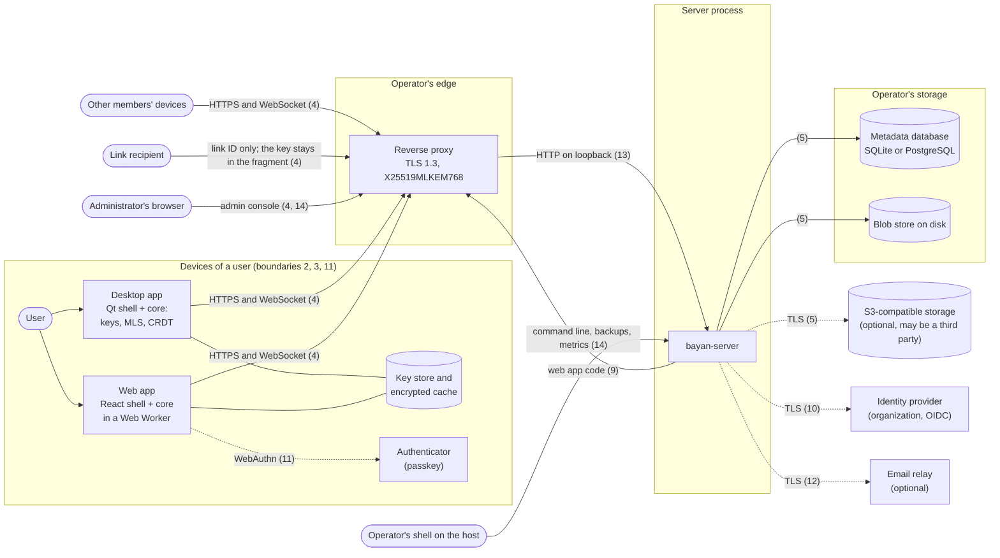

### 4.3 Inside the server

The boxes are parts of the one bayan-server binary (ADR-0015); only the middleware and the three `/healthz`, `/readyz` and `/version` routes exist today (SRV-001). Requests cross boundary 13 when they enter the process and boundary 5 when they reach the stores.

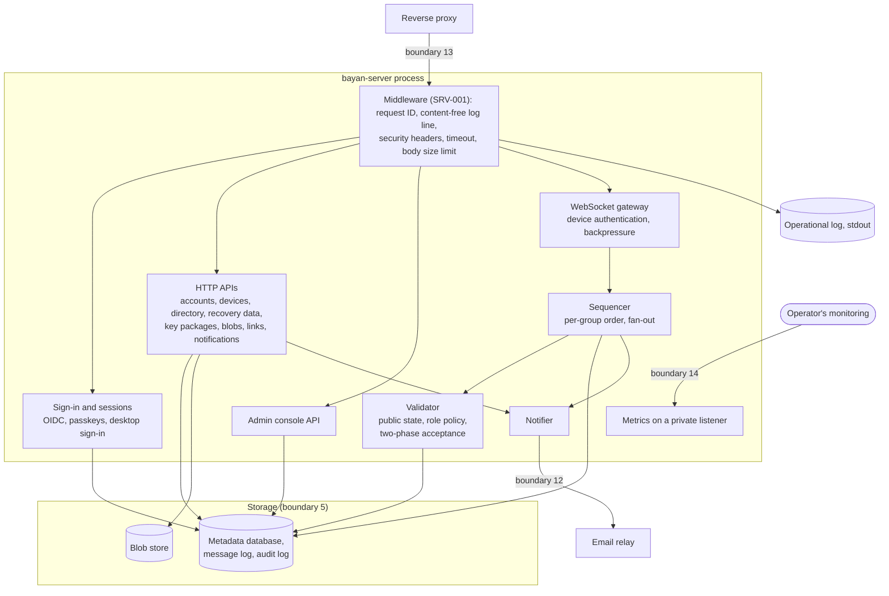

### 4.4 Inside a client

The engine never opens sockets or reads keychains itself (ADR-0012 Decision 5): it asks the shell through host services. On the web the engine, and with it every key, lives in the Web Worker; the page's main thread never needs key material (F16).

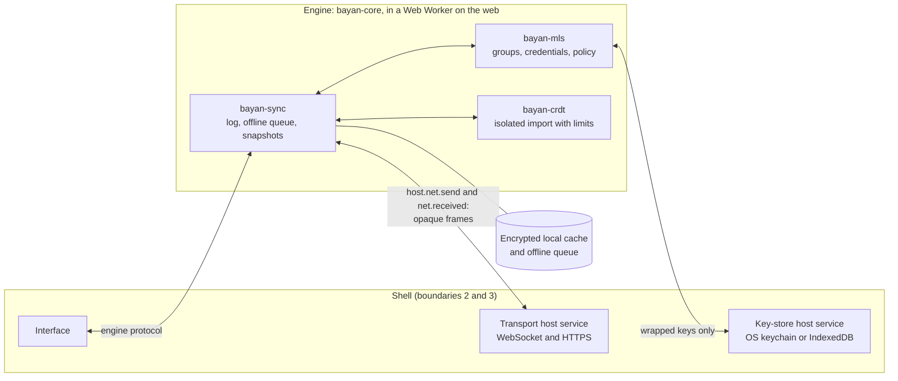

### 4.5 Elements and the STRIDE categories that apply

| ID | Element | Type | Categories | Main concern | Analysed in |
|---|---|---|---|---|---|
| E1 | User | External entity | S, R | Approving the wrong device; losing the recovery kit; denying actions | F3, F9, F10, F11, T24, T28 |
| E2 | Other members' clients | External entity | S, R | Crafted messages; commits only some members can process; denying authorship | F4, F6, F8, F12, T7, T8, T25 |
| E3 | Identity provider (OIDC) | External entity | S, R | A compromised provider signs in as users | F1, §4.6, T27 |
| E4 | Authenticator and passkey sync provider | External entity | S, R | A synced passkey gives sign-in, and with passkey unlock keys | F2, F10, T28 |
| E5 | Administrator and operator | External entity | S, R | Abusing admin powers; denying it | F17, T27 |
| E6 | Link recipient | External entity | S, R | Anyone with the URL reads | F5, T31 |
| E7 | Email relay | External entity | S, R | Sees who is notified about whom | F14, §4.6, T37 |
| E8 | Escrow officers (Phase 4) | External entity | S, R | Reading beyond policy | F15, §8 |
| P1 | Shell (desktop or web) | Process | S, T, R, I, D, E | Transport and key storage; on the web, code served by the server | F6, F16, T4, T11 |
| P2 | Engine: bayan-sync, bayan-mls, bayan-crdt | Process | S, T, R, I, D, E | Every client-side check of §7.1; crafted input; keys in memory | F3–F13, T7, T8, T36 |
| P3 | Reverse proxy | Process | S, T, R, I, D, E | TLS; forwarded client addresses; access logs that hold paths and addresses | §4.6, F1, F16, §9.1, T12, T22 |
| P4 | Sign-in and sessions | Process | S, T, R, I, D, E | Account takeover; session theft | F1, F2, T12, T27, T32 |
| P5 | Account, device, directory and recovery APIs | Process | S, T, R, I, D, E | Ghost users and devices; stale device lists | F3, F4, F9–F11, T23, T24, T30 |
| P6 | WebSocket gateway and sequencer | Process | S, T, R, I, D, E | Flooding; forks; device authentication | F6, F7, T13, T26 |
| P7 | Validator | Process | S, T, R, I, D, E | Accepting what clients refuse, or the reverse | F4, F12, §7, T25 |
| P8 | Blob and link APIs | Process | S, T, R, I, D, E | Storage abuse; link guessing | F5, F8, T13, T31 |
| P9 | Notifier | Process | S, T, R, I, D, E | Leaking metadata; phishing | F14, T37 |
| P10 | Admin console, command line and backup tools | Process | S, T, R, I, D, E | Admin takeover; restore rollback | F17, T33 |
| D1 | Client key store, cache and offline queue | Data store | T, R, I, D | Theft of a locked device; recordings | F7, F11, T20, T36 |
| D2 | Metadata database | Data store | T, R, I, D | Metadata exposure; tampering equals a malicious server | §9, F17 |
| D3 | Message log | Data store | T, R, I, D | Ciphertext kept long (T10, T22); readable commits; sender metadata | F6, F7, §9.1 |
| D4 | Blob store | Data store | T, R, I, D | Substitution; deletion; sizes | F5, F8 |
| D5 | Security audit log | Data store | T, R, I, D | Personal data; evidence integrity | F17, §9.1 |
| D6 | Operational logs and metrics | Data store | T, R, I, D | Identifiers leaking into logs or metric labels | §9.1, T20 |
| D7 | Backups | Data store | T, R, I, D | Theft; restore rollback | F17, T33 |
| D8 | Reverse-proxy and object-storage logs | Data store | T, R, I, D | Addresses, paths and link IDs outside the server's control | §4.6, §9.1 |
| DF1 | Client ↔ reverse proxy | Data flow | T, I, D | TLS, harvest now decrypt later | F1–F16, T12, T22 |
| DF2 | Reverse proxy ↔ server | Data flow | T, I, D | Plain HTTP on a private network | §4.6, A1 |
| DF3 | Server ↔ identity provider | Data flow | T, I, D | Token exchange, the provider's signing keys | F1, §4.6 |
| DF4 | Server ↔ database and object storage | Data flow | T, I, D | TLS with verification (ADR-0028); a third-party object store | §4.6, F17 |
| DF5 | Server ↔ email relay | Data flow | T, I, D | Content-free notices; TLS to the relay | §4.6, F14 |
| DF6 | Engine ↔ shell | Data flow | T, I, D | Malformed messages; key material crossing to the shell | §4.6, T4, T36 |
| DF7 | Client ↔ authenticator | Data flow | T, I, D | PRF output exposure | F2, F10 |
| DF8 | Delivery of the web app's code | Data flow | T, I, D | Modified code | F16, T11 |

### 4.6 Infrastructure elements

No flow covers these elements in full, so their threats are listed here.

| # | STRIDE | Element | Threat | Mitigation | Remaining risk |
|---|---|---|---|---|---|
| IE1 | S | P3, DF2 | A client fakes its address with a forwarded-for header, defeating the rate limits per address (F1.10, F5.3, F5.10) and the audit log's optional address | The server reads forwarded headers only from the configured proxy's address and ignores them from anywhere else; the proxy overwrites, never appends to, the header it sets | — |
| IE2 | S, I | DF2 | Another host on a shared private network reaches the server's plain-HTTP port directly | The server listens on loopback when the proxy is on the same host, or on a network only the proxy can reach; the deployment guide says so (SRV-105) | A misconfigured network |
| IE3 | I | P3, D8 | The proxy's access logs keep client addresses, user agents and paths, which may hold link IDs and blob IDs | Logs switched off or kept without paths and addresses (§9.1); identifiers in request bodies and frames rather than paths (SRV-104) | Depends on the operator |
| IE4 | T, I | DF1, P3 | Weak TLS settings at the proxy, or no HSTS | TLS 1.3 with X25519MLKEM768 and HSTS, as the deployment guide requires (ADR-0028 Decision 4) | — |
| IE5 | D | P3 | The proxy does not pass WebSocket upgrades, or closes idle connections the wrong way round | The proxy requirements of ADR-0028 Decision 4 and the deployment guide | — |
| IE6 | T, D | DF3 | The identity provider's signing keys change, or the provider is unreachable | Keys fetched over verified TLS, cached for a bounded time, fetched again when a token names an unknown key; sign-in fails closed while the provider is down | Organization sign-in depends on the provider's availability |
| IE7 | T, I | DF4 | Database or object-storage traffic read or changed on the network | TLS with certificate and host-name verification (ADR-0028); credentials from files; a database user with only the rights it needs | — |
| IE8 | I, D | DF4 | An S3-compatible store run by a third party sees blob IDs, sizes and times, and can delete or withhold blobs | Blobs are ciphertext with random IDs; members detect substituted blobs (F8.1); operators choose the provider | The provider's availability and the metadata of §9.2 |
| IE9 | T, I | DF5 | The connection to the email relay is downgraded to plain text, or the relay is not authenticated | TLS required to the relay (implicit TLS, or STARTTLS that fails without TLS) with certificate verification; relay credentials from files | — |
| IE10 | T, D | DF6 | A compromised shell component or script sends the engine malformed messages | Schema checks, limits and no panics across the boundary (T4, CORE-007) | — |
| IE11 | I | DF6 | Key material crosses from the engine to the shell or into recordings | Keys leave the engine only wrapped, through the key-store host service; recordings exclude MLS state (T36, §13.3) | — |

## 5. Keys, credentials and sessions

The flows in §6 rely on the key design below. ADR-0016 Decisions 6 and 7 fix its principles; the details are decided in [ADR-0029](../adr/0029-identity-devices-and-recovery.md).

### 5.1 Keys

| Key | What it is | Private part kept by | Changes when | Protects |
|---|---|---|---|---|
| Identity key | Ed25519 signing key, one per account | Only the secret store, and briefly the memory of a device that uses it | Only if lost or exposed; every contact then sees a key change | Who the user is: it certifies the device-signing key |
| Device-signing key | Ed25519 signing key, one per account, certified by the identity key | The user's native (desktop) devices, wrapped at rest (SEC-11), and the secret store; never a browser device | After a device that held it is lost, and after any suspected exposure (rotating it needs the recovery kit or passkey unlock) | Which devices belong to the user: it certifies device keys and signs the device list |
| Device key | Ed25519 signing key, one per device, certified by the device-signing key | That device only | Never; a new device gets a new key | The device's MLS signatures, and, under a separate signing label, proof of the device to the server |
| MLS keys | Leaf, path and init keys (HPKE, with the hybrid post-quantum KEM in production) and each epoch's secrets | The device, inside the engine | Every commit | Document content (ADR-0016) |
| Snapshot key | One key per snapshot for the group's AEAD (ADR-0016, amendment 2026-10-07, design detail 2) | The members who received it | Each snapshot | One snapshot |
| Link key and link signing key | A random 256-bit AEAD key and an Ed25519 key pair, per link | The devices of the owner who created the link (in that owner's encrypted settings), and the link's URL fragment, which holds the AEAD key and the public signing key | Each link | The snapshot keys wrapped for that link, and their authenticity (F5) |
| Recovery secret | Random 256-bit value, shown as the recovery kit (words and a QR code) | The user, on paper or in a password manager; never a device or the server | When the user makes a new kit | The secret store |
| Secret-store key | Derived from the recovery secret with HKDF | Derived when needed, then erased | With the recovery secret | Identity key, device-signing key and key-backup key, sealed with an AEAD |
| Key-backup key | HPKE key pair with the production suite's hybrid KEM | Private part: secret store. Public part: every device of the user | With every new recovery kit, and after any suspected exposure | The latest snapshot key of each of the user's documents (F8, F9) |
| Passkey unlock key | Derived with HKDF from a passkey's PRF output (opt-in) | Derived when needed | Per passkey | A copy of the recovery secret wrapped for that passkey (F10) |
| Session token | Random 256-bit secret | The client; the server stores only a hash | Each sign-in; rotated | Server access for one device |

All of this uses primitives that OpenMLS's provider already offers (Ed25519, HKDF, AEAD, HPKE including the hybrid KEM), so it adds no new primitive (ADR-0016 Decision 12); the constructions that combine them (certificates, the secret store, the key backup, passkey wrapping, the approval exchange, link signing and the device's proof of possession) are reviewed by the external audit before collaboration leaves beta (SEC-08); the owner decided on 2026-10-17 against a separate expert review before Phase 3 builds them (ADR-0029). Nothing is protected by a password or passphrase: that would need a password-hashing function such as Argon2id, which MLS's providers do not include, so the recovery kit is always a generated secret. The account's root secrets (secret store, passkey wraps) and link keys use 256-bit AEAD keys, a margin for keys that guard everything else for years; document data, snapshots and backup entries use the AEAD of the group's ciphersuite, as ADR-0016 decided (AES-128-GCM in the hybrid suite, which quantum computers do not meaningfully weaken).

**After an exposure.** Whoever obtains the recovery kit, or a passkey with passkey unlock, can open the secret store and, with the server's stored data alone, the latest snapshot of every document, including later ones, until the user acts (T28). The response is: a new recovery kit, a new key-backup key (devices seal the current snapshot keys to it again), a new device-signing key with the remaining devices certified again, and, if a hostile party may have kept an older secret store, a new identity key, which contacts see as a change. Passkey unlock is switched off for an exposed passkey. A new kit and a new key-backup key after every recovery are good practice, because a recovery may run on a device or in a browser the user does not fully trust.

### 5.2 Credentials and the directory

- **Credentials.** Every MLS leaf carries a credential that names the account and the device and carries the chain that proves it: the device certificate (signed by a device-signing key), that device-signing key's certificate (signed by the identity key) and the identity public key. A chain is valid when it leads to the account's identity key and names a device that the account's latest signed device list lists as current; a certificate made by an earlier device-signing key stays valid for a device that the latest list still lists, so a rotation does not break existing places in groups. Devices replace their credential in each group with their next self-update. The server's validator and every client check the chain whenever a leaf appears: in key packages, commits, Welcomes, resyncs and recovery joins. The encoding, a private-use credential type or X.509, is left to the Phase-3 work package (ADR-0029). The spike's basic credentials naming `user/device` (SRV-002) are replaced.
- **Directory.** For each account the server publishes the identity public key, the current device-signing certificate and the signed device list, which carries a version number, the current devices and the revoked ones, and records which device made each change. Clients pin a contact's identity key the first time they see it (TOFU), refuse a device list older than one they have already seen, and stop with a warning before sending anything new to a contact whose identity key has changed. Users can compare safety numbers or scan each other's QR codes and then see the contact as verified (ADR-0016 Decision 6).
- **Watching one's own devices.** Every device of a user shows each change of the user's device list, who made it and when. A device that finds a change attributed to itself that it did not make raises an alarm and starts the response of F11, because only a stolen device-signing key can produce one.
- **Personal data in groups.** A user's document index (titles and folders) and settings (pins, verifications and device names) are end-to-end encrypted groups of the user's own devices, like documents with one account. A new or recovered device therefore inherits the user's pins and does not start trusting the directory afresh.
- **What the directory can and cannot do.** The server can withhold or delay a newer device list, and it can answer a lookup for someone a client has never seen with an identity of its own (T23). It cannot add a device to an identity a client has pinned or verified (G4).

### 5.3 Sessions and device authentication

- **Every session belongs to one device.** On the web the session is a cookie with the `__Host-` prefix, `Secure`, `HttpOnly` and `SameSite=Strict`. The desktop app signs in through the system browser and receives its token over a loopback redirect protected by PKCE (RFC 8252, RFC 7636), never through an embedded browser view.
- **Proof of possession.** Each WebSocket connection, and each security-relevant HTTP request (revoking, deleting, approving), carries a signature by the device key over a fresh challenge from the server, under a signing label of its own, as DPoP (RFC 9449) does for OAuth tokens. A stolen token without the device key cannot act as the device (T32).
- **Unapproved devices are powerless.** A device that has signed in but is not yet approved (F3) can only finish its own approval or a recovery (F9). It cannot read group data, claim key packages, publish anything, end other sessions or delete anything. This is what keeps a sign-in takeover from becoming more (T27).
- **Re-authentication.** Adding a sign-in method, changing the email address, deleting the account, recovery joins and every admin action need a sign-in from the last few minutes; the server checks this, because clients cannot.

## 6. Flows

Every flow has a sequence diagram and a STRIDE table. Paths such as `/auth/oidc/start` are illustrative; SRV-105 publishes the real API in `specs/protocols/server-api.md`.

### 6.1 F1: Signing in with OpenID Connect

*Phase 1 (SRV-101); used by collaboration from Phase 3.* Organizations sign in through their own identity provider. The server is an OpenID Connect relying party using the authorization code flow with PKCE. The web app follows the redirects in the browser. The desktop app opens the system browser and receives the result on a loopback address (RFC 8252); embedded browser views are not used. A sign-in proves who the user is to the server; it never unlocks keys (ADR-0015 Decision 4).

The `state` value must be bound to the browser that started the sign-in. The provider's redirect back is a navigation from another site, on which browsers do not send `SameSite=Strict` cookies. The binding therefore uses a short-lived pre-sign-in cookie of its own (`__Host-` prefix, `Secure`, `HttpOnly`, `SameSite=Lax`, 10 minutes), and the provider returns the code in the query of a plain redirect (`response_mode=query`).

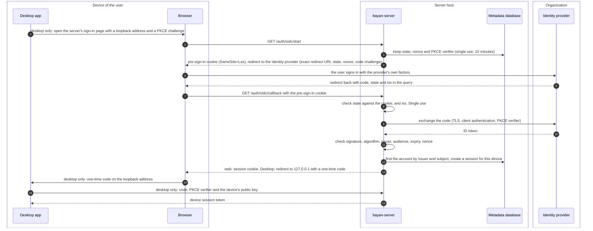

| # | STRIDE | Element | Threat | Mitigation | Remaining risk |
|---|---|---|---|---|---|
| F1.1 | S | P4, E3 | Someone signs in as the user by phishing them at the identity provider, or by controlling the provider or its administration (T27) | Sign-in gives no keys; a new device stays powerless until one of the user's devices approves it (F3, §5.3); the user's devices are told about new sessions; audit log | The attacker sees the metadata the account can see and can ask the user's devices for an approval the user might wrongly give |
| F1.2 | S | P4 | Account linking by email address: an account at another provider, or an unverified address, takes over an existing account | Accounts are found by issuer and subject, never by email address; linking a second provider needs a session of the account | — |
| F1.3 | S, T | P4 | Login cross-site request forgery, or an attacker's code injected into the victim's session | `state` bound to the browser by the pre-sign-in cookie and single use; PKCE; codes single use | — |
| F1.4 | S | P4 | Mix-up between several configured identity providers | A redirect URI per provider and the `iss` check of RFC 9207, as RFC 9700 recommends | — |
| F1.5 | T | P4 | Forged or replayed ID token | Signature checked against the provider's published keys, fetched over verified TLS (ADR-0028, §4.6 IE6); an allowlist of algorithms (no `none`); `nonce`, audience, issuer and expiry checked | A compromised provider can sign anything (F1.1) |
| F1.6 | S | P4 | Open redirect: a return address sends the browser and its code elsewhere | Only relative return paths, and for the desktop only loopback addresses | — |
| F1.7 | S | DF1, P1 | Desktop: another local program listens on the loopback port or intercepts the redirect | PKCE binds the code to the app that started the sign-in; a fresh port each time; the code is useless without the verifier (RFC 8252 §8.1) | Malware on the device is out of scope |
| F1.8 | I | D6 | Codes, tokens or identity claims end up in logs | Content-free log lines with route templates only (SRV-001); the ID token is not stored, only issuer, subject, display name and email address | — |
| F1.9 | R | D5 | A user, or an administrator, denies a sign-in or a session | Security audit log: sign-ins, failures, sessions created and ended (§9.1) | — |
| F1.10 | D | P4 | Flooding the sign-in endpoints or the store of pending sign-ins | Rate limits per address (with forwarded addresses trusted only from the proxy, §4.6 IE1) and per account; pending sign-ins expire and are bounded | Distributed floods need the proxy's own limits |
| F1.11 | E | P4 | Group claims of the identity provider turned into server administration rights | Server roles are assigned in the server, or from one documented, explicitly configured claim; document roles live only in MLS rosters | — |
| F1.12 | I | P1 | The session cookie is stolen by script injection or on the network (T32) | `HttpOnly`, `Secure`, `SameSite=Strict`, `__Host-` prefix; CSP and Trusted Types (SEC-10); TLS, and HSTS set at the proxy | — |
| F1.13 | S | D1 | The desktop token is copied from the device (T32) | Kept in the OS keychain; useless without the device key (§5.3) | An unlocked, compromised device is out of scope |
| F1.14 | E | P4 | Session fixation | A new session identifier after every sign-in; the old one ends | — |

### 6.2 F2: Passkey registration and sign-in

*Phase 1 (SRV-101).* Accounts that do not use an organization's provider sign in with passkeys (WebAuthn). New self-hosted servers keep registration closed: a new account starts from an invitation (OPS-09). The invitation link carries its token in the URL's fragment, which browsers never send to servers, so it reaches neither the proxy's logs nor email scanners that open links; the page reads it and spends it only in a POST request. On the desktop, passkeys are used through the system browser, because a platform's passkey interface for apps may refuse a self-hosted server's domain: on Apple's platforms, an app can use passkeys only for domains associated with it (Apple's "Supporting passkeys" documentation).

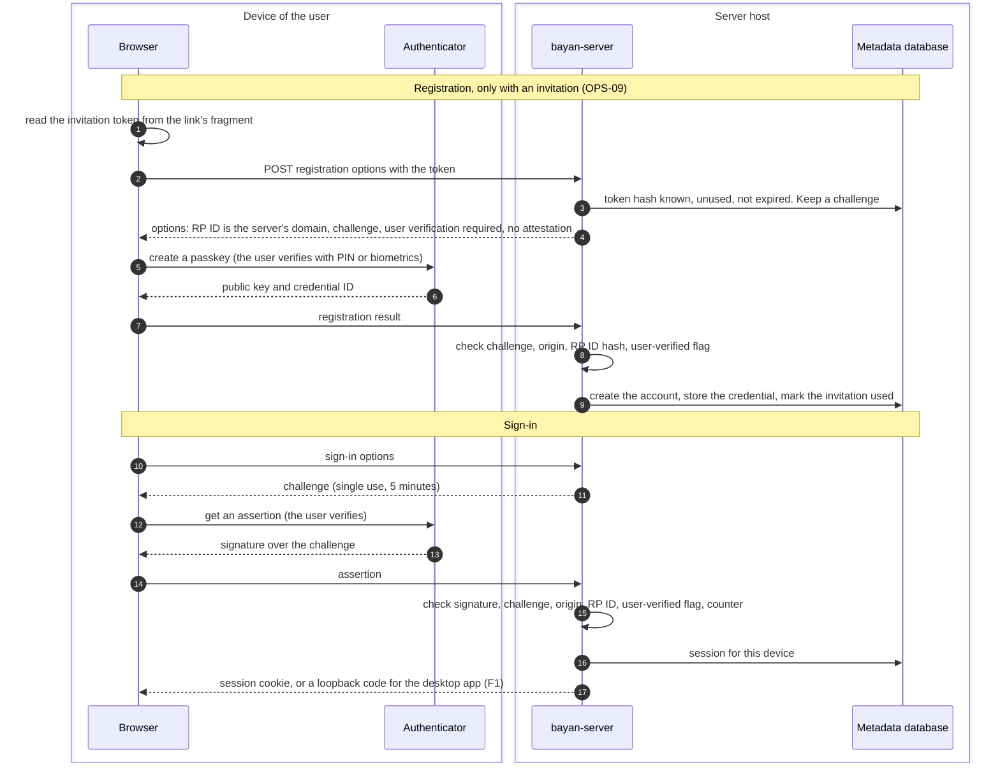

| # | STRIDE | Element | Threat | Mitigation | Remaining risk |
|---|---|---|---|---|---|
| F2.1 | S | P4 | Phishing and relaying of sign-ins | Passkeys are bound to the RP ID; the browser checks the origin; the server checks origin and RP ID hash | — |
| F2.2 | S | P4, E1 | Someone intercepts an invitation (for example in email) and registers in place of the invitee | Invitation tokens are single use, expire after 7 days, travel in the fragment and are stored only as hashes; the inviter sees who accepted; collaborators verify newcomers' safety numbers (T23) | Without verification, an intercepted invitation creates a ghost user (T23) |
| F2.3 | S | P4 | Replayed assertion | Single-use challenges with expiry; the signature counter is checked where the authenticator keeps one (synced passkeys usually report 0) | — |
| F2.4 | E | P4 | Registration without an invitation on a closed server | The server refuses (OPS-09) | — |
| F2.5 | I | D2 | Attestation reveals the user's authenticator model | Attestation "none"; the authenticator model (AAGUID) is not stored | — |
| F2.6 | S | P4, E5 | All passkeys lost: sign-in recovery | An administrator issues a new invitation bound to the existing account; the event is audited and shown on the user's devices; keys are recovered separately (F9) | A malicious administrator can do the same and take over the sign-in, but not the keys (T27) |
| F2.7 | I | P4 | Probing which accounts exist | Discoverable credentials and the same answer whether or not an account exists | — |
| F2.8 | R | D5 | Denying a registration or sign-in | Audit log | — |
| F2.9 | E | P4 | Weak authenticators without user verification | The user-verified flag is required | — |
| F2.10 | D | E4 | The user loses their only passkey | Encourage a second passkey; administrator re-invitation (F2.6) | — |
| F2.11 | I | DF7 | A hostile server's page asks the authenticator for the PRF output (F10) | Only matters for users who enabled passkey unlock (F10, T28) | See F10 |
| F2.12 | D | P4 | A link scanner opens an invitation link and uses it up | The token is in the fragment and spent only by the page's POST request | — |

### 6.3 F3: Device enrollment, approval and cross-signing

*Server groundwork in Phase 1 (SRV-101); cross-signing in Phase 3; ADR-0029.* A new device makes its own device key and a one-time transfer key, signs in and registers as pending. One of the user's approved native (desktop) devices then approves it, and the approval must be authenticated in both directions:

- The approving device must approve *this* device, not one the server slipped in at the same moment.
- The new device must accept its user's identity key and key-backup key only from that approving device, not from the server.

So the two devices first run an out-of-band step. Either the user scans, with the approving device, a QR code that the new device shows, holding the fingerprint of the new device's keys and a one-time secret. Or, where no camera helps, both devices show the same short code produced by a commit-then-reveal exchange between them. The approving device then certifies the new device key with the device-signing key and sends the approval: the certificate, the new device list, the identity key and the key-backup public key. It seals the approval to the transfer key with HPKE using the hybrid post-quantum KEM, and authenticates it with an AEAD key derived from the out-of-band secret. Only a native device receives the device-signing key in that sealed approval.

Browser devices never hold the device-signing key, so web code that a hostile server serves once (T11) cannot certify devices or sign device lists. A user without a native device approves new devices with the recovery kit instead (F9). Administrators can additionally require their own approval (COL-13); that is a gate on the server, not a certificate. Once approved, the new device joins the user's groups: the user's other devices add it with own-device adds, or it makes recovery joins itself (F9). The first device of an account creates the identity key, the device-signing key, the key-backup key and the recovery kit (F9).

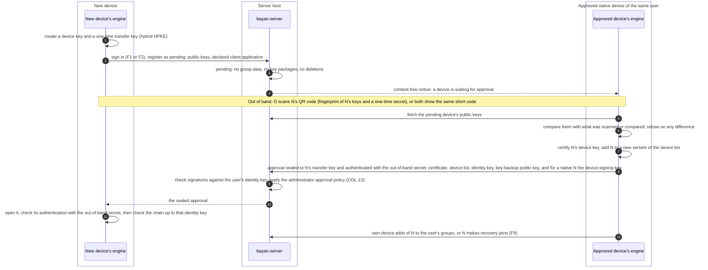

| # | STRIDE | Element | Threat | Mitigation | Remaining risk |
|---|---|---|---|---|---|
| F3.1 | S | P5, E1 | The server registers its own pending device and the user approves it (T24) | Approval always compares the new device's keys out of band, by QR code or short code; a bare "Approve?" button is never offered (ADR-0029) | A user who approves without comparing, or who scans a code shown by someone else's device, approves the wrong device |
| F3.2 | S | P5 | The server hands the new device its own identity key and key-backup key, so that the device trusts the server's identity and seals its snapshot keys to the server | The approval is authenticated with the out-of-band secret, and the new device accepts its user's identity key and key-backup key only from it (HPKE alone would not do: anyone can seal to a public key) | — |
| F3.3 | S | P4, P5 | A sign-in attacker (F1.1) registers a pending device (T27) | Pending devices are powerless; the user's devices show each request with its client application and time; pending requests expire after 24 hours; administrators can require their approval too | — |
| F3.4 | T | DF1 | The server changes the certificate, the device list or the sealed approval | Signatures by the device-signing key; the approval's authentication; the new device checks the chain | The server can withhold them (availability) |
| F3.5 | I | DF1, D1 | The device-signing key leaks in transit or at rest, or is recorded for decryption later (T22) | Sealed with HPKE using the hybrid post-quantum KEM to the new device's one-time key; wrapped at rest with a keychain key (SEC-11); kept only on native devices | — |
| F3.6 | E | P5 | A device of one account certifies a device for another account | Certificates name the account; chains must end at that account's identity key; the validator and every client check | — |
| F3.7 | S | P5 | A stale device list makes a revoked device look valid (T30) | Device lists carry versions; clients refuse an older version than one they have seen; removing a device from groups is done with MLS commits (F11), which do not depend on the list | The server can delay a newer list from reaching clients that have not seen it |
| F3.8 | R | D5 | Nobody can tell which device approved which | The device list records the approving device and the time; audit log | — |
| F3.9 | D | P5 | Flooding a user's devices with approval requests | Rate limits per account; requests expire | — |
| F3.10 | E | P5 | The administrator's restriction of client applications (COL-13) is relied on as a security control | Documented as a policy for well-behaved software only; authorization never depends on the client software (SEC-13) | — |
| F3.11 | I | D2 | Device names and declared client applications reveal the user's device inventory | Device names are end-to-end encrypted in the user's settings; the server stores only the declared client application and coarse dates (§9.1) | The declared client application is visible to the server |
| F3.12 | E | D1 | A stolen native device holds the device-signing key and certifies more devices, or signs device lists that undo its revocation (T39) | After a loss, rotate the device-signing key (F11), which needs the recovery kit or passkey unlock; every device alarms on changes attributed to itself that it did not make (§5.2); members accept new devices only if the latest list names them | The window between the theft and the rotation |
| F3.13 | E | DF8 | Web code that a hostile server serves once takes the keys of a browser device (T11) | The browser device holds no device-signing key, so it cannot certify devices or sign lists, and revoking it from another device ends its access | Until it is revoked, a stolen browser device's keys read what that device can read, including later shares to its user (§12) |

### 6.4 F4: Sharing, role changes, removal and leaving

*Phase 3.* To share, an owner's client looks the recipient up (by exact email address or account ID), checks the recipient's identity against its pin, claims one key package per recipient device, and sends one commit that adds the devices and gives the recipient a role in the roster. The validator checks it (ADR-0016, amendment 2026-10-07, design detail 3) and relays it; the new devices receive a Welcome, fetch the ratchet tree from the server and join in one storage transaction. An editor's client then sends them a snapshot (F8). A role change is an owner's commit with a new roster; a removal is an owner's commit that removes every device of the user and their roster entry. To leave, a user sends an authenticated leave request inside the group from one of their devices, which also tells the server to stop delivering to all of the user's devices, and an owner's client commits the removal; the last owner must first make another member an owner (ADR-0030). Sharing with someone who has no account yet records a pending share inside the document and sends an invitation (F2).

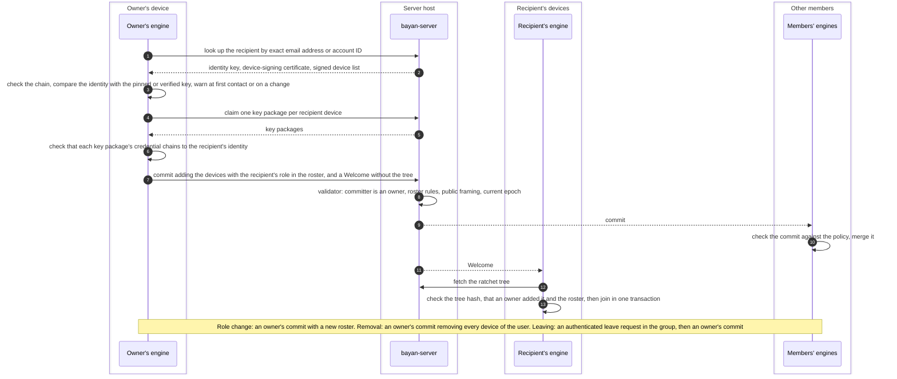

| # | STRIDE | Element | Threat | Mitigation | Remaining risk |
|---|---|---|---|---|---|
| F4.1 | S | P5 | Ghost user: the server answers the lookup with an identity it controls, and then reads what is shared with it (T23) | Pinned identities (TOFU) with a blocking warning on any change; safety numbers and QR codes; a visible "verified" mark | At first contact without verification the server can impersonate the recipient and read what is shared; key transparency is to be evaluated at the Phase-3 gate (§13.3) |
| F4.2 | S | P5 | The server hands out a key package of a device it controls | Key packages are signed by device keys whose certificates must chain to the recipient's identity; the owner's client checks | Only a ghost user (F4.1) gets past |
| F4.3 | E | P7 | A non-owner adds another user, changes roles, or adds an external sender | Refused by the validator and by every client (ADR-0016 design detail 3; tested in SRV-002) | — |
| F4.4 | E | P7 | The server grants a role or adds a member by itself | Impossible without an owner's signature on a commit; every client checks every commit and Welcome | — |
| F4.5 | T | P6 | The server tampers with the ratchet tree given to a newcomer | The newcomer checks the tree against the hash in the signed group information of the Welcome; the join is one transaction, so a bad tree cannot use up the key package (ADR-0016 requirement 1) | The server can keep sending bad trees (availability) |
| F4.6 | D | P6 | The server withholds the Welcome or the commit | The owner sees no join and no snapshot request; retry | Availability |
| F4.7 | I | D2, D3 | The server learns the social graph: who shares with whom, with which role, and when; it reads every commit, which is in public framing (T9) | Unavoidable for role enforcement (ADR-0016 Decision 9); listed in §9 | Residual |
| F4.8 | D | P5 | Someone claims all of a user's key packages so that nobody can add them (T34) | Only approved devices may claim; limits per claimer and per target; key packages expire; devices top up | A determined member can delay additions |
| F4.9 | I | P5 | The lookup is used to find out which email addresses have accounts (T38) | Exact-match lookups only, by approved devices, with rate limits; optionally limited to the organization; no listing or prefix search | Someone who already knows an address can test it |
| F4.10 | E | P2 | A removed member keeps reading | MLS removal moves the group to keys the removed devices do not have; the server stops delivering to them; later snapshots use new keys (tested in SRV-002) | What they already held stays with them (v0 residual) |
| F4.11 | D | P7 | A user cannot leave without an owner, because a member cannot commit its own removal (RFC 9420 §12.2) and standalone proposals are refused | Authenticated leave request, server stops delivery at once, an owner's client commits the removal; the standard self-removal proposal is evaluated once its specification is final (ADR-0030) | Until an owner acts, the leaving device's leaf stays in the tree |
| F4.12 | R | E2 | An owner denies having shared or removed someone | Commits are signed and visible to every member; the log keeps them for its retention period | — |
| F4.13 | E | P7 | The last owner is removed or demoted | Refused: every commit must leave at least one owner (design detail 3) | — |
| F4.14 | D | P7 | The only owner disappears for good, so membership can never change again (T29) | Recovery joins give a returning owner their access back (F9); clients suggest a second owner | If the owner and their recovery kit are both gone, membership stays frozen; content is not lost |
| F4.15 | I | E7 | A pending share's invitation email tells the email provider who shares with whom | Content-free invitations; no document names (F14) | Residual |

### 6.5 F5: End-to-end encrypted link sharing

*Phase 3; design detail for ADR-0016 Decision 8, decided in Phase 3.* An owner's client creates a random link key, a link signing key pair and a random link ID, and keeps the link key and the private signing key in that owner's own encrypted settings (§5.2), not in the document's group. It wraps the latest snapshot key for the link and signs the wrapped key, and stores both on the server under the link ID. The URL carries the link ID in its path; its fragment (after `#`), which browsers never send to servers, carries the link key and the public signing key. The owner's devices wrap and sign each new snapshot for the link as they make snapshots. A recipient's app reads the fragment, removes it from the address bar, fetches the wrapped key and the snapshot by link ID, checks the signature, and shows the document read-only.

Link readers are not MLS members, which is also how very large read-only audiences are served (ADR-0016, amendment 2026-10-07, design detail 5). Because only the creating owner's devices hold the link's keys, no other member, link reader or server can show link readers forged content. The cost is that the link's view advances only when that owner's devices make snapshots, and stops when that owner leaves the document. This document recommends that links stay read-only in Phase 3.

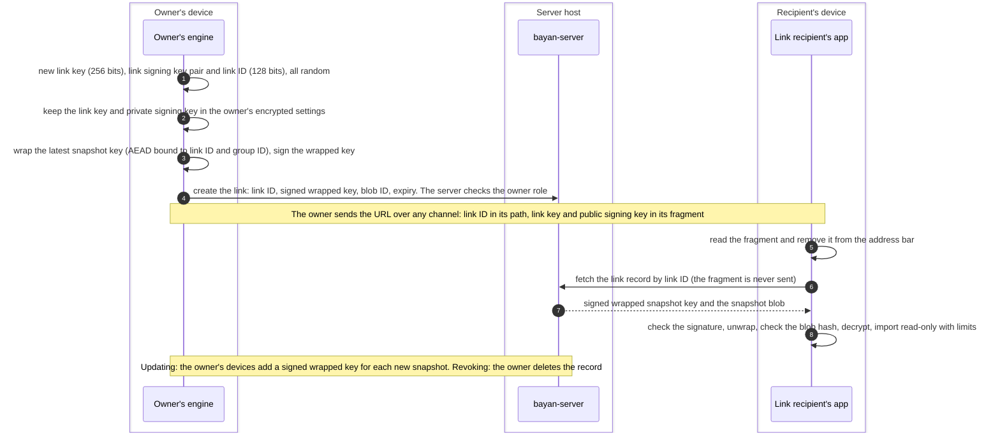

| # | STRIDE | Element | Threat | Mitigation | Remaining risk |
|---|---|---|---|---|---|
| F5.1 | I | E6 | The URL leaks: forwarded, kept in history or bookmarks, shown in screenshots or chat previews (T31) | A link is a bearer secret by design: expiry, revocation, read-only; the app removes the fragment from the address bar as soon as it opens | Whoever sees the URL can read until revocation |
| F5.2 | I | DF8 | A hostile server serves web code that sends it the fragment (T11, T31) | The desktop app can open links; reproducible web builds (T11) | Residual for links opened in a browser |
| F5.3 | S | P8 | Guessing link IDs | 128-bit random IDs; rate limits per address; the same answer for unknown and revoked links; the ID alone gives only ciphertext | — |
| F5.4 | T | P8 | The server swaps the snapshot blob | The signed wrapped key carries the blob's hash; AEAD binds the blob to the group and snapshot | — |
| F5.5 | T | P8 | The server serves an older wrapped key, showing a stale document | Signed wrapped keys carry the snapshot's creation time, shown to the reader | Readers cannot prove they see the newest state |
| F5.6 | E | P8 | A link grants more than reading | Read-only in Phase 3; editing needs an account and membership | — |
| F5.7 | E | P8 | A non-owner creates or updates a link | The server accepts link records only from owners' devices, and updates only from the creating owner's devices; readers accept only what the link's signing key signed | — |
| F5.8 | I | P8, D8 | The server learns when a link is used and from which address | No per-access records on the server (§9.1); operators keep proxy logs minimal (§4.6 IE3) | The server sees each fetch as it happens |
| F5.9 | E | P8 | Revocation does not undo access already obtained | Documented; the server deletes wrapped keys at once; nothing new is wrapped for a revoked link | Readers keep what they already fetched |
| F5.10 | D | P8 | A popular or abused link floods the server | Rate limits per link and per address; download bandwidth limits | — |
| F5.11 | T | E2, P8 | Another member, a link reader or the server shows link readers forged content | Only the creating owner's devices hold the link key and the private signing key; readers check the signature with the public key from the fragment | The owner who created the link can show readers anything, as an owner could edit the document anyway |
| F5.12 | D | P2 | A crafted snapshot crashes or exhausts the reader (T8) | Isolated import with time and memory budgets, as for any untrusted CRDT input (ADR-0008) | — |
| F5.13 | I | E6 | Password-protected links would invite weak passwords that the server could guess offline | Not offered: they need a password-hashing function, which MLS's providers do not include, and so an ADR (ADR-0016 Decision 12) | — |
| F5.14 | D | P2 | The link's view stops advancing when its owner's devices make no snapshots or the owner leaves | Clients warn owners about links they created before they leave; another owner can create a new link | Link views can be stale (§12) |

### 6.6 F6: Synchronizing while online

*Phase 3 (SRV-103 relay, SRV-104 protocol).* Each device keeps one WebSocket connection to the server. The connection is authenticated by the session and by the device key's signature on a challenge (§5.3). Edits become CRDT updates, which the engine batches, encrypts as MLS application messages (private framing, so even the sender is hidden inside) and hands to the shell as opaque frames. The server checks what it can without keys and fans the message out; receivers decrypt and check the sender's role themselves. Commits take the path of §7. Presence (cursors and selections, COL-02) travels as MLS messages marked ephemeral, which the server relays but never stores.

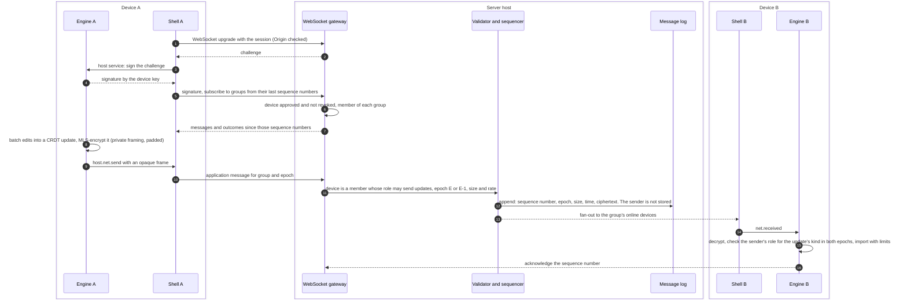

| # | STRIDE | Element | Threat | Mitigation | Remaining risk |
|---|---|---|---|---|---|
| F6.1 | S | P6 | A stolen session token is used to connect as a device (T32) | The device key's signature on a fresh challenge (§5.3) | — |
| F6.2 | S | P6 | Cross-site WebSocket hijacking: another site opens a connection that carries the user's cookie | The gateway checks `Origin` against the server's own; `SameSite=Strict`; the device signature | — |
| F6.3 | E | P6, P2 | A viewer or a non-member sends updates (T7) | The server refuses them using the roster and the authenticated device; clients refuse them too | — |
| F6.4 | E | P2 | A commenter sends edits | The server cannot tell edits from comments (§7.4); every client refuses them after decrypting | Clients spend effort decrypting and discarding them; rate limits bound it |
| F6.5 | T | P6 | The server drops, delays, reorders or replays messages | MLS authenticates every message; CRDT updates commute and importing one twice changes nothing; MLS refuses replays; sequence numbers and acknowledgements reveal gaps | Withholding is possible (availability) |
| F6.6 | T | P6 | The server forks the group, delivering different commits to different members (T26) | Members end up in different epochs and stop seeing each other's edits and presence; an optional group code (from MLS's epoch authenticator) that members can compare; repair by an owner's move (F13), after which CRDT merges both sides' edits | Members notice only indirectly unless they compare codes |
| F6.7 | I | P6, D3 | The server learns who edits which document, when, how much, and the rhythm of typing (T9) | The sender is checked and then forgotten, not stored; updates are batched and MLS padding hides exact sizes (both configurable); §9.2 | Timing and volume per device stay visible |
| F6.8 | D | P6 | Flooding: large or many messages, many subscriptions, fan-out in large groups | Size limits per message kind (at most the 16 MiB of SRV-002's limit, lower for updates); rate limits per device and per group; quotas; bounded queues with backpressure; connection limits per account and address | A member can still consume their share |
| F6.9 | D | P2 | A crafted CRDT update crashes or exhausts the receiving engine (T8) | Import isolated with time and memory budgets, and the engine restarted if it aborts (ADR-0008, amendment 2026-10-08); fuzzed import | — |
| F6.10 | R | E2 | A member denies an edit | MLS application messages are signed by the sender's device key, which other members verify after decrypting | Members can also prove authorship to others: there is no deniability (§12) |
| F6.11 | I | P6 | Presence reveals what someone is looking at | Presence is MLS-encrypted; the server sees only that ephemeral messages flow, and stores none | Their rate shows activity |
| F6.12 | E | P7, P2 | A writer demoted by the last commit sends late updates from the previous epoch | The server and clients check the role in both epochs (SRV-002) | — |
| F6.13 | D | P6 | A slow client makes the server buffer without limit | Bounded per-connection queues; slow clients are disconnected and catch up from the log | — |
| F6.14 | S | P6 | The server attributes a message to the wrong device | For commits the validator checks that the signer is the authenticated device; for updates, clients learn the real sender from the decrypted, signed content | — |

### 6.7 F7: Synchronizing after being offline

*Phase 3 (SRV-104).* While offline, a client keeps its edits as CRDT updates in an encrypted local queue. It does not keep MLS ciphertext, because members keep keys for at most one past epoch (ADR-0016, amendment 2026-10-07, requirement 3) and would not be able to read updates encrypted many epochs ago. When it reconnects, it fetches everything since its last sequence numbers, processes commits in order, and only then encrypts and sends its queued updates in the current epoch.

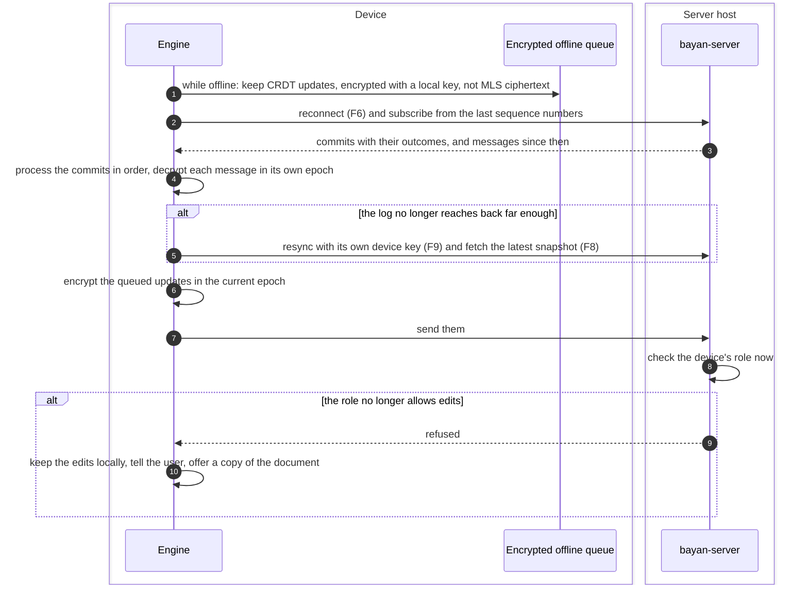

| # | STRIDE | Element | Threat | Mitigation | Remaining risk |
|---|---|---|---|---|---|
| F7.1 | I | D1 | The queue or cache is read on a lost, locked device or by another local user | Encrypted at rest under a key protected by the OS keychain on desktop, or by a non-extractable WebCrypto key on the web (SEC-11) | An unlocked device is out of scope |
| F7.2 | D | P2 | Updates encrypted long ago can no longer be read by anyone | The queue holds CRDT updates; MLS encryption happens when they are sent | — |
| F7.3 | E | P7, P2 | Edits made offline by a user who was demoted or removed in the meantime | The server and clients refuse them; the user is told and keeps a local copy (COL-03: nobody else's work is overwritten) | The user's offline edits do not reach the shared document |
| F7.4 | T | P6 | The server withholds part of the log | Sequence numbers reveal gaps; CRDT version vectors reveal missing updates; the client asks again | Availability |
| F7.5 | D | D3 | The log was pruned before the device came back (§9.1 retention) | Resync with the device's own key and the latest snapshot (ADR-0029) | Without resyncs, owners must re-add the device |
| F7.6 | I | D1 | A device that stays offline keeps old epoch secrets until it catches up | At most one past epoch is kept; secrets are encrypted at rest; they are deleted as the device processes commits | — |
| F7.7 | S | P6 | A device revoked while it was offline reconnects | The server refuses the connection; its queued edits are not accepted; the user's other devices have removed it from the groups (F11) | — |
| F7.8 | T | P6 | The server presents an older state of a group to a returning device | The device knows its own last epoch and never goes back | Availability |

### 6.8 F8: Snapshots and new members

*Phase 3; the construction is ADR-0016's amendment of 2026-10-07, design detail 2, tested in SRV-002.* MLS's forward secrecy means a device that joins cannot read anything sent before. An editor's client therefore encrypts a snapshot of the current document under a fresh key and uploads it as an opaque blob, then sends the key, the snapshot's ID and the blob's hash inside the group. Every member's device that receives a snapshot key seals it to its own account's key backup (F9), so that each user can recover their documents. A recovery restores only the latest snapshot, so editors' clients also make snapshots at a regular cadence, not only for newcomers.

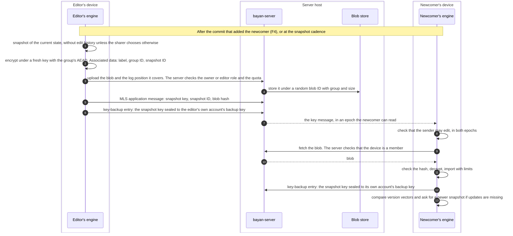

| # | STRIDE | Element | Threat | Mitigation | Remaining risk |
|---|---|---|---|---|---|
| F8.1 | T | P8, D4 | The server swaps or changes the blob | The hash inside the MLS-authenticated key message, and the AEAD with its associated data (SRV-002 `tampered_or_swapped_blobs_are_refused`) | — |
| F8.2 | E | P2, P8 | A commenter or viewer shares a snapshot key, or uploads blobs | Clients refuse the key message (SRV-002 `only_members_who_may_edit_can_share_snapshots`); the server refuses blob uploads from roles below editor | — |
| F8.3 | I | P2 | A snapshot carries edit history the sharer did not mean to share (T10) | Snapshots hold the current state only, unless the sharer chooses to include history; "inspect document" removes history | — |
| F8.4 | I | D4 | Removed members keep the keys of older snapshots | They could read those snapshots before; later snapshots use new keys sent only to current members (SRV-002 `removed_members_get_no_later_snapshot_keys`); the server deletes superseded snapshots and serves blobs only to current members | Old snapshot keys stay valid for blobs someone kept |
| F8.5 | D | P6, P8 | The server withholds the blob or the key message | The newcomer sees nothing to read and asks again; any other editor can send a fresh snapshot | Availability |
| F8.6 | D | P2 | A crafted snapshot crashes or exhausts the newcomer (T8) | Isolated import with time and memory budgets | — |
| F8.7 | T | E2 | A stale snapshot leaves out updates sent before the newcomer joined | Version vectors show what is missing; the newcomer asks for a newer snapshot | — |
| F8.8 | I | D4 | Snapshot sizes and times reveal the document's size and growth (T9) | Optional padding of blobs to size classes | Residual |
| F8.9 | D | D4 | Snapshot uploads fill the storage | Quotas per account and per group; only the latest few snapshots are kept | — |
| F8.10 | R | E2 | Who shared a snapshot is disputed | Key messages are signed by the sender's device | — |
| F8.11 | I | D2 | Key-backup entries | Sealed with HPKE using the hybrid post-quantum KEM to the account's key-backup key; the server learns only that an entry exists for a group (T22) | Whoever holds the recovery kit opens them (F9.14) |

### 6.9 F9: Recovery with the recovery kit

*Phase 3; ADR-0029.* When an account is created, its first device makes the recovery secret, shows it as the recovery kit (words and a QR code to print or save), checks that the user saved it, seals the identity key, the device-signing key and the key-backup key into the secret store on the server, and erases the secret. After losing every device, the user signs in on a new device, enters the recovery kit, and gets their identity back.

The new device then rejoins each group where the user still has a role, without anyone's help:

- **Recovery join.** An MLS external commit that adds the new device and removes no one. The new device then removes the user's lost devices with ordinary own-device removals. OpenMLS 0.9.0 can build an external commit that removes only a leaf with the joiner's own signature key, so a new device cannot remove another device in the same commit.
- **Resync.** A device that kept its own key, because it fell behind the log's retention (F7) or could not follow a commit (§7.2), rejoins with an external commit that replaces its own old leaf, as RFC 9420 §12.4.3.2 describes and OpenMLS supports.

Without recovery joins, a user who lost every device could rejoin only if an owner re-added them, and a document whose only owner lost every device could never change its members again (T29). Because a recovery may run on a device or in a browser the user does not fully trust, it ends with a new recovery kit and a new key-backup key (§5.1).

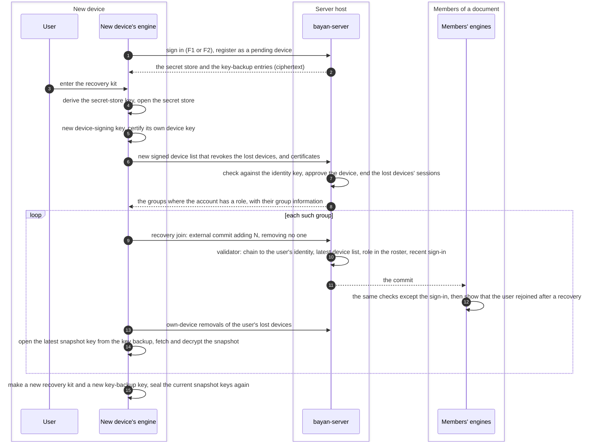

| # | STRIDE | Element | Threat | Mitigation | Remaining risk |
|---|---|---|---|---|---|
| F9.1 | S | E1, P5 | Someone with the recovery kit and a sign-in takes over the identity and rejoins every group (T28) | The kit is the root of the account and stays offline with the user; recovery also needs a recent sign-in, which the server checks; recovery joins are visible to every member and to the user's remaining devices, which alert; audit log | Whoever has both owns the account |
| F9.2 | I | D2 | The server tries to open the secret store by guessing | The recovery secret is 256 random bits, never a passphrase; the store is sealed with a 256-bit AEAD key | — |
| F9.3 | I | D2 | Harvest now, decrypt later on the key backup (T22) | Sealed with HPKE using the hybrid post-quantum KEM | — |
| F9.4 | D | E1 | The user loses every device and the recovery kit (T29) | Clear guidance to keep the kit; optional passkey unlock (F10); owners can share documents again with the user's new identity | The identity and documents nobody else holds are lost |
| F9.5 | D | P7 | The only owner of a document loses every device (T29) | Recovery joins restore the owner's devices without anyone's help | If the kit is lost too, the membership stays frozen; the content is not lost |
| F9.6 | E | P7 | A stolen device, or someone holding the identity key, uses a recovery join or resync to get back into groups after being removed (T39) | The joining device must be in the latest signed device list; the user's own remaining devices, which know every revocation, refuse it as witnesses (§7.2); joins are shown to everyone; owners can remove; the device-signing key is rotated after a loss | A server that withholds the newer device list from other members' view when the user has no other device (T30) |
| F9.7 | T | D2 | The server changes the secret store or backup entries | AEAD and HPKE authenticate them; a changed store does not open | Availability |
| F9.8 | D | P7 | The server, or a member, publishes group information with a wrong external key, so joins fail | Witnesses check the group information against the epoch they derived (§7.2); any member can publish a fresh copy | Availability |
| F9.9 | R | D5 | A recovery is denied or goes unnoticed | Audit log; members and the user's devices see recovery joins | — |
| F9.10 | D | P7 | A recovery join by a non-owner waits for a witness (§7.2) | Witnessing runs in the background on any member device that connects; meanwhile the key backup already gives the user the latest snapshot to read | Quiet groups wait longer; after 72 hours without a witness the join is dropped and retried |
| F9.11 | I | E1 | The kit is seen on screen or found on paper | Never sent to the server, never stored on a device; guidance on keeping it | — |
| F9.12 | S | E1, DF8 | Phishing for the kit: a fake prompt, or a hostile server's web code (T11) | The kit is entered only in the app, best the desktop app; BayanDocs never asks for it by email; a new kit after every recovery | Residual in the browser |
| F9.13 | D | P2 | The pinned OpenMLS cannot remove another device in the same external commit | Join first, then own-device removals; until they are done the lost devices keep their leaves, which the server already blocks | A short window in which lost devices remain members |
| F9.14 | I | D2 | A hostile operator who once obtains the kit, for example from web code during a recovery in a browser, opens the secret store and the latest snapshot of every document from its own stored data, without signing in, and keeps reading later snapshots | A new kit and a new key-backup key after every recovery and any suspected exposure; a new identity key if the operator may have kept an older secret store (§5.1) | Until the user makes the new kit (T28) |

### 6.10 F10: Passkey unlock (PRF)

*Phase 3, opt-in; ADR-0029 and ADR-0016 Decision 7.* The WebAuthn PRF extension lets an authenticator compute a secret from a passkey and a fixed input. With passkey unlock switched on, the client uses that secret to wrap a copy of the recovery secret and stores the wrapped copy on the server. On a new device, signing in with the passkey then also unlocks the account, instead of typing the recovery kit. Switching it on needs the recovery kit once, because no device keeps the recovery secret.

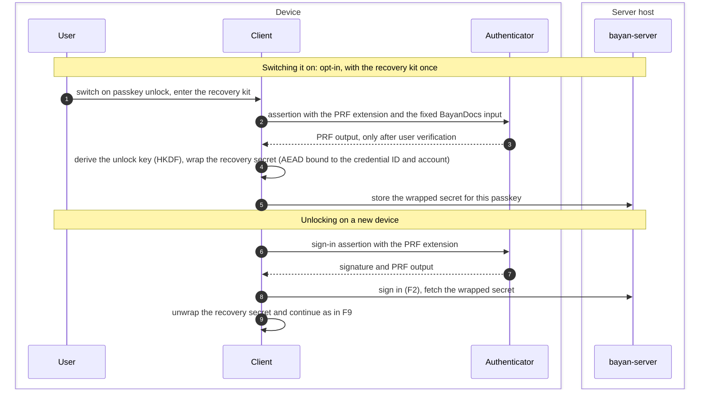

| # | STRIDE | Element | Threat | Mitigation | Remaining risk |
|---|---|---|---|---|---|
| F10.1 | S | E4 | One factor now gives everything: whoever can use the passkey, also through a compromised passkey sync account, gets the sign-in and the keys (T28) | Opt-in, with an explanation; administrators can switch it off for their organization; the recovery kit remains | Residual for users who switch it on |
| F10.2 | I | DF7, DF8 | In a browser, the PRF output and the recovery secret pass through code the server serves (T11) | The desktop app uses the platform's passkey interface directly where the platform allows it for the server's domain (on Apple's platforms only for associated domains, F2) | Residual in the web app, and on desktop platforms that need the browser for a self-hosted domain |
| F10.3 | I | D2 | The wrapped secret is stored on the server | Wrapped with an AEAD key derived from a 256-bit PRF output; useless without the passkey | — |
| F10.4 | S | DF7 | Another site asks the authenticator for the PRF output | Passkeys are bound to the server's domain; PRF outputs differ per domain and input | — |
| F10.5 | D | E4 | The authenticator or platform has no PRF | The recovery kit, which is always available (ADR-0016 Decision 7) | — |
| F10.6 | E | P4 | The server pretends PRF is unavailable | Affects only the convenience | — |
| F10.7 | R | D5 | Use of passkey unlock is denied or goes unnoticed | Audit log; the user's devices are told | — |
| F10.8 | T | D2 | The server swaps wrapped secrets between passkeys or accounts | The AEAD binds the credential ID and the account | — |
| F10.9 | I | E4 | A passkey or its sync account is compromised; the wrap holds the recovery secret itself, so the exposure lasts | Remove the passkey and its wrap, then respond as to an exposed kit: a new kit, a new key-backup key and device-signing key, and a new identity key if a hostile party may hold an older secret store (§5.1) | Until the user responds |

### 6.11 F11: Losing a device, and revocation

*Phase 3; ADR-0029.* From any of their remaining devices, the user marks a device as lost. The server ends the lost device's sessions at once; the user's devices then remove it from every group with MLS commits, which is what takes its keys away for good. If the lost device was a native device, it held the device-signing key, so the user rotates that key with the recovery kit or passkey unlock, and the lost device can no longer certify devices. Existing places of the remaining devices in groups stay valid, because a chain is checked against the latest device list (§5.2).

```mermaid
sequenceDiagram
  autonumber
  box Remaining device of the user
    participant D2 as Remaining device's engine
  end
  box Server host
    participant S as bayan-server
  end
  box Lost device
    participant D1 as Lost device
  end
  box Members
    participant M as Members' engines
  end
  D2->>S: new signed device list revoking D1
  S->>S: check the signature, end D1's sessions, refuse its connections, delete its key packages
  S--x D1: connections closed
  loop each group D1 is in
    D2->>S: commit removing D1 (own-device removal, §7)
    S-->>M: the commit
    M->>M: check it and merge it, D1 has no keys for the new epoch
  end
  opt D1 was a native device that held the device-signing key
    D2->>D2: recovery kit or passkey unlock, new device-signing key certified by the identity key
    D2->>S: new device list signed with the new key, listing the remaining devices
  end
  Note over D2,M: Without any remaining device: recovery (F9), whose recovery joins and removals replace the lost devices
```

| # | STRIDE | Element | Threat | Mitigation | Remaining risk |
|---|---|---|---|---|---|
| F11.1 | I | D1 | The thief reads what is stored on the device | Locked: encrypted at rest (SEC-11). Unlocked: out of scope | — |
| F11.2 | E | P6 | The thief keeps synchronizing until the user notices | Revocation from any device or the web app ends the sessions at once; the MLS removals follow, after which post-compromise security holds | The time until the user notices |
| F11.3 | E | D1 | The thief certifies new devices with the device-signing key, or signs a device list that undoes the revocation (T39) | Rotation of the device-signing key; members accept a new device only if the latest list, signed by the current key, names it; the user's devices alarm on changes attributed to them that they did not make (§5.2) | Until the rotation |
| F11.4 | T | P6 | A malicious server keeps serving the revoked device | The MLS removal commits, not the server's block, remove access cryptographically; members see them | A server that withholds the removal commits causes a stall the user notices |
| F11.5 | D | P7 | Removals by a user who is not an owner wait for a witness (§7.2) | The server's block is immediate in the meantime | — |
| F11.6 | S | P5 | A sign-in attacker or a hostile server revokes the user's devices | Revocations must be signed by the device-signing key; ending other devices' sessions needs an approved device (§5.3) | A hostile server can always refuse service |
| F11.7 | R | D5 | Disputed revocations | The device list records them; audit log | — |
| F11.8 | D | P7 | The lost device was the only owner's only device (T29) | Recovery joins (F9) | See F9.5 |
| F11.9 | D | P7 | Rotating the device-signing key breaks the remaining devices' places in groups | A certificate made by an earlier device-signing key stays valid for a device the latest list names (§5.2); devices replace it with their next self-update | — |

### 6.12 F12: Accepting a commit that only members can check

*Phase 3 (SRV-103 and `bayan-mls`). Direction chosen by the owner (ADR-0016, amendment 2026-10-07, requirement 6); details in ADR-0030 and §7.2.* The server's validator cannot check the parts of a commit that are keyed with the epoch's secrets: its membership and confirmation tags, and the path secrets it encrypts to the other members (SRV-002 report §5). Each member decrypts only the path secret meant for its own part of the group. A committer can therefore send a commit that the server accepts and that every other member refuses. It can also make a commit work for some members, for example the owners or whoever is online, and fail for the rest. With two-phase acceptance, a commit from a member who is not an owner takes effect only once a device of another account confirms that it can process it and no such device refuses it; nobody merges it before.

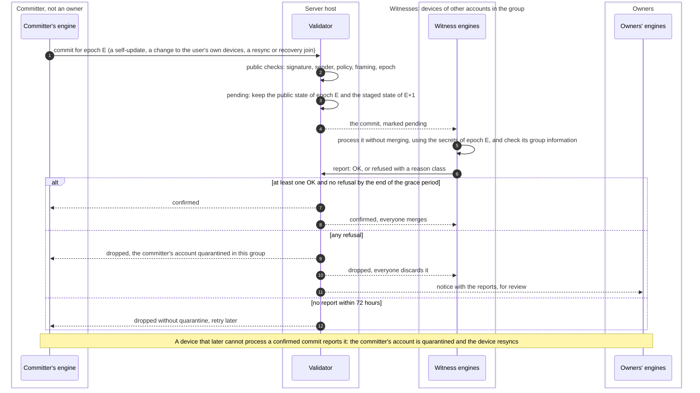

| # | STRIDE | Element | Threat | Mitigation | Remaining risk |
|---|---|---|---|---|---|
| F12.1 | D | P7 | A member stalls the group with a commit only members can check (T25) | Two-phase acceptance: the commit is dropped as soon as one witness refuses it, and the committer's account is quarantined in the group (ADR-0030) | — |
| F12.2 | D | E2 | Selective encryption: the commit works for some members (owners, or whoever is online) and fails for others | Any refusal drops the commit, and an owner's OK carries no special weight; if only members who were offline got bad secrets, they report the confirmed commit as stuck, the committer's account is quarantined afterwards, and they resync (§7.2) | Members who were offline must resync once |
| F12.3 | D | E2 | A lying witness refuses honest commits, or reports confirmed ones as stuck | The honest committer's account is quarantined until an owner, who sees every report, lifts it and can remove the liar; owners' commits are not affected by reports | A liar can delay the commits of members who are not owners until an owner acts (FM12) |
| F12.4 | D | P7 | No witness is online | Background witnessing by any member device that connects; after 72 hours without any report the commit is dropped without quarantine and the committer retries | Members who are not owners cannot change keys or devices in a group nobody else visits |
| F12.5 | E | P7 | A removed user refuses their own removal to block it | Only accounts that remain in the group are witnesses; owners' commits, which remove other users, take one phase | — |
| F12.6 | T | P7 | The server lies about the outcome | A member that could not process a commit cannot merge it whatever the server says; the server can only stall, as it always could | Availability |
| F12.7 | S | P6 | Reports from devices that are not witnesses | Only reports from authenticated devices of witness accounts count; for resyncs and recovery joins, the joining account's other devices may also refuse, but their OK does not count | — |
| F12.8 | R | D5 | Which device refused which commit is disputed | Content-free records of reports, kept for owners until the commit is decided and 30 days after | — |
| F12.9 | D | P7 | Server state grows with pending commits | One pending commit per group; it costs one more copy of the public state (up to 1.34 MiB at 1,000 members with the hybrid suite, SRV-002). OpenMLS's public group cannot be copied, so the server keeps the pending commit staged and stages it again after a restart | — |
| F12.10 | I | P6 | Reports reveal which members are online and active | The server sees connections anyway (§9.2) | Residual |
| F12.11 | E | P5 | A quarantined member enrolls a new device to start again | Quarantine applies to the account in the group, covering all its devices and its recovery joins | — |

### 6.13 F13: Moving a document to a new group

*Phase 3; ADR-0016, amendment 2026-10-07, design detail 4.* An owner moves a document to a new group to change its ciphersuite (until OpenMLS implements MLS's re-initialization) or, as the last resort after a stall, to leave out the users who caused it (requirement 6). The owner announces the move in the old group with an update that only owners may send, and every member checks the new group against the announcement before switching.

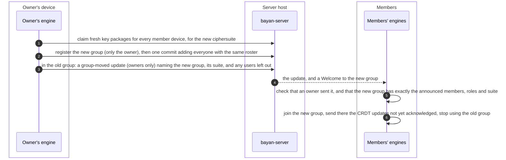

| # | STRIDE | Element | Threat | Mitigation | Remaining risk |
|---|---|---|---|---|---|
| F13.1 | S | P2 | A fake move announcement | Only owners may send the group-moved kind; MLS authenticates the sender; members compare the new group with the announcement | — |
| F13.2 | E | P2 | A move used to add or drop members unnoticed | Members compare the new group with the old roster and the announcement; any users left out must be listed and are shown | — |
| F13.3 | D | P6 | The server refuses to register the new group or withholds Welcomes | Availability | Residual |
| F13.4 | I | D2 | The server links the old and the new group | Expected; metadata (§9) | Residual |
| F13.5 | D | P6 | Size and cost of moving a large group (2.58 MiB commit for 1,000 members with the hybrid suite, SRV-002) | Rate limits and size limits that allow it; the move is rare | — |
| F13.6 | T | P2 | Edits made during the move are lost | Members resend unacknowledged CRDT updates in the new group, where they merge | — |

### 6.14 F14: Notifications without content (COL-10)

*Phase 3.* The server can tell a user that something happened (a document was shared with them, a device is waiting for approval, a security event) but never what a document says or what it is called: it does not know. Notices go to the user's devices over the sync connection; email is optional, switched on by the operator and the user. Push services of browser and phone vendors are not used, because they are third-party network calls at runtime, which the project's rules exclude ([AGENTS.md §6](../AGENTS.md#6-security-and-privacy)).

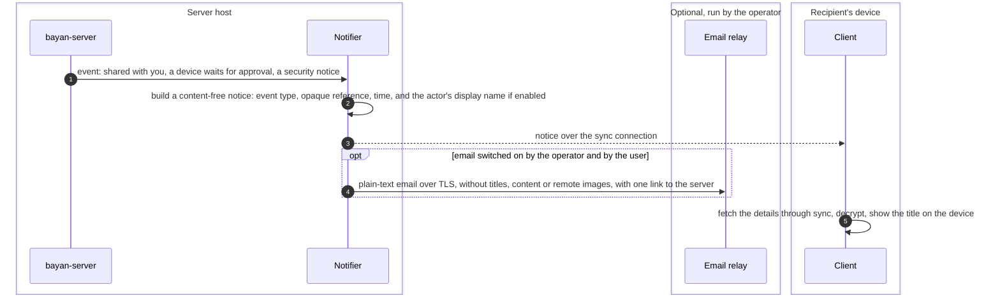

| # | STRIDE | Element | Threat | Mitigation | Remaining risk |
|---|---|---|---|---|---|
| F14.1 | I | P9 | Content or titles in notifications | The server has neither; notices hold only an event type, a time, an opaque reference and optionally a display name; clients never send titles to the server | — |
| F14.2 | I | E7 | The email provider learns who works with whom (T37) | Email is opt-in; display names in email are optional; TLS to the relay (§4.6 IE9) | Residual for users who choose email |
| F14.3 | S | E7 | Phishing: look-alike emails, or attacker-chosen display names in real ones | Plain text; display names escaped and shortened; no document names; one fixed link to the server's own address; the app says that BayanDocs never asks for the recovery kit by email | Users can still be fooled by imitations |
| F14.4 | D | P9 | Notification floods, for example by sharing many documents | Rate limits per sender and per recipient; muting | — |
| F14.5 | I | P9 | Push services would learn timing and identifiers | Not used by default; any push channel needs an ADR | — |
| F14.6 | I | P9 | Mentions in comments reveal who mentioned whom | Mentions travel only inside the encrypted group; at most an opt-in, generic "new activity" notice | — |
| F14.7 | R | D2 | Delivery is disputed | Delivery records, kept 7 days after delivery (§9.1) | — |
| F14.8 | S | P9 | A fake in-app "device waiting" notice lures the user into approving a device | Approval requires comparing keys out of band (F3) | — |

### 6.15 F15: Compliance escrow member

*Phase 4 (E4-ENTERPRISE); ADR-0016 Decision 10. The design and its abuse cases are in §8.* An organization's policy adds a passive escrow member, whose key the organization keeps offline, to the documents its accounts own. Every member sees it.

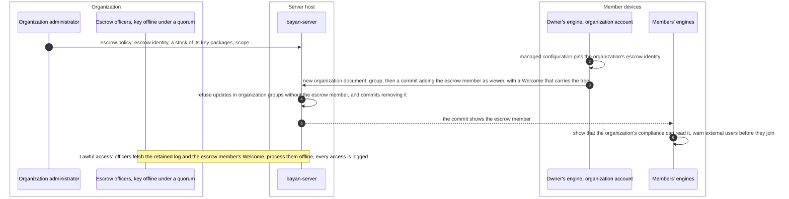

| # | STRIDE | Element | Threat | Mitigation | Remaining risk |
|---|---|---|---|---|---|
| F15.1 | E | P7 | The server or an administrator adds escrow to groups silently | Adding is an owner's commit that every member sees; clients add escrow only when their organization's managed configuration says so (EA1 in §8.2) | An organization that controls its employees' clients controls this |
| F15.2 | I | E8 | The organization reads more than its policy allows | Passive member with an offline key under a quorum of officers; audit of every access (§8.2) | Collusion of the quorum |
| F15.3 | S | P5 | The server substitutes its own key for the escrow member's | The escrow identity is pinned through the organization's managed configuration, not taken from the server alone | Unmanaged clients rely on TOFU |
| F15.4 | E | E8 | The escrow member writes | Viewer role; clients refuse anything it sends | — |
| F15.5 | D | E2 | Members remove the escrow member to evade the policy | The server refuses such commits; owners' clients refuse to make them | Members can still copy content: escrow is not data-loss prevention |
| F15.6 | I | D3 | Retaining logs for escrow contradicts minimization | A separate retention period for escrowed groups, stated in the policy shown to members | Residual by policy |

### 6.16 F16: Delivering and starting the web app

*Phase 1 (WEB-101, WEB-103) and every phase after; ADR-0014 and its amendment of 2026-10-12.* The web app is code the server sends to the browser every time it is loaded. Everything the app protects therefore depends on that code (T11). The app's own checks cover what browsers allow (strict CSP, Trusted Types, Subresource Integrity enforced with `Integrity-Policy`, and a check of the engine's files against hashes built into the app), with one gap that WEB-002 found: the browser does not bind the worker's own requests to the bytes the app checked ([bayan-web issue 8](https://github.com/BayanDocs/bayan-web/issues/8)).

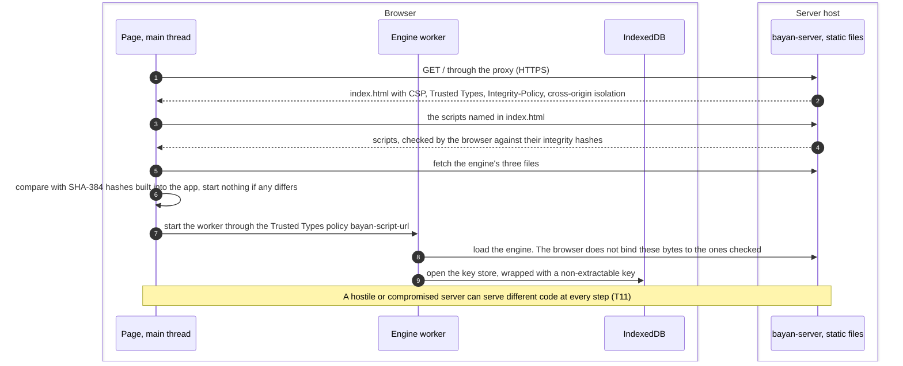

| # | STRIDE | Element | Threat | Mitigation | Remaining risk |
|---|---|---|---|---|---|
| F16.1 | T | DF8 | A hostile or compromised server serves modified code that steals keys (T11) | The desktop app as the high-assurance client; browser devices hold no device-signing key (F3.13); reproducible web builds with published hashes; web code transparency (such as WAICT) once browsers ship it; self-hosting removes trust in third parties | Residual for web users, and for what is shared with accounts that use the web app, until their browser devices are revoked |
| F16.2 | T | DF1 | Code changed on the network | TLS 1.3; HSTS at the proxy | — |
| F16.3 | E | P1 | Script injection into the page | Strict CSP without inline scripts, Trusted Types, no `dangerouslySetInnerHTML` (SEC-10, ADR-0014) | — |
| F16.4 | T | DF8 | The worker's files are swapped after the app checked them | Closing the gap is tracked in bayan-web issue 8; it must be closed before collaboration runs in browsers (§13.3) | Residual until then |
| F16.5 | I | P1 | Key material reaches the page's main thread, where more code runs | Keys stay in the worker; the protocol never sends key material to the page (§13.3) | — |
| F16.6 | T | P1 | A malicious service worker of the installable app (WEB-103) persists after the server is fixed | It is registered through the same single Trusted Types policy; it is updated like any script and checked against the build's hashes | Residual while web code transparency is missing |
| F16.7 | I | P1 | Third-party origins at runtime | None (ADR-0014 Decision 9) | — |
| F16.8 | S | E5 | An operator runs a modified web app | The "Source code" link to the exact source running (OPS-08) lets users and auditors compare | Users rarely check |
| F16.9 | D | P1 | Poisoned caches or content delivery networks | No CDN; `Cache-Control` rules; integrity hashes | — |

### 6.17 F17: Administration, backups and restores

*Phase 1 (SRV-101 admin bootstrap, SRV-105 operations) and Phase 3 (admin console, OPS-06).* Administrators manage accounts, quotas and policies through the admin console; operators run the command line inside the container and make and restore backups. None of them can read documents or add devices or members: those need keys that only users' devices hold.

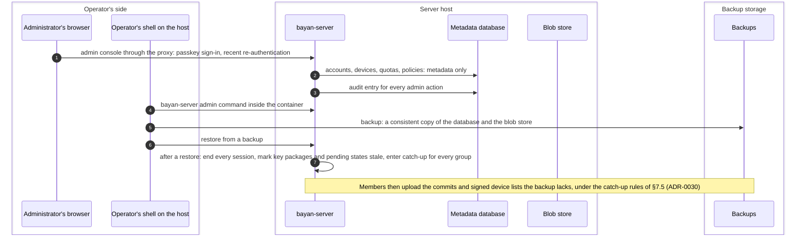

| # | STRIDE | Element | Threat | Mitigation | Remaining risk |
|---|---|---|---|---|---|
| F17.1 | S | P10 | An administrator account is taken over | Passkey-only administrator sign-in; re-authentication; audit; actions that affect users are shown to them (T27) | — |
| F17.2 | E | P10 | An administrator reads documents | Impossible: the server has no keys (ADR-0015 Decision 6) | — |
| F17.3 | E | P10 | An administrator adds a device to a user or a member to a group | Impossible: certificates come only from the user's devices, membership only from owners' commits | The administrator approval gate (COL-13) can only block |
| F17.4 | D | P10 | An administrator deletes data or disables accounts | Audit log; backups; users notified | Residual: operators control availability |
| F17.5 | I | D7 | Backups are stolen | They hold the metadata of §9 and ciphertext; secret stores and backup entries stay sealed; encrypted backups and restricted access recommended | Metadata exposure |
| F17.6 | T | D7 | A restore rolls group state back, brings back sessions revoked after the backup, and offers key packages already used (T33) | After a restore the server ends every session, asks devices for new key packages, and lets members catch it up under the rules of §7.5 (ADR-0030) | Until members reconnect, groups changed since the backup wait |
| F17.7 | R | D5 | An administrator denies an action | Audit log, which the server only appends to; operators export it regularly | An operator with database access can edit it |
| F17.8 | I | P10 | The console shows more metadata than needed, for example who shares with whom | Console views show counts and sizes; anything more is a deliberate, audited support action | — |
| F17.9 | I | D6 | The first administrator's bootstrap token appears in the log stream | The command line prints it to the operator's terminal only, never to the logs; the server keeps only its hash, until it is used | — |
| F17.10 | E | E5 | Command-line access means access to the host | The operator's responsibility; documented in the deployment guide | — |

## 7. Role enforcement: design details and failure modes

Roles are enforced twice: by the server, so that what it refuses never reaches anyone, and by every client, so that a misbehaving server cannot give anyone more than their role (ADR-0016 Decision 5). §7.1 lists who checks what; §7.2 gives the details of two-phase acceptance; §7.3 lists what happens when the server and the clients disagree; §7.4 confirms that the server is not told whether an update is an edit or a comment; §7.5 says how groups catch up after a server restore.

### 7.1 Who enforces what

| Rule | Server (validator) | Clients | Source |
|---|---|---|---|
| Only commits change a group; standalone proposals and unused proposal types are refused | Yes | Yes | ADR-0016, amendment 2026-10-07, design detail 3 (below: "design detail 3") |
| Only owners add or remove other users' devices, change roles, or change anything in the group context | Yes | Yes | Design detail 3 |
| A user's devices may add and remove each other | Yes | Yes | Design detail 3 |
| A resync replaces the joining device's own earlier place, with the same device key | Yes | Yes | ADR-0029 |
| A recovery join adds an approved device of a user who has a role and removes no one; the user's lost devices are removed afterwards by own-device removals | Yes, and it requires a recent sign-in | Yes, except the sign-in, which only the server can see | ADR-0029 |
| After every commit: one role per user with a device, none for anyone else, at least one owner | Yes | Yes | Design detail 3 |
| The group context holds exactly the roster and its required capabilities (no external senders); the required credential type is the one ADR-0029 chooses instead of basic credentials | Yes | Yes | Design detail 3, changed by ADR-0029 |
| Every credential chains to its account's identity key and names a device that the latest device list lists as current | Yes, against the directory | Yes, against pinned identities | ADR-0029 |
| A commit is signed by the device whose connection sent it (except when catching up after a restore, §7.5) | Yes | Yes, by its signature | SRV-002 |
| Updates come only from devices whose user is an owner, editor or commenter | Yes, from the connection | Yes, from the decrypted, signed sender | Design detail 3 |
| Edits need owner or editor; comments commenter or above; snapshot keys editor or above; group moves owner | No: the kind is encrypted (§7.4) | Yes | Design detail 3 |
| Late updates are judged by the roles of both epochs | Yes | Yes | Design detail 3 |
| Commits by users who are not owners take effect only after a witness confirms them and none refuses them | Yes | Yes: nobody merges before | ADR-0030 |
| Blob uploads need owner or editor; blob downloads need a current member device or a valid link | Yes | Clients check hashes and keys | This document |
| Only owners create links, and only the creating owner's devices update them | Yes | Link readers check the link's signature | This document (F5) |
| Organization groups keep their escrow member (Phase 4) | Yes | Yes, and show it | §8 |
| Server and clients use the same version of the policy | Yes, refuses unknown versions | Yes, refuses unknown versions | ADR-0030 |

### 7.2 Two-phase acceptance

The owner chose this direction on 2026-10-09 (ADR-0016, amendment 2026-10-07, requirement 6): the server keeps the previous epoch's public state until a device of another user confirms the new epoch, and otherwise drops the commit and quarantines its sender. The rules below are the details SRV-003 was asked for, decided in [ADR-0030](../adr/0030-commit-acceptance-and-group-repair.md). They depart from the chosen direction in three points, which the owner accepted explicitly on 2026-10-17:

1. **Owners' commits take effect at once.** The direction covers every commit; ADR-0030 applies two phases only to commits by members who are not owners. Owners can already remove anyone. Two phases for owners would let one lying member drop every owner's commit except its own removal, which it cannot witness, stopping shares and role changes until an owner removed it; every share would wait until another member's device comes online; and nobody could witness the first share of a document that only its owner belongs to.
2. **A commit that nobody checks within 72 hours is dropped without quarantine.** The direction says "otherwise drops the commit and quarantines its sender"; a time-out is not evidence of misbehavior, so ADR-0030 drops such a commit but does not punish its sender, who retries.
3. **Quarantine covers the sender's account in that group, not one device,** so that a quarantined member cannot start again with a new device.

```mermaid
stateDiagram-v2
  [*] --> Pending: valid commit by a member who is not an owner
  Pending --> Confirmed: OK from a witness and no refusal within the grace period
  Pending --> Dropped: a refusal from any witness, sender's account quarantined
  Pending --> Expired: no report within 72 hours
  Pending --> Superseded: an owner commits for the same epoch
  Confirmed --> [*]
  Dropped --> [*]
  Expired --> [*]
  Superseded --> [*]
```

1. **Which commits.** A commit takes two phases when the committer's account is not an owner in the epoch before it: self-updates, changes to the committer's own devices, and resyncs and recovery joins by users who are not owners. Owners' commits and group registrations take effect at once, as today.
2. **Pending.** The validator checks the commit exactly as the SRV-002 validator does. If it passes and no other commit is pending in the group, it becomes the group's pending commit. The server keeps the commit staged next to the current state; OpenMLS's public group cannot be copied (see the spike's `validator.rs`), so the server keeps the pending commit in the database and stages it again after a restart. It relays the commit marked as pending and holds any Welcome it carries until the commit is confirmed. While a commit is pending, the server accepts updates for the current and the previous epoch as today, but none for the pending epoch. It refuses other commits by users who are not owners, asking them to retry. It accepts an owner's commit for the current epoch, which drops the pending commit as *superseded*, without quarantine.
3. **Witnesses and reports.** A witness is a device of an account other than the committer's that is a member both before and after the commit. For resyncs and recovery joins, the joining account's own other devices, which know every revocation, may also refuse, but their OK does not count. Every witness device that receives the pending commit processes it without merging it, checks the group information the committer published with it, and reports either OK or a refusal with a reason class:
   - `tag`: a membership or confirmation tag is wrong;
   - `path`: its path secret does not decrypt or does not fit;
   - `group-info`: the published group information does not match the epoch it derived;
   - `policy`: its own policy check refuses what the validator accepted;
   - `credential`: a chain or a revocation is wrong;
   - `malformed`.

   Reports travel over the device's authenticated connection. The server keeps the first report of each device and counts accounts, not devices. Devices witness the pending commits of all their groups in the background when they connect, not only those of documents that are open.
4. **Decision.** The first report starts a grace period, 10 seconds by default. At its end, the commit is *confirmed* if at least one witness account reported OK and none refused. A single refusal *drops* it: a commit made honestly can be processed by every member, so a refusal means either a bad commit or a lying witness, and the second is the smaller harm. An owner's report counts like anyone else's, because a committer can make a commit work for the owners' devices alone. If no witness reports at all within 72 hours, the commit *expires*: it is dropped without quarantine and its committer may retry.
5. **Outcomes.** *Confirmed:* the new epoch becomes current, the old one is kept as the previous epoch, held Welcomes are delivered, and every device merges the commit (the committer merges its pending commit). *Dropped or expired:* the server discards the new state and every device discards the commit (the committer clears its pending commit). After a drop, the committer's **account** is *quarantined* in the group: the server refuses commits by any of its devices, including resyncs and recovery joins, but not its updates, until an owner lifts the quarantine or removes the account. Owners are told about every drop, quarantine and stuck report, with the reasons, without content.
6. **After confirmation.** A witness device that cannot process a commit that was confirmed while it was offline reports it as stuck, with a reason class. A stuck report with reason `tag`, `path` or `group-info` quarantines the committer's account, because the commit was bad for some members, and owners are told. The stuck device resyncs with its own device key, using group information that a member who processed the epoch published, or an owner's client re-adds it.
7. **The committer meanwhile.** The committer keeps sending updates in the current epoch while its commit is pending: OpenMLS 0.9.0 lets a member create application messages while its own commit is pending, as long as the commit's proposals are carried inline, as this design's always are (checked in its source, `MlsGroup::create_message`).

| Parameter | Proposed default (SRV-103 measures and may change it) | Why |
|---|---|---|
| Grace period | 10 seconds | Lets a refusal from another online witness arrive before the server confirms |
| Expiry without any report | 72 hours | Frees the group's single pending slot; the committer retries |
| Pending commits per group | 1 | Bounds the server's state: one more copy of the public state, at most 1.34 MiB at 1,000 members with the hybrid suite (SRV-002) |
| Report records | Until decided, then 30 days | Owners can review who refused what |
| Quarantine | Until an owner lifts it or removes the account | Stops a member who sent a bad commit from trying again |

**What it costs.** A commit by a user who is not an owner takes effect one round trip to another user's online device plus the grace period later; owners' commits are not delayed. Witnessing a commit costs a device what processing it costs: in the worst case measured by SRV-002, a first self-update after many members were added at once, about 42 ms natively and 100 ms in Chromium at 1,000 members with the hybrid suite.

**What it does not solve.** A server can still withhold or delay anything (availability). An owner's commit, which takes one phase, that members cannot process stalls the group; that needs a compromised or broken owner device, and another owner's move (F13) repairs it. A lying witness can drop honest commits of members who are not owners, or report them as stuck after confirmation, and so get their accounts quarantined until an owner acts (FM12). In a group that no other member visits, members who are not owners cannot change their keys or devices until someone does. A commit that works for every member who happens to be online, and fails for those who are offline, is confirmed; the members it fails for resync, and its sender is quarantined afterwards.

### 7.3 When the server and the clients disagree

| # | Disagreement | Typical cause | What happens | How it is noticed | Repair |
|---|---|---|---|---|---|
| FM1 | The server accepts a commit that members cannot process (tags, path secrets, group information) | A malicious or broken member (T25) | Two-phase acceptance drops it at the first refusal; the committer's account is quarantined | Witness reports | Automatic; an owner lifts the quarantine or removes the account |
| FM2 | The server accepts a commit that clients' policy refuses | A validator bug, different policy versions, a compromised server | Clients refuse it and report `policy`. A commit by a user who is not an owner is dropped; an owner's commit leaves members behind | A `policy` refusal is logged as a security event | Fix the server; the owner commits again; policy versions (ADR-0030) prevent version mismatches |
| FM3 | The server refuses a commit clients would accept | A validator bug, an outdated server, a hostile server | The committer cannot change the group | The committer sees the reason class | Fix or upgrade the server; nothing to repair in the group |
| FM4 | The server relays updates that clients refuse (a viewer's update, a commenter's edit) | A misbehaving member, a server bug | Clients discard them | Clients count discarded updates and may report the count, without content | An owner removes the member |
| FM5 | The server refuses updates that clients would accept | A bug, a hostile server | Edits stay queued on the device | The user sees that edits are not delivered | Fix the server |
| FM6 | The server delivers different commits to different members (a fork) | A hostile server (T26) | Members continue in separate epochs and stop seeing each other's edits | Collaborators' edits and presence vanish; optional group codes differ | An owner's move (F13); CRDT merges both sides' edits afterwards |
| FM7 | The server withholds commits or messages from some members | A hostile server, a bug | Those members fall behind | Sequence numbers and missing acknowledgements | Fetch again; past the log's retention, a resync |
| FM8 | The server is behind its members | A restore from a backup (T33) | The server refuses members' commits as being for the wrong epoch | Epoch mismatch errors | Catch-up (§7.5) |
| FM9 | The server's device lists are older or newer than a client's | A withheld list, a restore | The server may accept a revoked device or refuse a valid one | Clients compare list versions | Clients upload the newest signed list they have |
| FM10 | An epoch is confirmed that some members cannot process | A commit that worked only for the members who were online, or a bug | Those devices are stuck | Their stuck report; the committer's account is quarantined | The stuck devices resync, or an owner re-adds them |
| FM11 | The server's roster differs from the clients' | Not possible while both follow the same commits; otherwise it is FM2 or FM8 | — | — | — |
| FM12 | An honest commit is dropped, or its committer quarantined after confirmation, because a lying witness refused it or reported it as stuck | A malicious member | That account's commits are refused | Owners see every refusal and stuck report | An owner lifts the quarantine and may remove the liar |
| FM13 | The state the validator's MLS library reaches after a commit differs from the state its policy approved | A bug in the validator or the library | The server quarantines the whole group and accepts nothing more for it (the safety net of the SRV-002 validator) | The group stops; owners are told | Fix the server; an owner's move if needed |

### 7.4 The kind of an update stays encrypted

ADR-0016's amendment of 2026-10-07 (design detail 3) records the owner's decision of 2026-10-09 that the server is not told whether an update is an edit or a comment, and asked SRV-003 to confirm it. **Confirmed; no change.** MLS lets a sender attach authenticated data that the server can read; putting the kind there would let the server also refuse a commenter's edits, but:

1. Security does not depend on it: every client refuses a commenter's edits after decrypting them (SRV-002 `clients_reject_updates_whose_sender_lacks_the_role`), and the server already refuses viewers.
2. It would tell the server which updates are comments, and with sizes and timing, how much each person comments and when (T9), contrary to ADR-0016 Decision 9.
3. It would let a hostile server suppress comments selectively, which it cannot do now without suppressing everything.
4. A commenter who floods the group with edits only costs others some decryption; the server's per-device rate limits and quotas bound that (F6.4).

One distinction stays visible, because the server must know what to store: whether a message is ephemeral (presence, relayed and never stored) or durable. Snapshot-key messages, group-moved notices and link notices are durable updates like any other and look the same to the server.

### 7.5 Catching up after a restore

A server restored from a backup is behind every group that changed since the backup (FM8). Members still hold those commits, so they bring the server up to date (ADR-0030):

1. After a restore the server ends every session, marks stored key packages and pending commits as stale, and puts every group in *catch-up*.
2. Member devices upload the commits they merged after the server's restored epoch, oldest first. Each is checked against the public state and the policy as usual, with two differences: its signature, not the uploading connection, shows who made it, and it is not witnessed again, because its members already merged it.
3. A commit is accepted only if a device of another account uploads it, or an owner's device does, or the group has only one account. A member therefore cannot slip in its own commit that was dropped before the restore.
4. If devices upload different commits for the same epoch, the server stops catching up that group and tells its owners; the chain an owner's device uploads decides, and members on the other branch resync.
5. Devices also upload their newest signed device lists, which the server accepts when they are newer and correctly signed, and replace their key packages. Lost updates and snapshots are sent again from members' CRDT state through the normal sync protocol (SRV-104).
6. Reports and quarantines recorded after the backup are lost. A quarantined account can then commit again; if it sends another bad commit, witnesses drop it and its account is quarantined again. Owners, who were told of the first quarantine, can remove the account.

## 8. Compliance escrow member

*Phase 4 (E4-ENTERPRISE in [plan/05](../plan/05-work-breakdown.md)); ADR-0016 Decision 10.* This section is the design recommendation for the Phase-4 work package and the abuse cases it must handle. The flow is F15.

### 8.1 Design

1. **A member, not a back door.** The escrow member is an ordinary MLS member: one device of a dedicated escrow account of the organization, with the role viewer, certified like any device (§5.2). Everything about it is visible in the group: it can be added only by a commit and every member's client shows it.
2. **Passive, with an offline key.** The escrow device never commits and never sends. Its private keys stay offline, in a hardware security module whose own quorum feature requires several officers (k of n) to approve each use; splitting the key in software instead would need secret sharing, which MLS's providers do not include and which would need its own ADR (ADR-0016 Decision 12). The organization uploads a stock of the escrow member's key packages, made offline in advance. A member must process every commit in order to read later epochs, so lawful access means fetching the group's retained log and the escrow member's Welcome and processing them offline, from the escrow member's join onwards. The escrow member's Welcome therefore carries the ratchet tree, and the server keeps it, with the log, for the escrow retention period. No online service ever decrypts.
3. **Scope.** The policy covers only groups whose owners are accounts of the organization. Clients add the escrow member only when the organization's managed configuration says so, and they pin the organization's escrow identity from that configuration rather than from the server alone. The server enforces presence: it refuses updates in a group of the organization until the escrow member is in it, and refuses commits that remove it.
4. **Visibility to outsiders.** Before a user from outside the organization joins an escrowed document, their client tells them that the organization can read it, and they can refuse.
5. **Retention.** Escrow needs the log kept, which contradicts minimization (§9). Escrowed groups therefore have a retention period of their own, stated in the policy and shown to members.
6. **Zero knowledge stays.** The server never holds the escrow key (ADR-0015 Decision 6).
7. **Alternative for Phase 4 to weigh.** Editors could instead seal each snapshot key to an escrow public key, without an escrow member: the escrow then sees only snapshots and the log need not be kept, but neither the server nor members could check that a modified client really does it. The member design is checkable by everyone, which is why this section recommends it.

### 8.2 Abuse cases

| # | Abuse | By whom | Effect | Mitigation | Remaining risk |
|---|---|---|---|---|---|
| EA1 | Escrow added to groups outside the policy, unnoticed | Server operator, organization administrator | Reads documents | Adding is an owner's commit shown to every member; clients add escrow only from the organization's managed configuration | An organization that manages its employees' clients can push such a configuration |
| EA2 | Escrow on documents of people outside the organization | Organization administrator | Reads outsiders' content | Only groups owned by the organization's accounts; outsiders are warned before joining and can refuse | Outsiders who ignore the warning |
| EA3 | The escrow key is used without due process | Escrow officers | Reads documents | The hardware module's quorum (k of n), an offline key, every access logged; notice to members afterwards where the law allows | Collusion of k officers |
| EA4 | The escrow key is stolen | External attacker | Every escrowed document retained so far is exposed | Offline hardware storage; periodic rotation (a new escrow member replaces the old one); minimal retention | Ciphertext retained until the theft |
| EA5 | A fake escrow identity | Server operator | The server could read organization documents | The escrow identity is pinned through the organization's managed configuration; administrators compare its safety number | Unmanaged clients rely on TOFU (T23) |
| EA6 | Members remove escrow to evade the policy | Member | Policy breach | The server refuses such commits; owners' clients refuse to make them | Members can always copy content: escrow is not data-loss prevention |
| EA7 | The escrow member sends content | Anyone holding its key | Forged edits or comments | Viewer role: clients refuse its updates; it never commits | — |
| EA8 | Escrow used for real-time surveillance | Organization | Continuous reading | Passive design: no online decryption; access only by processing the retained log; access frequency audited | An organization could run the key online anyway; a matter of policy and law |
| EA9 | Logs kept indefinitely | Organization, operator | More exposure to future key theft and to harvest now, decrypt later | Retention stated in the policy; the hybrid suite; deletion after the period | — |
| EA10 | The escrow member never updates its keys, so its leaf has no post-compromise security | Design | A stolen escrow key reads until the member is replaced | Periodic replacement of the escrow member | The window until replacement |

## 9. Metadata inventory

This is the field-by-field list that v0 §6 item 2 asked for: what the server stores (§9.1), what it sees without storing (§9.2), and what that lets an operator learn (§9.3). Retention periods are proposed defaults that SRV-102 and SRV-105 make configurable; "operator" means whoever runs the server. SRV-102's schema must contain nothing that is not listed here (§13.1).

### 9.1 What the server stores

**Accounts** (SRV-101, SRV-102)

| Field | Why it is needed | Who can read it | Retention |
|---|---|---|---|
| Account ID (random, 128 bits) | Key of every other record; appears in credentials and rosters | Server, administrators, members of the account's groups | Account's lifetime, then 30 days |
| Display name | Shown to people who look the user up and in documents' member lists | Anyone who looks the user up; members; administrators | Account's lifetime; the user can change it |
| Email address | Invitations, exact-match look-up by collaborators, optional email notices | Administrators; look-ups only confirm a match | Account's lifetime |
| Identity provider: issuer and subject | Finding the account at sign-in (F1.2) | Server, administrators | While the link exists |
| Status, created, disabled (dates) | Administration | Administrators | Account's lifetime |
| Server administrator flag | Admin console | Administrators | Account's lifetime |
| Quota and usage counters | Storage limits (T13) | Administrators, the user | Account's lifetime |
| Notification preferences: email notices on or off, muted groups | F14 | The user | Account's lifetime |
| Organization and policies (Phase 4) | Escrow, device approval, client restrictions (COL-13) | Organization administrators | Account's lifetime |
| Last sign-in (day only) | Handling inactive accounts | Administrators, the user | Overwritten |

**Sign-in**

| Field | Why it is needed | Who can read it | Retention |
|---|---|---|---|
| Passkey credential ID, public key, signature counter, transports | WebAuthn sign-in (F2) | Server, the user | Until the passkey is removed |
| Passkey label chosen by the user, created and last used (day) | Lets the user manage passkeys | The user, administrators | Until removed |
| Wrapped recovery secret per passkey (opt-in) | Passkey unlock (F10) | Server, as ciphertext | Until switched off or the passkey is removed |
| Pending OIDC sign-ins: state, nonce, PKCE verifier, return path, the pre-sign-in cookie's identifier | F1 | Server | 10 minutes, or until used |
| Pending desktop sign-ins: loopback address, PKCE challenge, one-time code | F1 | Server | 10 minutes; the code 60 seconds, single use |
| WebAuthn challenges | F2 | Server | 5 minutes, or until used |
| First administrator's bootstrap token, as a hash | Admin bootstrap (F17) | Server | Until used, at most 24 hours |
| *Not stored:* attestation statements, authenticator model (AAGUID) | — | — | — |

**Sessions**

| Field | Why it is needed | Who can read it | Retention |
|---|---|---|---|
| Hash of the session token, account ID, device ID | Authentication | Server | Until expiry or sign-out, then deleted |
| Created, last used (coarse), expires, sign-in method | Expiry, the user's session list | Server, the user | Same |
| *Not stored:* IP address, user agent | — | — | — |

**Devices**

| Field | Why it is needed | Who can read it | Retention |
|---|---|---|---|
| Device ID (random), account ID | Identifies the device's records | Server, the user, administrators | Until the device is removed, then 90 days |
| Device certificate and public keys | Checking chains; authorizing connections (§5.2, §5.3) | Server, members of the device's groups, the user | Same |
| Declared client application and version | COL-13: users see it, administrators may restrict it | The user, administrators | Same |
| Approval state, approving device, administrator approval, dates | COL-13; audit | The user, administrators | Same |
| Pending approval: the new device's transfer key, and the sealed approval waiting to be collected (ciphertext) | F3 | Server; the approval only as ciphertext | Until collected, at most 24 hours |
| Revoked at, reason class | Revocation (F11) | The user, administrators | 90 days after revocation |
| Last activity (day) | COL-13 shows it | The user, administrators | Overwritten |
| *Not stored in clear:* device names (encrypted in the user's settings) | — | — | — |

**Directory and recovery data** (Phase 3)

| Field | Why it is needed | Who can read it | Retention |
|---|---|---|---|
| Identity public key, device-signing certificate | Others verify the user's devices (§5.2) | Approved devices that look the user up | Current, and the previous ones for 90 days |
| Signed device list with its version | Others check which devices are current | Same | Current version; earlier versions 90 days |
| Secret store (ciphertext) and its version | Recovery (F9) | Server, as ciphertext; the account's devices | Current version only; older versions are deleted when replaced |
| Key-backup entries: group ID, snapshot ID, sealed snapshot key, created | Recovering documents (F8, F9) | Server, as ciphertext; the account's devices | Latest entry per group; deleted when the user leaves the group |

**Key packages** (SRV-103)

| Field | Why it is needed | Who can read it | Retention |
|---|---|---|---|
| Device ID, ciphersuite, key package (public keys, credential, lifetime), uploaded | Adding the device to groups | Server; approved devices that claim it | Until claimed or expired |
| Claim counters per claimer and target, in memory | Rate limits (T34) | Server | Minutes |
| *Not stored:* who claimed whose key package, beyond the counters | — | — | — |

**Groups and their public state** (SRV-103)

| Field | Why it is needed | Who can read it | Retention |
|---|---|---|---|
| Group ID (random, chosen by its creator), ciphersuite, epoch | Routing and validation | Server, members | Group's lifetime |
| Ratchet tree: every member device's credential and public keys | Validation; newcomers fetch it (ADR-0016 design detail 1) | Server, members, devices being added | Current epoch, and the previous one while needed |
| Group context: roster (account IDs and roles), required capabilities, policy version | Role enforcement | Server, members | Group's lifetime |
| Group information with the external public key, signed by a member | Resyncs and recovery joins (F9) | Server; devices of accounts in the roster | Current epoch only |
| Pending commit, reports, quarantined accounts, catch-up state (§7.2, §7.5) | Two-phase acceptance and catch-up | Server; owners see reports and quarantines | Until decided, then 30 days; quarantine until lifted |
| Created, last commit (dates) | Retention, operations | Server, administrators | Group's lifetime |

A user's document index and settings are groups like any other, with one account; the server sees only that (§5.2).

**Message log and delivery** (SRV-103, SRV-104)

| Field | Why it is needed | Who can read it | Retention |
|---|---|---|---|
| Group ID, sequence number, kind (commit, update, outcome), epoch, size, received at | Ordering, catch-up, retention | Server | As the payload |
| Commit payloads, in public framing: who committed, which devices were added or removed with their credentials, every roster and role change | Delivery, catch-up, validation | **Readable by the server**; members | Until every current member device has acknowledged them, at most 90 days; devices behind that resync |
| Update payloads, in private framing (ciphertext) | Delivery and catch-up | Server, as ciphertext; members | Until a later snapshot covers them, at least 7 days and at most 90 days |
| Outcome records of two-phase acceptance | Devices that were offline learn whether to merge | Server, members | As the commit they decide |
| Last acknowledged sequence number, per device and group | Catch-up; deciding when commits can be deleted | Server | While the device is a member |
| Stop-delivery flags of leave requests, per device and group | Leaving (F4) | Server | Until the removal commit |
| Welcome (ciphertext), its target device | Joining | Server, the target device | Until acknowledged, at most 30 days; an escrow member's Welcome for the escrow retention period (§8) |
| *Not stored:* which device sent an update; presence messages | — | — | — |

**Blobs** (SRV-102)

| Field | Why it is needed | Who can read it | Retention |
|---|---|---|---|
| Blob ID (random), group ID, size, created, kind (snapshot or other) | Storage, quotas, retention of superseded snapshots | Server | Until members delete it, a newer snapshot supersedes it, or the group is deleted |
| For snapshots: the log position the snapshot covers, as its uploader states it | Deciding when updates may be deleted | Server | As the blob |
| Payload (ciphertext), in the blob store | Snapshots, media, original packages | Server, as ciphertext; members | Same |
| *Not stored:* who uploaded it (usage counters are updated instead), a content hash (no deduplication across groups, which would reveal equal content) | — | — | — |

**Links** (Phase 3)

| Field | Why it is needed | Who can read it | Retention |
|---|---|---|---|
| Link ID (random, 128 bits), group ID, created by (account ID), created, expires, revoked | Link sharing (F5) | Server; owners of the group | Until expiry or revocation, then 7 days |
| Signed wrapped snapshot keys (ciphertext), and the blob IDs of those snapshots | Link reading; which blobs the link may fetch | Anyone with the link ID, as ciphertext; the server for the blob IDs | Deleted at revocation or expiry |
| *Not stored:* who opened a link, when, from where | — | — | — |

**Invitations, notifications, audit**

| Field | Why it is needed | Who can read it | Retention |
|---|---|---|---|
| Invitation: token hash, invited email address, inviting account, kind, created, expires, used | Closed registration (OPS-09), pending shares | Server, administrators, the inviter | Until used or expired, then 30 days |
| Notification: recipient, event type, opaque reference, created, delivered | In-app and email notices (F14) | Server, the recipient | Until delivered, then 7 days |
| Security audit log: event type, account ID, device ID, time, outcome; optionally a truncated IP address if the operator turns it on | Investigating incidents; the user's own account history | Administrators; the user for their own events | 90 days |

Audit events: sign-ins and failures; sessions created and ended; passkeys added and removed; devices registered, approved and revoked; recoveries and passkey unlocks; administrator actions and policy changes; quarantines and stuck reports; restores. The audit log is stored data with a retention period, not part of the operational log, which must never contain account identifiers ([AGENTS.md §6](../AGENTS.md#6-security-and-privacy)).

**Operations**

| Field | Why it is needed | Who can read it | Retention |
|---|---|---|---|
| Operational log lines: request ID, method, route template, status, duration (SRV-001, in place) | Operations | Operator | The operator's log system; 14 days recommended |
| Metrics with labels of low cardinality: route template, status class, message kind | Operations (OPS-03) | Operator | Operator's choice |
| Rate-limit counters per address, account, device and group, in memory | Abuse prevention (T13) | Server | Minutes |
| Backups: copies of everything above and of the blob store | Recovery from disasters | Operator | Operator's policy; encrypted, 30 days recommended |
| *Not in logs or metric labels:* account, device, group, blob or link IDs; IP addresses; paths; query strings; bodies; header values; tokens (tested by bayan-server's `tests/logging_*.rs`) | — | — | — |

**Outside the server, under the operator's control:** the reverse proxy's access logs (client IP address, time, method, path, which may contain link IDs and blob IDs, status, size, user agent), the object store's request logs, the email relay's logs, and the organization's identity provider's logs. The deployment guide (SRV-105) should recommend switching the proxy's access logs off or logging without paths and addresses (§4.6 IE3), and the API should carry group and blob IDs in request bodies or WebSocket frames rather than paths where it can.

### 9.2 What the server sees without storing it

- IP addresses and ports, through the proxy's forwarded headers, and user agents: where and with what people connect.
- When each device is connected, and which groups it subscribes to.
- For every update: which device sent it, how large it is and when, which reveals who edits which document, when, how much, and the rhythm of typing.
- The rate of ephemeral (presence) messages: who is looking at a document right now.
- Snapshot and media sizes: each document's size and growth and how many images it holds.
- Key-package claims: who is about to share with whom, before the commit.
- Link fetches: when a link is used and from which address.
- Look-ups: which email addresses someone looks up.

### 9.3 What this lets an operator learn

From §9.1 and §9.2 together, an operator can learn the social graph (who shares with whom, with which role, from the readable commits), activity (who works on which document when, and how much), the documents' sizes and growth, each user's devices and client applications, approximate locations from IP addresses, the organization's structure, and typing rhythms that may identify a person. It cannot learn content, titles, folder structure, comments or who mentions whom. Mitigations already designed: titles and structure encrypted (ADR-0016 Decision 9); the sender of updates not stored; no IP addresses stored by default; coarse dates; the retention limits above. Options for later, each with a cost in bandwidth or latency: batching updates at fixed intervals and padding them (MLS supports padding), padding blobs to size classes, and decoy traffic. This is threat T9, accepted as residual in §12.

## 10. Security requirements per server endpoint

v0 §6 item 6 asked for a checklist per planned endpoint. §10.1 applies to every endpoint; §10.2 adds what each one needs. The paths are illustrative: SRV-105 publishes the real API in `specs/protocols/server-api.md`, and each Phase-1 server work package proves these requirements for the endpoints it builds (§13.1).

### 10.1 Requirements for every endpoint

| # | Requirement |
|---|---|
| B1 | **Transport.** Reached only through the reverse proxy over TLS 1.3 with X25519MLKEM768 offered (ADR-0028); HSTS sent by the proxy; the server listens only on loopback or a private network that nobody else can reach (A1, §4.6). |
| B2 | **Authentication** is required unless §10.2 says "none". Sessions belong to devices; security-relevant requests carry the device key's signature on a fresh challenge (§5.3). |
| B3 | **Authorization** is checked by the server on every request against its current state (role, membership, device approval, revocation, quarantine), never against what the client claims, and never depends on which client software is connecting (SEC-13). |
| B4 | **Input.** A size limit per endpoint and per message kind; strict parsing with depth and count limits; every decoder fuzzed (SEC-13, plan/07). Unknown fields are ignored, but count towards the size. |
| B5 | **Rate limits and quotas** per address for unauthenticated requests, and per account, device and group for authenticated ones (T13). |
| B6 | **Logging.** One content-free line per request with the route template only (SRV-001); security events go to the audit log (§9.1), never to the operational log. |
| B7 | **Same origin only.** No CORS. State-changing requests authenticated by cookie check `Origin`; session cookies are `SameSite=Strict`; the one exception is the short-lived pre-sign-in cookie of F1, which must be `SameSite=Lax` to come back with the identity provider's redirect and grants nothing by itself. WebSocket upgrades check `Origin` too. |
| B8 | **Responses** carry `Cache-Control: no-store` when they are not public files, the security headers of ADR-0014 (already on every response, SRV-001), and binary payloads as `application/octet-stream`. |
| B9 | **Errors** are generic and content-free, and do not reveal whether an account, invitation or link exists. |
| B10 | **Time limits**: the header-read and request time limits of SRV-001; idle and ping time limits on WebSockets; bounded queues with backpressure. |
| B11 | **Identifiers** are random and at least 128 bits long, so they reveal no counts (as request IDs already do, SRV-001); secrets such as tokens are 256 bits and stored only as hashes. |
| B12 | **Challenges, codes and tokens** are single use and expire, and secrets never travel in URL paths or queries that proxies log: invitation and link secrets travel in fragments, sign-in codes are single use within seconds. |
| B13 | **Tests.** Every endpoint is in the authorization matrix that runs with a hostile test client (SEC-13, SRV-103). |
| B14 | **Clocks.** Times sent by clients are hints, never inputs to a security decision (A5). |
| B15 | **Client addresses.** Forwarded-address headers are believed only from the configured proxy (§4.6 IE1). |

### 10.2 Endpoints

| Endpoint (illustrative) | Work package | Authentication | Who may use it | Specific requirements |
|---|---|---|---|---|
| `GET /healthz`, `/readyz`, `/version` | SRV-001 (in place) | None | Anyone | Status and version only; no store; the proxy may restrict them to monitoring |
| Static files of the web app | SRV-001 (in place), WEB-103 | None | Anyone | ADR-0014 headers; integrity hashes; nothing outside the web folder; no directory listings (F16) |
| `/auth/oidc/start`, `/auth/oidc/callback` | SRV-101 | None; creates a session | Anyone | State bound to the pre-sign-in cookie, nonce and PKCE; `response_mode=query`; the `iss` check; exact redirect URIs; ID-token checks; accounts by issuer and subject; relative return paths only; a new session identifier (F1) |
| `/auth/native/start`, `/auth/native/token` (desktop sign-in) | SRV-101 | Browser session, then a device token | Anyone signed in | Loopback redirects only, to 127.0.0.1 or [::1] on any port (RFC 8252); PKCE with S256 required; codes single use for 60 seconds; the token bound to the device key |
| Passkey registration: options, finish | SRV-101 | Invitation token, or a recent sign-in when adding a passkey | Invitees; the account's user | RP ID is the configured domain; origin checked; user verification required; attestation "none"; challenges single use for 5 minutes; invitations single use (F2) |
| Passkey sign-in: options, finish | SRV-101 | None | Anyone | As above; no account enumeration; the signature counter checked (F2) |
| Sessions: list, end, sign out | SRV-101 | Session | The account's own sessions; administrators any, audited | Ending another device's session needs an approved device (§5.3) |
| Invitations: create, accept | SRV-101 | Session to create; none to accept | Administrators, or users the policy allows | 256-bit tokens stored as hashes, carried in the link's fragment and spent only by POST; 7-day expiry; single use; the same answer for unknown and used tokens (F2) |
| Account: read, change profile, email or notification preferences, delete | SRV-101 | Session of an approved device | The account itself | Re-authentication for email changes and deletion; deletion after a grace period, announced to the user's devices |
| Devices: register as pending, list | SRV-101 (groundwork), Phase 3 | Session; a pending device may only register itself | The account's own devices | Declared client application recorded; pending requests expire after 24 hours; rate limits (F3) |
| Devices: approve, revoke | Phase 3 | Approved device, with a device-key signature | The account's own devices; the administrator approval gate (COL-13) | Certificates and device lists signed and checked against the identity key; device-list versions only increase; the sealed approval stored only until collected (F3, F11) |
| Directory: publish identity key, device-signing certificate, device list | Phase 3 | Approved device, or a recovering device with a recent sign-in | The account itself | Signatures checked; versions only increase; only the identity key may replace the device-signing certificate |
| Directory: look up a user, fetch an identity | Phase 3 | Approved device | Any approved device; optionally only within the organization | Exact match on email address or account ID only; rate limits; the same answer for no match; no listing (T38) |
| Recovery: secret store, key backup, passkey-unlock wraps | Phase 3 | Session; a pending device may only read its account's secret store, key-backup entries and wraps | The account itself | Bounded sizes; versions only increase; reads during a recovery are audited (F9, F10) |
| Key packages: upload, count, claim | SRV-103 | Approved device | Upload: for the device itself. Claim: any approved device | Every package checked (signature, lifetime, accepted suite, credential naming the uploading device and chaining to its account, roster capability); at most 100 stored per device (SRV-002); claims limited per claimer and per target (T34) |
| Groups: register | SRV-103 | Approved device | The creator, as the only member and owner (SRV-002) | Unique group IDs; only accepted suites, never provisional code points for real documents (ADR-0016) |
| Groups: fetch tree, fetch group information | SRV-103, Phase 3 | Approved device | Tree: members and devices named in a held Welcome. Group information: devices of accounts in the roster | Size limits; no store; recovery joins also need a recent sign-in (F9) |
| Sync WebSocket (`/sync`) | SRV-103, SRV-104 | Session plus a device-key signature on a challenge; `Origin` checked | Member devices, per group | Per message: membership, role, epoch, framing; commits through the validator and §7.2; size limits per kind; rate limits per device and group; ephemeral messages never stored; reports counted only from witnesses; resumption by sequence numbers; catch-up after a restore (§7.5); nothing that identifies users in logs (F6) |
| Blobs: upload, download, delete, list for clean-up | SRV-102 | Approved device, or a valid link ID for download | Upload: owners and editors. Download: current member devices, or link readers for that link's blobs. Delete: owners | Random blob IDs; at most 256 MiB per snapshot (SRV-002); quotas; streamed, never held whole in memory; served as `application/octet-stream` with `nosniff` (F8) |
| Links: create, update, revoke | Phase 3 | Approved device | Create: owners of the group. Update and revoke: the creating owner's devices; revoke also any owner | 128-bit random link IDs; expiry; wrapped keys deleted at revocation (F5) |
| Links: fetch | Phase 3 | None (the link ID) | Anyone with the link | Rate limits per address and per link; the same answer for unknown, expired and revoked links; no access records; `noindex` (F5) |
| Notifications: list, acknowledge | Phase 3 | Approved device | The account itself | Content-free payloads (F14) |
| Metrics (`/metrics`) | SRV-105 | A separate listener on a private address, or a token from a file | Operator | No identifiers as labels; never routed through the public proxy |
| Admin console API | SRV-105, Phase 3 (OPS-06) | Administrator session with a passkey and recent re-authentication | Administrators | Every action audited; counts and sizes rather than memberships; protection against cross-site requests; a separate path prefix that the proxy can restrict (F17) |
| Command line, backup and restore | SRV-101, SRV-105 | Access to the host | Operator | Bootstrap tokens printed to the terminal, never logged, kept only as hashes; consistent backups; the restore procedure and catch-up of §7.5 (F17) |
| "Source code" link (OPS-08) | SRV-105 | None | Anyone | Configurable by operators of modified versions; static |
| SCIM provisioning | Phase 4 | Bearer token from a file, compared in constant time | The organization's identity provider | Deprovisioning ends sessions and blocks devices at once and asks owners' clients to remove the user from groups (§13.3) |
| Escrow policy | Phase 4 | Organization administrator | The organization | Changes audited and shown to members (§8) |

## 11. Principal threats

The register keeps the numbers of v0. Rows T1–T22 are v0's, with their status and mitigations brought up to date; T23–T39 are new in v1. "Where" points to the analysis.

| # | Boundary | STRIDE | Threat | Mitigations | Status | Where |
|---|---|---|---|---|---|---|
| T1 | 1 | E, D | Memory-corruption exploit in a parser (ZIP, XML, fonts, images, EMF) | Rust with `forbid(unsafe_code)`; no C parsers; fuzzing; resource limits (ADR-0006) | In place for bayan-opc (CORE-005); planned for the rest | v0 |
| T2 | 1 | E, I | Active content: macros, DDE, OLE, remote templates, external links, dangerous URL schemes, UNC credential leaks | Never auto-run or auto-fetch; consent per document (ADR-0023, CORE-130) | Planned | v0 |
| T3 | 1 | D | Decompression bombs, entity expansion, deep nesting, giant tables | DTDs rejected; limits on sizes, ratios, depth, counts; cancellable layout | In place for bayan-opc; planned for the rest | v0 |
| T4 | 2 | E, D | Malformed messages from a compromised shell component or web page script | Schema validation at the boundary; no panics across it; strict CSP and Trusted Types on the web | In place in the engine skeleton (CORE-007) | §4.6 |
| T5 | 4 | I | The server reads document content | MLS with the hybrid post-quantum suite; zero-knowledge invariant (ADR-0015, ADR-0016); validated by SRV-002; the exceptions are T11 and T23 | Planned | §6, G1 |
| T6 | 4 | S, E | The server adds a device or member to read documents ("ghost member") | Membership changes are commits every member checks; devices are cross-signed and checked against pinned identities (§5.2); for identities seen for the first time, see T23 | Planned (ADR-0016 Decision 6, details in ADR-0029) | F3, F4 |
| T7 | 4 | T, E | A collaborator without write role, or the server, injects edits | Roster in the group context; the server refuses viewers; clients check every update's sender and kind | Planned (tested in SRV-002) | F6, §7 |
| T8 | 4 | D, E | Crafted CRDT updates or snapshots crash or exhaust a client | Authenticated before import; limits; fuzzed import; isolation with time and memory budgets and restart (ADR-0008, amendment 2026-10-08) | Planned | F6, F8, F5 |
| T9 | 4 | I | Metadata leakage: membership, roles, readable commits, timing, sizes, senders of updates, typing rhythm | Titles and structure encrypted; the inventory of §9; senders and addresses not stored; retention limits; batching and padding options | Partly mitigated; residual | §9 |
| T10 | 4 | I | Deleted content persists in collaboration history and leaks to new members | Snapshots for newcomers without history by default; log retention (§9.1); "inspect document"; exported `.docx` without CRDT history unless the user opts in | Planned | F8 |
| T11 | 9 | T, I | A malicious server serves modified web code to steal keys | Desktop as the high-assurance client; browser devices hold no device-signing key and can be revoked (F3.13); SRI enforced with `Integrity-Policy`; engine files checked against built-in hashes (WEB-002) with one remaining gap (bayan-web issue 8); reproducible builds with published hashes; web code transparency when browsers ship it. It reaches what is shared with any account that uses the web app, and limits link sharing (T31) and passkey unlock (T28) in browsers | Residual | F16, F3 |
| T12 | 4, 5 | S | Account takeover through weak sign-in | Passkeys; hardened OIDC; device-bound sessions; rate limits; sign-in never gives keys | Planned | F1, F2 |
| T13 | 4, 5 | D | Abuse: update floods, storage exhaustion | Quotas; rate limits per device and group; size limits per message kind; bounded queues; role revocation | Planned | F6, F8, §10 |
| T14 | 6 | E, I | A script or extension escapes the sandbox or leaks content | Pure-Rust engine without ambient authority; capability prompts; WebAssembly components; limits | Planned (Phase 5) | v0 |
| T15 | 7 | E | Compromised AI sidecar or model file | Separate process; models checked by hash or signature; no network by default | Planned (Phase 5) | v0 |
| T16 | 8 | T | Malicious dependency or CI compromise | ADR-0017: 24-hour minimum age, exact pins, audits, SHA-pinned actions, minimal permissions, provenance, signing; the workflow conventions of [AGENTS.md](../AGENTS.md#workflow-conventions) | In place (X-002, X-003) | v0 |
| T17 | 8 | T | Malicious update delivered to users | Signed releases; signed update metadata with rollback protection; immutable releases (ADR-0026) | Planned | v0 |
| T18 | 3 | I | Clipboard or URL handling leaks content to other apps or sites | Explicit user actions only; confirmation before opening URLs; no automatic fetching | Planned | v0 |
| T19 | lab | I | The private corpus leaks | Private storage; aggregate-only reports; isolated reference machine | Planned | v0 |
| T20 | 2, logs | I | Content leaks through logs, crash reports or recordings | No content in logs (tested in SRV-001 and CORE-007); opt-in, user-reviewed crash reports; recordings only on explicit request; for collaboration see T36 | In place for the server's logs and the engine skeleton | §9.1 |
| T21 | 4 | S, T, D, E | Third-party or modified clients, buggy or malicious, connect with a user's valid credentials | The server treats every client as untrusted; new devices need approval from a trusted device and optionally an administrator; clients check every update; device lists with revocation; a public conformance suite (SEC-13, COL-13, COL-14) | Planned | F3, §7, §10 |
| T22 | 4, 5 | I | Harvest now, decrypt later | Hybrid post-quantum key exchange in TLS (ADR-0028) and in MLS (ADR-0016, amendment 2026-10-04); key backups and device approvals sealed with the hybrid KEM; the account's root secrets under 256-bit symmetric keys | Planned | F3, F8, F9 |
| T23 | 4 | S, I | Ghost user: at first contact, or by intercepting an invitation, the server hands out an identity it controls, and then reads what is shared with it | Pinned identities with blocking warnings on change; safety numbers and QR codes; verified marks; pins carried to new devices; key transparency to evaluate at the Phase-3 gate | Residual | F2, F4, §5.2 |
| T24 | 4, 11 | S, E | During an approval, the server slips in its own device, or hands the new device its own identity key and key-backup key | Approval authenticated out of band in both directions; no bare approval button; pending devices powerless | Planned (ADR-0029) | F3 |
| T25 | 4 | D | A member stalls a group with a commit that only members can check, or that works only for some members | Two-phase acceptance: any refusal drops it, the sender's account is quarantined, members it failed for resync | Planned (ADR-0030) | F12, §7.2 |
| T26 | 4 | T, D | The server forks a group, giving different commits to different members | Members stop at different epochs; optional group codes to compare; an owner's move, after which CRDT merges both sides | Residual | F6, §7.3 |
| T27 | 4, 10, 11, 14 | S, E, D | A sign-in taken over (identity provider, passkey, administrator) is used for more than signing in | Sign-in never gives keys; pending devices powerless; destructive and security actions need an approved device; notices to the user's devices; audit | Planned | F1, F2, F11, F17 |
| T28 | 11 | S, I, E | The recovery kit, or a passkey with passkey unlock, is compromised: the account follows, and with the server's stored data the latest snapshot of every document can be read, now and later, until the user responds | The kit is generated, kept offline and never sent; recovery joins need a sign-in and are visible; passkey unlock is opt-in and can be switched off by administrators; a new kit and new key-backup and device-signing keys after every recovery and any suspected exposure (§5.1) | Residual by design | F9, F10 |
| T29 | 4 | D | Access cannot be recovered, or a document's membership is frozen for good | Recovery joins; key backup; encouraging a second owner | Planned (ADR-0029); residual if the kit is also lost | F4, F9, F11 |
| T30 | 4 | S, E | Device lists or revocations withheld, or old ones served again | Versioned, signed device lists that only move forward; removal from groups by MLS commits, independent of the lists; the user's own devices refuse revoked devices' joins | Planned | F3, F9, F11 |
| T31 | 4, 9 | I | A link's key is exposed: shared too widely, kept in history, or read by served web code | Fragment never sent and removed on open; expiry; revocation; read-only; the desktop app opens links | Residual | F5 |
| T32 | 4 | S | A session token or sign-in code is stolen | Cookie attributes; tokens in keychains; device-key proof of possession; PKCE; single-use codes | Planned | F1, F6 |
| T33 | 5, 14 | T, D, E | Restoring a backup rolls state back: groups stall, revoked sessions return, used key packages are offered again | After a restore: all sessions end, key packages are replaced, members catch the server up (§7.5) | Planned (ADR-0030) | F17, §7.5 |
| T34 | 4 | D, I | Key packages claimed to block additions, or to learn who is about to share with whom | Claims only by approved devices; limits per claimer and target; expiry; claims not stored | Planned | F4 |
| T35 | 4 | I, E | The compliance escrow is abused: silent addition, scope creep, key theft, surveillance | Visible member; managed configuration; passive offline key under a hardware quorum; audit; retention policy | Planned (Phase 4) | §8, F15 |
| T36 | 2, 3 | I | Engine recordings or diagnostics capture keys or decrypted content of collaborative documents | Recordings of collaborative sessions contain no MLS state or key material and are never uploaded (§13.3); keys never cross to the shell except wrapped | Planned | §4.6, §13.3 |
| T37 | 12 | I, S | Notifications leak metadata or carry phishing | Content-free notices; email opt-in over TLS; no push services; plain-text emails with escaped names | Planned | F14 |
| T38 | 4 | I | The directory is used to find out who has an account | Exact-match look-ups by approved devices only, rate limited, the same answer for no match | Planned | F4 |
| T39 | 4 | S, E | A stolen device or a stolen device-signing or identity key is used for resyncs, recovery joins, to certify devices or to sign device lists | Device must be in the latest signed list; the user's own devices refuse revoked devices and alarm on list changes attributed to them; joins are shown to all; the device-signing key is rotated after a loss and never held by browser devices | Planned (ADR-0029) | F3, F9, F11 |

## 12. Accepted residual risks (v1)

1. An operator can deny service, and can observe the metadata listed in §9 (T9).
2. People who use the web app trust the origin that serves its code (T11), and so, until that account's browser devices are revoked, does everyone who shares with an account that uses the web app. The same holds for link recipients in a browser (T31) and for passkey unlock in a browser (T28). The desktop app removes this trust for accounts that do not use the web app; self-hosting removes third parties.
3. At first contact, a user who does not compare safety numbers trusts the server's directory (T23), until key transparency is adopted.
4. A collaborator who can read can copy; a former member keeps what they already had, including snapshots they received.
5. Compromised endpoints are out of scope; revocation and post-compromise security limit what happens afterwards.
6. A user can run any client with their own account; it can do only what that user may do.
7. A hostile server can fork a group; members notice only indirectly unless they compare group codes (T26).
8. Whoever holds the recovery kit owns the account, and, with the server's stored data alone, reads the latest snapshot of every document until the user makes a new kit and rotates the keys it protects; with passkey unlock, the passkey alone does the same (T28).
9. Losing every device and the recovery kit loses the identity and the documents nobody else holds; a document whose only owner is gone keeps working but cannot change its members (T29).
10. Links are bearer secrets, and a link's view can be out of date.
11. A lying member can drop the commits of members who are not owners, or report them as stuck, and get their accounts quarantined until an owner acts; a commit that works only for the members who are online is confirmed, and the others resync; a compromised owner device can stall a group until another owner moves it (§7.2).
12. Updates are signed: members can prove to one another, and to anyone who trusts their keys, who wrote what. There is no deniability.
13. In escrowed documents (Phase 4), the organization can read what its policy allows.
14. After a restore from backup, groups that changed since the backup wait until their members' clients reconnect and catch the server up (§7.5).

## 13. Recommendations

### 13.1 Phase-1 server work packages

This change updates the drafts in [workpackages/phase-1/server.md](../workpackages/phase-1/server.md); the Phase-0 gate review refines them into Ready briefs.

| Work package | Recommended additions |
|---|---|
| SRV-101 | Sessions bound to devices with proof of possession of the device key; the desktop app signs in through the system browser with a loopback redirect and PKCE; the OIDC checks of F1, including the `SameSite=Lax` pre-sign-in cookie, and the passkey checks of F2; pending devices without powers; invitations as hashed, single-use tokens carried in fragments; re-authentication for sensitive actions; the security audit log of §9.1 with its retention; no IP addresses or user agents stored by default; forwarded addresses trusted only from the proxy; the first administrator's bootstrap token printed only to the operator's terminal; evidence for every requirement of §10 that its endpoints touch |
| SRV-102 | The metadata schema of §9.1, with nothing that the inventory does not list and its retention jobs; random identifiers; no uploader per blob and no deduplication across groups; quotas per account and group; object keys made only of random IDs |
| SRV-103 | The server side of two-phase acceptance (§7.2, ADR-0030), with its state persisted; key-package checks and claim limits; group information kept for resyncs and recovery joins; device authentication and `Origin` checks on the WebSocket; size limits per message kind, rate limits per device and group, backpressure; the sender of updates never stored and ephemeral messages never stored; the retention of §9.1; the failure modes of §7.3 in the hostile-client suite |
| SRV-104 | In the sync protocol: sequence numbers and catch-up, outcome, report and stuck messages for two-phase acceptance, queuing CRDT updates rather than ciphertext while offline, version vectors to find missing updates, authenticated leave requests, catch-up after a server restore (§7.5), options for batching and padding, and group IDs in frames rather than paths |
| SRV-105 | Metrics without identifiers on a private listener; the audit log's storage and export; backups with the restore procedure of §7.5 and a test of it; deployment guidance on HSTS at the proxy, on forwarded headers, on the proxy reaching the server only over loopback or a closed network, and on switching the proxy's access logs off or logging without paths and addresses; this document's §10 as the checklist for `server-api.md` |

### 13.2 Decisions

- **[ADR-0029](../adr/0029-identity-devices-and-recovery.md) (accepted on 2026-10-17): identity keys, device approval and account recovery.** It makes ADR-0016 Decisions 6 and 7 concrete (§5) and fixes three of the problems found: recovery joins and resyncs so that a user who lost every device can rejoin their documents (T29); a key backup so that documents only the user held survive (T29); and device approval authenticated in both directions, with no device-signing key on browser devices (T24, T11). It also states plainly what holds at first contact (T23) and what the recovery kit and passkey unlock expose (T28). It changes design detail 3 of ADR-0016's amendment of 2026-10-07 in two points: groups accept resyncs and recovery joins, which are external commits; and the required credential type is the one ADR-0029 chooses instead of basic credentials.
- **[ADR-0030](../adr/0030-commit-acceptance-and-group-repair.md) (accepted on 2026-10-17): commit acceptance, departures and group repair.** It gives the details of two-phase acceptance (§7.2), with three departures from the owner's earlier direction, which the owner accepted. It also lets users leave without waiting for an owner's goodwill (F4.11), adds a policy version, and defines how groups catch up after a server restore (§7.5, T33). It confirms the owner's decision that the kind of an update stays encrypted (§7.4).
- Both needed the owner's decision (ADR-0001 Decision 5: they change security design). The owner accepted both on 2026-10-17, and decided against the expert review of ADR-0029's constructions before Phase 3 that the proposal made a condition. ADR-0029 combines signatures, key derivation and encryption into constructions of its own: device certificates and device lists, the secret store, the key backup, passkey wrapping, the authenticated approval exchange (QR code or short code), link signing and the device's proof of possession. Their first review from outside the project is therefore the external audit before collaboration leaves beta (SEC-08), which must cover both ADRs (risks R-06 and R-11).

### 13.3 Later phases and other repositories

1. **Core, Phase 3 (`bayan-mls`, `bayan-sync`).** The client side of §7.2 (holding staged commits, reports, background witnessing, stuck reports); credential chains, device lists and pinned identities (§5.2); resyncs, recovery joins and the key backup (F9); an offline queue of CRDT updates (F7); version vectors (F8); a snapshot cadence (F8); batching and padding options (§9.3). OpenMLS 0.9.0 can remove, in an external commit, only a leaf with the joiner's own signature key; asking upstream for an external commit that removes another leaf the application accepts would let a recovery join replace a lost device in one commit.
2. **Engine boundary.** OpenMLS draws randomness from the platform (through `getrandom`, with its `js` feature in WebAssembly, as SRV-002 used it). ADR-0012's amendment of 2026-10-08 allows only Loro's two platform calls, so `bayan-mls` needs its own amendment of ADR-0012, or randomness supplied by the host, before it joins the engine.
3. **Engine protocol.** A key-store host service that only ever sees wrapped keys, next to the transport host service of §4.4; no key material in messages to the shell. **Recordings:** `diag.record` of a collaborative session must not capture MLS state, keys or the user's identity (its `initial_state` holds the engine's session state), and never uploads; replays of collaborative sessions replay decrypted CRDT updates on the developer's own machine (T36).
4. **Web.** Close the gap in the integrity of the worker's files ([bayan-web issue 8](https://github.com/BayanDocs/bayan-web/issues/8)) before collaboration runs in browsers; keys only in the worker, wrapped in IndexedDB with a non-extractable key; no device-signing key in the browser; remove a link's fragment from the address bar as soon as it is read (F5, F16).
5. **Desktop.** Open BayanDocs links in the desktop app; keep tokens and wrapped keys in the OS keychain; hold the device-signing key; use the platform's passkey interface for passkey unlock where the platform allows it for the server's domain (F10).
6. **Phase-3 gate.** Decide on key transparency, whose IETF protocol (draft-ietf-keytrans-protocol) was still a draft in April 2026 (T23); on HTTPS in the server itself (ADR-0028 Decision 4); on padding; and confirm that no push service is used (F14).
7. **Phase 4.** Escrow as in §8; SCIM deprovisioning that blocks a user's devices at once and asks owners' clients to remove them from groups; managed configuration that pins an organization's identities (EA5).
8. **Risk register.** The Phase-0 gate review adds T23 (ghost users), T26 (forks), T28 (recovery kit and passkey unlock) and T29 (unrecoverable access) to risks R-06 and R-21 of [plan/08](../plan/08-risk-register.md).
9. **External audit (SEC-08).** Its scope includes ADR-0029, ADR-0030, the snapshot construction (ADR-0016, amendment 2026-10-07), link sharing (F5) and this document.

## 14. Traceability

### 14.1 The open items of v0

| v0 §6 open item | Where v1 addresses it |
|---|---|
| 1. Full data-flow diagrams for login, device enrollment, sharing, link sharing, sync, snapshotting and recovery | Context and component diagrams §4.2–§4.4; flows F1 (OIDC), F2 (passkeys), F3 (device enrollment and cross-signing), F4 (sharing and roles), F5 (links), F6 and F7 (sync online and offline), F8 (snapshots and new members), F9 and F10 (recovery), F11 (device loss), plus F12–F17 |
| 2. Exact metadata stored by the server, field by field, with justification | §9 |
| 3. Role enforcement design details and failure modes (server and client disagree) | §7, F12, ADR-0030 |
| 4. Recovery kit and passkey PRF flows; lost-device and revocation scenarios | §5.1, F9, F10, F11, ADR-0029 |
| 5. Compliance escrow member design and its abuse cases | §8, F15 |
| 6. Security requirements checklist per server endpoint | §10 |

### 14.2 Requirements of SRV-003

| Requirement | Where |
|---|---|
| SEC-12: threat model maintained per component | This document; §15 |
| COL-04: zero-knowledge E2EE of content, titles, comments, media, history and folder structure | G1, §6, §7.4, §9, T5, T9 |
| COL-05: roles, link sharing, revocation | F4, F5, §7 |
| COL-06: multiple devices, cross-signing, account recovery | §5, F3, F9, F10, F11, ADR-0029 |
| COL-10: notifications without content | F14 |

## 15. Maintenance and review

- **When it changes.** At every phase gate, and in any work package that changes a trust boundary or adds an endpoint. Phase-1 server work packages record, for each endpoint they build, the evidence for §10's requirements, and update §9 when they store a new field.
- **Numbers.** Threat numbers (T1–T39), flow numbers (F1–F17), infrastructure rows (IE1–IE11), failure-mode numbers (FM1–FM13) and escrow abuse cases (EA1–EA10) are never reused or renumbered; new ones are added at the end.
- **Review.** A separate reviewer session reviews each version (SRV-003 AC-4); the external audit before collaboration leaves beta reviews §5–§8 (SEC-08).
- **History.** v0, 2026-10-03, planning session. v1, 2026-10-14, SRV-003: system and flow diagrams, STRIDE per element and per flow, metadata inventory, role enforcement, escrow, endpoint requirements, T23–T39, ADR-0029 and ADR-0030 proposed, and accepted by the owner on 2026-10-17.
